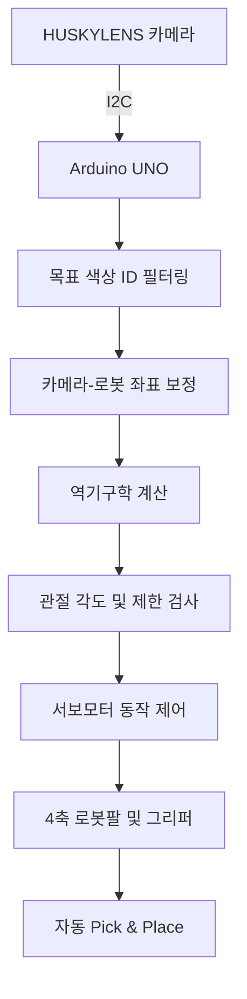

# VisionPick Arm

**Vision-Guided Pick & Place Robotic Arm**

HUSKYLENS 비전 센서와 Arduino C++을 기반으로 개발하는 **4-DOF 자동 Pick & Place 로봇팔**.

카메라로 목표 물체를 인식하고, 이미지 좌표를 로봇 작업 좌표로 변환한 뒤 역기구학(Inverse Kinematics)으로 관절 각도를 계산해 물체를 집고 지정된 위치로 이동시키는 시스템 구현을 목표로 함.

기구 설계, 공학 계산, 3D 프린팅, 임베디드 제어 및 비전 시스템을 직접 개발하고 검증하는 개인 로보틱스 프로젝트.

- **프로젝트 기간:** 2026.10.21 ~ 2026.11.30
- **현재 상태:** 제작용 CAD 설계 진행 중 — J1 서보혼 연결부 검증 대기
- **최근 업데이트:** 2026-11-01
- **기술:** Arduino C++ · HUSKYLENS · Fusion 360 · PLA+ 3D 프린팅

> **진행 상태 안내:** 현재까지 준비된 STL·G-code는 출력용 파일이며, 실제 3D 프린팅·조립·구동을 완료한 상태가 아님. 일부 치수는 실측값이고, 다른 치수는 CAD 설계 후보값임.

<!-- 전체 Assembly 캡처를 media/photos/assembly-overview-wip.png에 올린 후 아래 주석을 해제할 것.

-->

---

## 프로젝트 개요

VisionPick Arm은 로봇팔의 기계 구조와 제어 소프트웨어를 직접 설계하고, 이를 AI 비전 센서와 통합하는 프로젝트임.

### 개발 목표

- 4축 로봇팔 및 양쪽 연동형 그리퍼 직접 설계
- Fusion 360 기반 모듈형 기구 설계
- PLA+ 3D 프린팅 및 실제 조립
- Arduino C++ 기반 FK·IK 및 관절 제어 구현
- HUSKYLENS 기반 물체 인식 및 좌표 변환
- 자동 Pick & Place 구현
- 반복 실험을 통한 정확도·성공률 분석

### 목표 작업

30 × 30 × 30mm 크기의 빨간색·파란색 블록을 대상으로 물체 자동 분류 시스템 개발.

사용자가 목표 색상을 지정하면 해당 물체의 위치를 인식하고, 로봇팔이 블록을 집어 지정된 위치로 이동하는 기능을 목표로 함.

### 현재 개발 현황 — 2026.11.01

| 개발 분야 | 진행 상황 |
|---|---|
| 비전 인식 | HUSKYLENS I2C 통신, 빨강 ID1·파랑 ID2 인식, 목표 ID 필터링 검증 완료 |
| 기구학 | FK·IK 계산 및 Fusion XZ 평면 좌표 검증 완료. Arduino C++ 구현은 예정 |
| J1 베이스 | 고정판·기둥·베어링 링·MG996R 브래킷 CAD 및 슬라이싱 준비 |
| J1 회전 구동부 | 6방향 서보혼 선정·실측 완료. 회전판 연결 패드와 나사 체결 설계는 검증 전 |
| J2 어깨 | FT5330M 실측 및 레일 시험 출력 파일 준비 |
| J3·J4·J5 | J3 최종 고정 구조, J4 손목, J5 그리퍼 제작용 상세 CAD 미완료 |
| 제작 | 2026.11.06 송도 i7 첫 시험 출력 예정. 현재 실물 출력 0개 |

---

## 시스템 구성



현재 **비전 인식·목표 ID 필터링까지 Arduino에서 구현 완료**. 기구학은 수학적 계산 및 Fusion 360 검증 단계까지 완료했으며, Arduino C++ FK·IK와 모터 구동은 후속 단계임.

### 제어 개발 단계

| 단계 | 상태 |
|---|---|
| HUSKYLENS I2C 통신 | 완료 |
| 색상 인식(빨강·파랑) | 완료 |
| 목표 ID 필터링 | 완료 |
| FK·IK 수학 검증 | 완료 |
| FK·IK Fusion 평면 좌표 검증 | 완료 |
| Arduino C++ FK·IK 구현 | 예정 |
| 카메라-로봇 좌표 보정 | 예정 |
| 관절 동작 제어 | 예정 |
| 자동 Pick & Place | 예정 |

---

## 기구 설계

### 로봇 구성

4개 회전 관절과 양쪽 연동형 그리퍼로 구성.

| 관절 | 기능 | 구동 모터 |
|---|---|---|
| J1 Base | Yaw 회전 | MG996R 호환 모터 |
| J2 Shoulder | Pitch 회전 | FEETECH FT5330M |
| J3 Elbow | Pitch 회전 | MG996R 호환 모터 |
| J4 Wrist | Pitch 회전 | TowerPro MG90S |
| J5 Gripper | 양쪽 손가락 연동 | SG90 |

J1·J2 모터의 일부 실물 치수를 측정했지만, 전체 모터의 구동 범위·전류·토크 및 반복 위치 정확도는 아직 검증하지 않음.

### 디자인 콘셉트

**Industrial Open-Frame**

- 오렌지·블랙 산업용 디자인
- 모터·관절·볼트가 드러나는 개방형 구조
- 경량 링크 및 보강 리브
- 양쪽 지지형 관절 구조 우선 검토
- 볼트 기반 분해·교체 가능한 모듈 설계
- 독립형 상부 고정 카메라

### 개념 설계 치수

| 항목 | 초기값 |
|---|---:|
| L1 링크 | 100mm |
| L2 링크 | 80mm |
| 어깨 높이 | 70mm |
| 작업대 | 약 300 × 300mm |
| 카메라 높이 | 250mm |
| 초기 집기 반경 | 약 140mm |
| 대상 물체 | 30mm 정육면체 |

위 치수는 Concept CAD 및 초기 계산에 사용한 **임시값**임. 실제 조립 치수는 제작용 CAD와 실물 측정을 통해 확정 예정.

### 그리퍼

SG90 1개로 구동하는 양쪽 링크 연동형 2핑거 그리퍼 설계.

- 대칭 회전 방식
- 손가락 길이 40mm(임시)
- 회전축 간격 54mm(임시)
- 목표 개방 폭 45~50mm
- 교체 가능한 접촉 패드 고려
- 전체 집게 질량 60g 이하 목표

`Gripper_Concept_v01` 스케치 및 SG90 참고 Component 구성 완료. **연동 링크·구동 메커니즘·실제 파지력은 미검증**.

### 제작용 CAD 진행 — 2026.10.28 ~ 11.01

메인 Fusion 파일: `VisionPick_Assembly_v01`.

| 부품 | 설계·실측 정보 | 제작 상태 |
|---|---|---|
| `Base_Fixed` | 외경 Ø160mm, 두께 6mm, 경량화 홀 Ø12mm × 6개 | CAD·G-code 준비 |
| J1 지지 기둥 3개 | Ø12 × 37mm, 리브 보강, 인서트 후보홀 Ø4.0 × 7mm | CAD·G-code 준비 |
| `J1_Servo_Mount_Fixed` | MG996R 장착 브래킷·케이블 노치 등 | 시험 출력 파일 준비 |
| `J1_Bearing_Mount_Fixed` | 외경 Ø110 / 내경 Ø70 / 두께 5mm, 총 7개 체결홀 | CAD·G-code 준비 |
| 사각 턴테이블 베어링 | 외형 71.82 × 71.82mm, 두께 7.95mm, 중앙 Ø35mm | 실물 측정 완료 |
| `Base_Rotating` | 외경 Ø110mm, 두께 6.40mm | **연결부 미완성·출력 보류** |
| J2 FT5330M 레일 | 실물 치수 반영, 시험 체결 구조 | 시험 출력 파일 준비 |

`Base_Rotating`에는 베어링용 Ø4.5mm 관통홀 4개와 J2 고정용 Ø4.0 × 4.5mm 블라인드 홀 4개가 있음. 후자의 인서트 치수는 **임시 설계**이며, 아래에 남는 재료는 1.9mm임.

#### J1 서보혼 연결부 — 현재 작업 중

실제로 장착해 본 세 종류의 혼 중 **6방향 플라스틱 서보혼**을 우선 선택함.

| 항목 | 값 | 구분 |
|---|---:|---|
| 6방향 혼의 회전 외경 | 31.77mm | 실측 |
| 모터 하우징 윗면 → 혼 날개 윗면 | 8.44mm | 실측 |
| 반대편 바깥 홀 중심 간 거리 | 26.53mm | 실측(PCD 해석은 배치 확인 조건) |
| 서보혼 작은 체결홀 | Ø1.49mm | 실측 |
| 서보혼 날개 두께 | 2.36mm | 실측 |
| 서보혼 ↔ 베어링 개구부 반경 여유 | 1.615mm | 동축·이상 형상 가정 계산값 |
| 회전판 아래 연결 패드 | Ø32.5 / 중앙 회피홀 Ø10 / 돌출 1.56mm | **CAD 후보값** |
| 회전판의 서보혼 체결 위치 | 120° 간격 3개, Ø2.4mm 후보 원 | **Sketch 단계** |

6방향 혼은 MG996R 출력축에 끼워 중앙 나사를 체결했으며, 가벼운 정적 확인에서 독립적인 흔들림이 없었음. 이는 **토크 전달 내구성 검증과 별개**임.

J2 바닥판과 회전판 윗면 사이 간격은 **0mm**. 회전판 위에서 나사를 넣을 경우 머리 매립과 조립 순서를 검토해야 하며, **Ø2.4mm 관통 가공·최종 매립 가공은 아직 확정하지 않음**.

- [Fusion 제작용 Assembly 스냅샷(.f3d)](cad/fusion/VisionPick_Assembly_2026-11-01_J1_Horn6_WIP.f3d)
- 추가 검토: [설계 결정 기록](docs/design-decisions.md), [실측·검증 기록](docs/experiments.md)

### 11월 6일 3D 프린팅 준비

**장소:** 연세대학교 메이커스페이스 i7(송도)  
**예약:** 2026-11-06(금) 오전 10시  
**슬라이서:** Cubicreator4 / PLA-PLUS / 기본 레이어 0.2mm

| 출력 작업 | 예상 시간 | 예상 재료 |
|---|---:|---:|
| `J1_MG996R_Bracket_Test_v01` | 1시간 23분 | 12.66g |
| `J2_FT5330M_Rail_Test_v01` | 1시간 30분 | 15.22g |
| `M3_Insert_Tolerance_Test_v01` | 27분 | 4.35g |
| `Base_Fixed` | 5시간 22분 | 73.60g |
| J1 지지 기둥 3개(통합 작업) | 1시간 19분 | 11.33g |
| `J1_Bearing_Mount_Fixed_v01` | 1시간 52분 | 22.06g |
| **합계** | **11시간 53분** | **139.22g** |

**G-code 6개 작업 / 출력 대상 실물 8개.** 시간과 재료량은 슬라이싱 예측치이며 실제 출력 실적이 아님. `Base_Rotating`은 서보혼 체결 구조 검증 전까지 출력하지 않음.

M3 인서트는 아직 구매·시험하지 않았고, Ø3.8/4.0/4.2mm 시험편으로 적합성을 비교할 예정.

---

## 기구학 및 공학 계산

### 순기구학·역기구학

2링크 평면 기구학을 기반으로 베이스 회전 및 손목 자세 제어까지 계산함.

- 순기구학(FK)
- 역기구학(IK)
- Elbow-up / Elbow-down 해
- 베이스 Yaw 각도 계산
- 손목 자세 보정
- TCP 오프셋 고려

### Fusion 360 검증

수학적으로 계산한 목표 손목 좌표와 Fusion 360 모델의 XZ 평면 좌표 비교.

| 검증 항목 | 계산값 | Fusion 값 | 결과 |
|---|---:|---:|---|
| FK — X | 155.885mm | 155.885mm | 통과 |
| FK — Z | 80mm | 80mm | 통과 |
| IK — X | 100mm | 100mm | 통과 |
| IK — Z | 150mm | 150mm | 통과 |

**평면 좌표 검증 완료.** J2와 J4 사이 Y 방향 오프셋 약 8mm가 확인됐으며, 완전한 3차원 위치·TCP 검증은 별도 진행 예정.

### 기초 토크 분석

임시 질량과 수평 자세를 기준으로 관절별 요구 토크 산정.

| 관절 | 설계 요구값 |
|---|---:|
| J1 Base | 0.008868 N·m |
| J2 Shoulder | 5.855 kgf·cm |
| J3 Elbow | 2.019 kgf·cm |
| J4 Wrist | 0.400 kgf·cm |
| J5 Gripper | 0.4905 N / Finger |

J1 값은 일부 질량의 회전 관성과 각가속도만 고려한 결과. J2~J4는 그리퍼 40g 가정 및 2.5배 설계 여유 적용. 집게가 60~80g으로 증가하는 조건도 별도로 검토함.

위 값은 **최종 모터 성능 검증 결과가 아님**. 상세 계산 조건 및 결과: [실험 기록](docs/experiments.md).

---

## 하드웨어 및 개발 환경

### 하드웨어

| 구성품 | 모델·사양 | 진행 상태 |
|---|---|---|
| 제어기 | Arduino UNO | 보유 |
| 비전 센서 | HUSKYLENS 1 | 보유·인식 시험 완료 |
| J1 서보모터 | MG996R 호환 | 실물 서보혼 장착 확인, 구동 시험 전 |
| J2 서보모터 | FEETECH FT5330M | 실측 및 CAD 반영, 구동 시험 전 |
| J3 서보모터 | MG996R 호환 | 장착 구조 검토 중 |
| J4 서보모터 | TowerPro MG90S | 예정 |
| J5 서보모터 | SG90 | 보유 |
| 서보 전원 | 외부 안정화 DC 전원 | 미확정 |
| 베어링 및 축 | J1 사각 턴테이블 베어링 확보 | 나머지 지지부 검토 중 |
| 출력 부품 | PLA+ | CAD 및 G-code 준비 중·실제 미출력 |

### 개발 도구

| 도구 | 용도 |
|---|---|
| Arduino C++ | 센서 처리·로봇 제어 |
| Arduino IDE | 임베디드 개발 |
| Fusion 360 | 기구 설계·Assembly |
| Cubicreator4 | 3D 프린팅 슬라이싱 |
| HUSKYLENS | 센서 내장 색상 인식 |
| GitHub | 소스 코드·CAD·실험 기록 관리 |

HUSKYLENS 내장 Color Recognition 기능 사용. 직접 학습한 YOLO 모델이나 ROS2 기반 제어 시스템은 현재 필수 개발 범위에 포함하지 않음.

### 저장소 구조

```text
visionpick-arm/
├── README.md
├── firmware/
│   └── huskylens_color_filter/
│       └── huskylens_color_filter.ino
├── cad/
│   ├── fusion/
│   │   └── VisionPick_Assembly_2026-11-01_J1_Horn6_WIP.f3d
│   └── stl/
├── docs/
│   ├── experiments.md
│   └── design-decisions.md
└── media/
    └── photos/
```

- [실험·측정 기록](docs/experiments.md)
- [설계 의사결정 기록](docs/design-decisions.md)

### CAD 스냅샷 업로드 계획

추후 아래 위치에 이미지를 업로드해 README와 개발 기록에 연결할 예정. **현재 PNG 파일은 미업로드 상태**이므로 깨진 이미지 링크를 표시하지 않음.

- `media/photos/assembly-overview-wip.png` — 전체 Assembly 등각 뷰, README 대표 이미지
- `media/photos/j1-coupling-wip.png` — J1 베어링·회전판·서보혼 상세
- `media/photos/j1-section-wip.png` — J1 중심축 단면과 간섭 검토

---

## 실행 방법

현재 실행 가능한 기능은 **HUSKYLENS 색상 인식 및 Arduino 목표 ID 필터링**임.

### 필요 장비

- Arduino UNO
- HUSKYLENS 1
- Arduino IDE
- USB A-B 케이블
- HUSKYLENS Arduino 라이브러리
- I2C 배선

### I2C 연결

| HUSKYLENS | Arduino UNO |
|---|---|
| VCC | 5V |
| GND | GND |
| SDA | A4 |
| SCL | A5 |

실제 연결 전 핀 표기와 전원 조건을 확인할 것.

### 실행 순서

1. HUSKYLENS Arduino 라이브러리 설치
2. HUSKYLENS Protocol Type을 I2C로 설정
3. `huskylens_color_filter.ino` 열기
4. `targetID` 설정(1: 빨강 / 2: 파랑)
5. Arduino UNO에 업로드
6. Serial Monitor를 115200 baud로 설정
7. 목표 물체의 ID·X·Y 좌표 출력 확인

출력 예시:

```text
HUSKYLENS Connected!
ID: 1
X: 154
Y: 123
----------
```

서보모터 구동 시에는 Arduino 5V 핀이 아닌 **별도 외부 전원**을 사용하고 공통 GND를 구성할 예정.

---

## 개발 진행 기록

### 2026.10.21 — HUSKYLENS 통신

- Arduino UNO ↔ HUSKYLENS I2C 연결
- 인식 결과 요청 및 데이터 수신 구현
- 물체 ID·중심 좌표 출력 확인

### 2026.10.22 — 비전 인식 및 Concept CAD

- 빨강·파랑 블록 동시 인식 및 목표 ID 필터링 구현
- 산업용 오픈 프레임 디자인 결정
- 4축 로봇팔 Concept CAD 제작
- Revolute / Rigid Joint 구성 및 구동 검증
- Wrist Pitch 축 추가

### 2026.10.23 — 기구학

- FK·IK 수학 계산 및 두 가지 Elbow 해 계산
- 베이스 회전·손목 자세 보정 학습
- TCP 오프셋 반영 계산 연습

### 2026.10.26 — CAD 및 하중 검증

- Fusion FK·IK XZ 좌표 검증
- 어깨·팔꿈치·손목 FBD 및 정적 토크 계산
- 베이스 회전 관성·집게 파지력 계산
- 실제 모터 후보를 반영한 토크 재검토

### 2026.10.26~27 — 그리퍼 및 하드웨어

- `Gripper_Concept_v01` 스케치 제작
- SG90 참고 Component 구성
- 양쪽 연동형 집게 구조 선정
- 하드웨어 연구 R01/R02 및 서보모터 선정·주문

### 2026.10.28~31 — 제작용 J1·J2 CAD

- J1 고정판, 3개 지지 기둥, MG996R 브래킷, 베어링 고정 링 설계
- 사각 턴테이블 베어링 실측 후 Reference 반영
- `Base_Rotating` 두께 보정 및 베어링·J2 체결홀 생성
- J2 FT5330M 레일 장착 구조 설계
- 11월 6일 시험 출력용 G-code 준비

### 2026.11.01 — J1 서보혼 선정 및 회전판 연결 구조

- MG996R용 원형·십자형·6방향 서보혼 실측·비교
- **6방향 혼 Ø31.77mm** 선정 및 중앙 나사 정적 체결 확인
- 서보혼 체결홀 PCD 후보 Ø26.53mm, 홀 Ø1.49mm, 날개 두께 2.36mm 기록
- Fusion에 서보혼 회전 범위 및 나사 체결 위치 Reference 작성
- `Base_Rotating` 아래 연결 패드(후보) 모델링
- J2 바닥판과 회전판 간격 0mm 확인, 나사 머리 매립 필요성 검토
- CAD WIP 스냅샷 GitHub 저장, **실제 체결·간섭 검증은 미완료**

---

## 개발 로드맵

### 완료한 작업

- [x] HUSKYLENS I2C 통신 및 빨강·파랑 블록 인식
- [x] Arduino 목표 ID 필터링
- [x] 4축 Concept CAD·Joint 구동
- [x] FK·IK 수학 계산 및 Fusion 평면 좌표 검증
- [x] 관절별 1차 하중·토크 계산
- [x] 모터 선정 및 그리퍼 Concept 설계
- [x] J1 주요 출력 부품 CAD 및 6개 G-code 작업 준비(미출력)
- [x] J1 6방향 서보혼 실측 및 정적 장착 확인

### 진행 중·예정 작업

- [ ] **STEP 43-G:** J1 서보혼 나사 체결, 머리 매립, 베어링 회전 간섭 검증
- [ ] **STEP 43-H:** `Base_Rotating` 최종 STL·G-code 준비
- [ ] 2026.11.06 첫 시험 출력 및 브래킷·인서트·베어링 조립 적합성 확인
- [ ] J3 고정부, J4 Wrist, J5 Gripper 제작용 CAD 완성
- [ ] 전원 공급·배선·모터 개별 제어 시험
- [ ] Arduino C++ FK·IK 및 각도 보정·궤적 생성·상태머신
- [ ] 카메라 좌표 보정 및 자동 Pick & Place 통합
- [ ] 구조 강도·처짐·실제 조립 공차 검증
- [ ] 반복 실험 및 시연 영상·포트폴리오 정리

**목표 완료일: 2026-11-30**

---

## 성능 검증 계획

| 지표 | 평가 내용 |
|---|---|
| 색상 인식 정확도 | 조명·위치 변화에 따른 ID 인식 성공률 |
| 위치 오차 | 목표 좌표와 실제 좌표 간 거리 |
| 반복 정밀도 | 동일 목표 반복 접근 시 위치 편차 |
| 집기 성공률 | 자동 집기 성공 횟수 / 시도 횟수 |
| 사이클 시간 | Pick & Place 1회 소요 시간 |

자동 Pick & Place 실험 **최소 20회 수행**을 목표로 하며 결과·실패 원인을 [실험 기록](docs/experiments.md)에 남길 예정.

---

## 핵심 기술 과제

- **모터 및 하중 검증:** 중력 토크 외에 가속·감속, 발열, 전류, 출력축 하중 및 질량 변화 고려
- **구조 강성:** PLA+ 링크 응력·처짐·베어링 지지·조립 유격 검증
- **서보혼 체결:** 6방향 혼의 나사 체결력, 조립 접근성, 회전 간섭 및 장기 내구성 검증
- **그리퍼 기구:** 하나의 서보로 양쪽 손가락 연동 및 충분한 파지력 확보
- **좌표 보정:** 픽셀 좌표를 로봇 기준 좌표로 변환하고 TCP 오프셋 보정
- **동작 제어:** 서보 영점·각도 제한·이동 궤적·충돌 방지 제어

---

## 프로젝트 범위

상용 로봇 수준의 정밀도보다 **직접 설계한 기구학·하중·제어·비전 시스템을 실제 하드웨어에서 통합하고 검증하는 것**을 우선함.

ROS2, 고급 컴퓨터비전, 새로운 그리퍼 및 추가 관절은 향후 확장 대상으로 두고, 2026년 11월 30일 이전에는 실제 자동 Pick & Place 구현을 우선한다.
