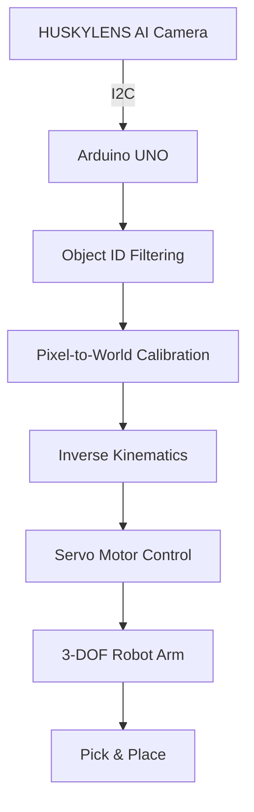

# VisionPick Arm

**Vision-Guided Pick & Place Robotic Arm**

HUSKYLENS AI 비전 센서와 Arduino C++을 활용한 3축 자동 물체 분류 로봇팔.

책상 위의 물체를 인식하고, 카메라 좌표를 로봇 좌표로 변환한 뒤 역기구학(Inverse Kinematics)을 통해 목표 위치로 이동하는 Pick & Place 시스템 구현을 목표로 함.

기구 설계부터 3D 프린팅, 제어 알고리즘, AI 비전 연동까지 직접 설계하고 검증하는 개인 로보틱스 프로젝트.

**Project Period:** 2026.10.21 – 2026.11.30  
**Status:** In Development  
**Development:** Mechanical Design · Embedded C++ · Computer Vision

---

## 1. Overview

VisionPick Arm은 카메라 기반 물체 인식과 로봇팔 제어를 통합하는 프로젝트임.

기존 로봇팔 키트를 단순 조립하는 방식이 아닌, 기구 구조와 하드웨어를 직접 설계하고 Arduino C++으로 제어 시스템을 구현하는 방향으로 진행.

### Project Goals

- 3축 로봇팔 및 2핑거 그리퍼 직접 설계
- Fusion 360 기반 기구 설계 및 3D 프린팅 제작
- HUSKYLENS 기반 물체 ID 및 위치 좌표 인식
- 카메라 좌표계와 로봇 좌표계 간 변환
- 순기구학(Forward Kinematics) 및 역기구학 구현
- Arduino C++ 기반 서보모터 제어
- 자동 Pick & Place 구현 및 반복 정밀도 검증

초기 실험 대상은 30 × 30 × 30 mm 크기의 빨간색·파란색 블록으로 설정.

사용자가 목표 색상을 선택하면 해당 물체를 찾아 지정된 위치로 이동시키는 기능을 최종 목표로 함.

## 2. System Architecture

전체 시스템은 다음 흐름으로 구성할 예정.



현재 카메라 통신 및 목표 ID 필터링까지 구현 완료. 좌표 보정, 역기구학, 실제 로봇팔 제어는 개발 예정.

### Control Pipeline

| Stage | Description | Status |
|---|---|---|
| Object Detection | 색상별 물체 ID 및 중심 좌표 인식 | 완료 |
| Target Selection | 지정된 ID의 물체만 필터링 | 완료 |
| Coordinate Calibration | 이미지 좌표를 실제 작업 좌표로 변환 | 예정 |
| Inverse Kinematics | 목표 좌표에 대한 관절 각도 계산 | 예정 |
| Motion Control | 서보모터 구동 및 각도 제한 | 예정 |
| Pick & Place | 물체 집기 및 지정 위치 이동 | 예정 |

## 3. Mechanical Design

### Robot Configuration

3축 로봇팔과 1축 그리퍼로 구성.

| Joint | Function |
|---|---|
| J1 — Base | 수직축 회전 |
| J2 — Shoulder | 첫 번째 링크 상하 회전 |
| J3 — Elbow | 두 번째 링크 상하 회전 |
| J4 — Gripper | 양쪽 손가락 개폐 |

### Design Concept

**Industrial Open-Frame**

산업용 로봇팔의 외형과 개방형 기계 구조를 결합한 디자인 채택.

- 오렌지·블랙 컬러 조합
- 모터 및 관절 구조가 드러나는 오픈 프레임
- 3D 프린팅 기반 경량 링크 및 브래킷
- 볼트·너트를 활용한 분해 및 유지보수 구조
- 독립형 상부 고정 카메라

#### Gripper

30 mm 정육면체를 잡기 위한 양쪽 연동형 2핑거 그리퍼 설계 예정.

- SG90 서보모터 1개 활용 검토
- 기어 및 링크 기구를 통한 양쪽 손가락 연동
- 최대 개방 폭 45–50 mm 목표
- 블록 미끄럼 방지를 위한 접촉 패드 고려

손목 회전축이 없는 구조이므로, 관절 자세 변화에 따른 집게 방향 및 작업대 간섭을 CAD 단계에서 검증할 예정.

### Workspace

| Parameter | Initial Design |
|---|---|
| Workbench | 약 300 × 300 mm |
| Camera Height | 약 250 mm |
| Pickup Radius | 약 140 mm |
| Target Object | 30 mm Cube |

집기 지점과 배출 지점을 유사한 반경에 배치해 베이스 회전만으로 수평 이동을 단순화하는 구조를 우선 검토.

위 수치는 개념 설계용 기준값이며, 최종 링크 길이와 작업 영역은 기구학 및 토크 계산 이후 확정할 예정.

## 4. Hardware & Software

### Hardware

| Component | Description |
|---|---|
| Microcontroller | Arduino UNO |
| Vision Sensor | DFRobot HUSKYLENS 1 |
| Joint Actuators | Servo Motors × 3 (선정 예정) |
| Gripper Actuator | SG90 Micro Servo |
| Power Supply | External Servo Power Supply (선정 예정) |
| Mechanical Parts | 3D Printed PLA+ Components |
| Fasteners | Bolts, Nuts, Shafts, Bearings |
| Test Objects | Red / Blue 30 mm Cubes |

### Development Tools

| Tool | Purpose |
|---|---|
| C++ | 센서 데이터 처리, 기구학 및 제어 |
| Arduino IDE | 임베디드 소프트웨어 개발 |
| Fusion 360 | CAD 모델링 및 기구 조립 |
| Cubicreator | 3D 프린팅 슬라이싱 |
| HUSKYLENS | 내장 AI 비전 기반 물체 인식 |

HUSKYLENS의 내장 색상 인식 알고리즘을 우선 사용하며, 별도 YOLO 모델 학습은 현재 필수 범위에 포함하지 않음.

## 5. Repository Structure

```text
visionpick-arm/
│
├── README.md
│
├── firmware/
│   └── huskylens_color_filter/
│       └── huskylens_color_filter.ino
│
├── cad/
│   ├── fusion/
│   └── stl/
│
├── docs/
│   ├── experiments.md
│   └── design-decisions.md
│
└── media/
    └── photos/
```

프로젝트 진행에 따라 CAD 파일, 실험 기록 및 미디어 자료 추가 예정.

## 6. Getting Started

### Requirements

- Arduino UNO
- HUSKYLENS 1
- Arduino IDE
- HUSKYLENS Arduino Library
- USB A-B Cable

**Library:** [HUSKYLENSArduino](https://github.com/HuskyLens/HUSKYLENSArduino)

### Wiring

HUSKYLENS I2C 인터페이스 사용.

| HUSKYLENS | Arduino UNO |
|---|---|
| VCC | 5V |
| GND | GND |
| SDA | A4 |
| SCL | A5 |

실제 연결 시 센서의 핀 표기를 확인할 것.

추후 서보모터는 별도 외부 전원으로 구동하고 Arduino와 공통 GND를 구성할 예정.

### Run

1. Arduino IDE에서 HUSKYLENS 라이브러리 설치
2. HUSKYLENS 통신 프로토콜을 I2C로 설정
3. `huskylens_color_filter.ino` 열기
4. `targetID` 설정 (`1`: Red, `2`: Blue)
5. Arduino UNO에 업로드
6. Serial Monitor를 `115200 baud`로 설정
7. 학습한 물체를 카메라에 보여주고 인식 결과 확인

### Expected Output

```text
HUSKYLENS Connected!

ID: 1
X: 154
Y: 123
----------
```

위 좌표는 출력 형식 예시이며, 실제 값은 물체 위치에 따라 달라짐.

## 7. Development Progress

### 2026.10.21 — HUSKYLENS Communication

- HUSKYLENS와 Arduino UNO I2C 연결
- HUSKYLENS Arduino 라이브러리 설치
- Arduino C++ 기반 센서 데이터 요청 및 수신
- 물체 ID, 중심 좌표 X/Y 출력 구현

**Result:** 센서 연결 및 데이터 수신 성공.

### 2026.10.22 — Fusion 360 Concept CAD

**Mechanical Design**

- Fusion 360 기반 4-DOF 로봇팔 Concept CAD 제작
- User Parameters를 활용한 링크 길이 및 관절 위치 정의
- Base, Shoulder, Elbow, Wrist 구조 모델링
- Revolute / Rigid Joint를 이용한 조립 및 구동 검증
- Drive Joint를 통해 4개 회전축의 독립 구동 확인
- 30mm 정육면체 및 Gripper Placeholder 모델링
- 블록 접근 및 손목 자세 유지 가능성 확인

**Design Changes**

- 기존 3축 구조에서 Wrist Pitch 축을 추가한 4축 구조로 변경
- 집게 자세 제어 기능 확보를 위한 구조 변경
- 최종 구동 구성: 4-DOF + 1-DOF Gripper

**Limitations**

- 일부 위치에서 집게 수직 자세 및 접근 제한 확인
- 실제 관절 회전 범위와 기구 간섭 검증 필요
- 모터, 베어링, 체결 구조 미반영
- 현재 모델은 제작용 CAD가 아닌 Concept CAD

**Result:** 4축 로봇팔의 기본 조립 및 관절 구동 검증 완료.

## 8. Roadmap

- [x] HUSKYLENS I2C 통신
- [x] 빨강·파랑 블록 인식
- [x] 목표 ID 필터링
- [x] 초기 시스템 구조 설계
- [ ] Fusion 360 Concept CAD
- [ ] 순기구학 및 역기구학 구현
- [ ] 관절 토크 계산 및 모터 선정
- [ ] 기계부품 3D 프린팅
- [ ] 서보모터 및 그리퍼 제어
- [ ] 카메라 좌표 보정
- [ ] 자동 Pick & Place 통합
- [ ] 반복 실험 및 성능 평가
- [ ] 최종 시연 영상 및 기술 문서 정리

**Target Completion:** November 30, 2026

## 9. Validation Plan

최종 시스템 완성 후 다음 항목을 정량적으로 평가할 예정.

| Metric | Evaluation Method |
|---|---|
| Recognition Accuracy | 위치 및 조명 변화에 따른 ID 인식 정확도 |
| Positioning Error | 목표 좌표와 실제 도달 좌표 간 오차 |
| Pick Success Rate | 반복 집기 실험 성공률 |
| Repeatability | 동일 좌표 반복 도달 시 위치 편차 |
| Cycle Time | 1회 Pick & Place 소요시간 |

최종 Pick & Place 반복 실험은 최소 20회 수행 목표.

실험 결과와 실패 원인은 `docs/experiments.md`에 기록 예정.

## 10. Engineering Notes

프로젝트 진행 중 중점적으로 검증할 기술적 문제.

**1. Gripper Orientation**

손목 구동축이 없는 3축 구조에서 링크 자세에 따른 집게 방향 변화와 접근 경로 간섭 검토 필요.

**2. Camera Calibration**

카메라 이미지의 픽셀 좌표를 작업 공간의 실제 좌표로 변환하는 보정 과정 필요. 물체 높이와 카메라 설치 오차도 고려 예정.

**3. Torque & Structural Rigidity**

각 링크와 모터의 질량, 물체 하중, 정적 중력 토크를 계산하고 안전 여유를 반영해 모터 선정 예정.

**4. 3D Printing Tolerances**

출력 방향, 조립 공차, 관절 유격, 기어 맞물림 등을 실제 출력 및 조립 실험을 통해 검증 예정.

---

## Project Scope

본 프로젝트는 상용 로봇 수준의 정밀도 구현보다 기구 설계, 제어 및 비전 인식의 통합 과정을 직접 구현하고 검증하는 데 초점을 둠.

실험 결과에 따라 링크 구조, 그리퍼, 인식 방식 및 제어 알고리즘을 지속적으로 개선할 예정.
