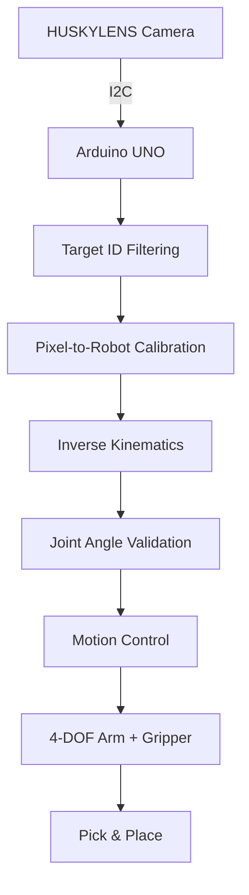

# VisionPick Arm

**Vision-Guided Pick & Place Robotic Arm**

HUSKYLENS 비전 센서와 Arduino C++을 기반으로 개발하는 **4-DOF 자동 Pick & Place 로봇팔**.

카메라로 목표 물체를 인식하고, 이미지 좌표를 로봇 작업 좌표로 변환한 뒤 역기구학(Inverse Kinematics)으로 관절 각도를 계산해 물체를 집고 지정된 위치로 이동시키는 시스템 구현을 목표로 함.

기구 설계, 공학 계산, 3D 프린팅, 임베디드 제어 및 비전 시스템을 직접 개발하고 검증하는 개인 로보틱스 프로젝트.

**Project Period:** 2026.10.21 – 2026.11.30  
**Status:** In Development — Hardware Design  
**Stack:** Arduino C++ · HUSKYLENS · Fusion 360 · 3D Printing

---

## Overview

VisionPick Arm은 로봇팔의 기계 구조와 제어 소프트웨어를 직접 설계하고, 이를 AI 비전 센서와 통합하는 프로젝트임.

### Objectives

- 4축 로봇팔 및 양쪽 연동형 그리퍼 직접 설계
- Fusion 360 기반 모듈형 기구 설계
- PLA+ 3D 프린팅 및 실제 조립
- Arduino C++ 기반 FK·IK 및 관절 제어 구현
- HUSKYLENS 기반 물체 인식 및 좌표 변환
- 자동 Pick & Place 구현
- 반복 실험을 통한 정확도·성공률 분석

### Target Task

30 × 30 × 30mm 크기의 빨간색·파란색 블록을 대상으로 물체 자동 분류 시스템 개발.

사용자가 목표 색상을 지정하면 해당 물체의 위치를 인식하고, 로봇팔이 블록을 집어 지정된 위치로 이동하는 기능을 목표로 함.

---

## System Architecture



현재 **비전 인식·목표 ID 필터링까지 Arduino에서 구현 완료**.

기구학 알고리즘은 수학적 계산 및 Fusion 360 검증을 완료했으며, Arduino C++ 구현과 모터 구동은 후속 개발 단계임.

### Control Pipeline

| Stage | Status |
|---|---|
| HUSKYLENS I2C Communication | Completed |
| Color Recognition (Red / Blue) | Completed |
| Target ID Filtering | Completed |
| FK / IK Mathematical Validation | Completed |
| FK / IK Fusion Verification | Completed |
| Arduino FK / IK Implementation | Planned |
| Camera-to-Robot Calibration | Planned |
| Joint Motion Control | Planned |
| Automated Pick & Place | Planned |

---

## Mechanical Design

### Robot Configuration

4개 회전 관절과 양쪽 연동형 그리퍼로 구성.

| Joint | Function | Actuator |
|---|---|---|
| J1 Base | Yaw Rotation | MG996R Compatible |
| J2 Shoulder | Pitch Rotation | FEETECH FT5330M |
| J3 Elbow | Pitch Rotation | MG996R Compatible |
| J4 Wrist | Pitch Rotation | TowerPro MG90S |
| J5 Gripper | Two-Finger Actuation | SG90 |

서보모터 4개 신규 주문 완료, SG90 1개 기존 보유.

현재 주문된 모터의 실제 성능·작동 범위와 전기적 호환성은 수령 후 검증 예정.

### Design Concept

**Industrial Open-Frame**

- 오렌지·블랙 산업용 디자인
- 모터·관절·볼트가 드러나는 개방형 구조
- 경량 링크 및 보강 리브
- 양쪽 지지형 관절 구조 우선 검토
- 볼트 기반 분해·교체 가능한 모듈 설계
- 독립형 상부 고정 카메라

### Concept Parameters

| Parameter | Trial Value |
|---|---:|
| Link 01 (L1) | 100mm |
| Link 02 (L2) | 80mm |
| Shoulder Height | 70mm |
| Workbench | 약 300 × 300mm |
| Camera Height | 250mm |
| Pickup Radius | 약 140mm |
| Target Object | 30mm Cube |

위 치수는 Concept CAD 및 초기 계산에 사용한 임시값임.

실제 링크 길이와 장착 구조는 모터 실측 및 제작용 CAD 검증을 통해 확정 예정.

### Gripper

SG90 1개로 구동하는 양쪽 링크 연동형 2핑거 그리퍼 설계.

- 대칭 회전 방식
- 손가락 길이 40mm (임시)
- 회전축 간격 54mm (임시)
- 목표 개방 폭 45~50mm
- 교체 가능한 접촉 패드 고려
- 전체 집게 질량 60g 이하 목표

현재 `Gripper_Concept_v01` 스케치 및 SG90 참고 Component 구성 완료.

연동 링크·구동 메커니즘·실제 파지력은 미검증.

---

## Kinematics & Engineering

### Forward / Inverse Kinematics

2링크 평면 기구학을 기반으로 베이스 회전 및 손목 자세 제어까지 계산.

- Forward Kinematics (FK)
- Inverse Kinematics (IK)
- Elbow-up / Elbow-down Solutions
- Base Yaw Calculation
- Wrist Orientation Compensation
- TCP Offset Consideration

### Fusion 360 Validation

수학적으로 계산한 목표 손목 좌표와 Fusion 360 모델의 XZ 평면 좌표 비교.

| Test | Calculated | Fusion | Result |
|---|---|---|---|
| FK — X | 155.885mm | 155.885mm | Pass |
| FK — Z | 80mm | 80mm | Pass |
| IK — X | 100mm | 100mm | Pass |
| IK — Z | 150mm | 150mm | Pass |

평면 좌표 검증 완료.

J2와 J4 사이 Y 방향 오프셋 약 8mm가 확인됐으며, 완전한 3차원 위치·TCP 검증은 별도 진행 예정.

### Preliminary Torque Analysis

임시 질량과 수평 자세를 기준으로 관절별 요구 토크 산정.

| Joint | Design Requirement |
|---|---:|
| J1 Base | 0.008868 N·m |
| J2 Shoulder | 5.855 kgf·cm |
| J3 Elbow | 2.019 kgf·cm |
| J4 Wrist | 0.400 kgf·cm |
| J5 Gripper | 0.4905 N / Finger |

J1 값은 일부 질량의 회전 관성과 각가속도만 고려한 결과.

J2~J4는 그리퍼 40g 가정 및 2.5배 설계 여유 적용. 집게가 60~80g으로 증가하는 조건도 별도로 검토함.

위 값은 최종 모터 성능 검증 결과가 아님.

상세 계산 조건 및 결과: [Experiments](docs/experiments.md)

---

## Hardware & Software

### Hardware

| Component | Model / Specification | Status |
|---|---|---|
| Controller | Arduino UNO | Owned |
| Vision Sensor | HUSKYLENS 1 | Owned |
| Base Servo | MG996R Compatible | Ordered |
| Shoulder Servo | FEETECH FT5330M | Ordered |
| Elbow Servo | MG996R Compatible | Ordered |
| Wrist Servo | TowerPro MG90S | Ordered |
| Gripper Servo | SG90 | Owned |
| Power Supply | External DC Servo Power | Pending |
| Bearings & Shafts | Joint Support Components | Pending |
| Mechanical Parts | PLA+ 3D Printed Components | In Design |

### Development Environment

| Tool | Purpose |
|---|---|
| Arduino C++ | Sensor Processing & Robot Control |
| Arduino IDE | Embedded Development |
| Fusion 360 | Mechanical Design & Assembly |
| Cubicreator | 3D Printing Slicing |
| HUSKYLENS | On-Device Vision Recognition |
| GitHub | Version Control & Documentation |

HUSKYLENS 내장 Color Recognition 기능 사용.

직접 학습한 YOLO 모델이나 ROS2 기반 제어 시스템은 현재 V1 필수 개발 범위에 포함하지 않음.

---

## Repository Structure

```text
visionpick-arm/
├── README.md
├── firmware/
│   └── huskylens_color_filter/
│       └── huskylens_color_filter.ino
├── cad/
│   ├── fusion/
│   └── stl/
├── docs/
│   ├── experiments.md
│   └── design-decisions.md
└── media/
    └── photos/
```

파일은 개발 진행에 따라 추가 예정.

### Documentation

- [Experiment Results](docs/experiments.md)
- [Design Decisions](docs/design-decisions.md)

---

## Getting Started

현재 실행 가능한 기능은 HUSKYLENS 색상 인식 및 Arduino 목표 ID 필터링임.

### Requirements

- Arduino UNO
- HUSKYLENS 1
- Arduino IDE
- USB A-B Cable
- [HUSKYLENS Arduino Library](https://github.com/HuskyLens/HUSKYLENSArduino)

### I2C Wiring

| HUSKYLENS | Arduino UNO |
|---|---|
| VCC | 5V |
| GND | GND |
| SDA | A4 |
| SCL | A5 |

핀 표기와 전원 조건을 확인한 후 연결.

### Run

1. HUSKYLENS Arduino 라이브러리 설치
2. HUSKYLENS Protocol Type을 I2C로 설정
3. `huskylens_color_filter.ino` 열기
4. `targetID` 설정 (`1`: Red / `2`: Blue)
5. Arduino UNO 업로드
6. Serial Monitor `115200 baud` 설정
7. 목표 물체의 ID·X·Y 좌표 출력 확인

### Example Output

```text
HUSKYLENS Connected!
ID: 1
X: 154
Y: 123
----------
```

좌표는 출력 형식 예시임.

서보모터 구동 시에는 Arduino 5V 핀이 아닌 별도 외부 전원을 사용하고 공통 GND를 구성할 예정.

---

## Development Progress

### 2026.10.21 — HUSKYLENS Communication

- Arduino UNO ↔ HUSKYLENS I2C 연결
- 인식 결과 요청 및 데이터 수신 구현
- 물체 ID·중심 좌표 출력 확인

### 2026.10.22 — Vision & Concept CAD

- 빨강·파랑 블록 동시 인식
- 목표 ID 필터링 구현
- 산업용 오픈 프레임 디자인 결정
- 4축 로봇팔 Concept CAD 제작
- Revolute / Rigid Joint 구성 및 구동 검증
- Wrist Pitch 축 추가

### 2026.10.23 — Kinematics

- FK·IK 수학 계산
- Elbow-up / Elbow-down 해 계산
- 베이스 회전 및 손목 자세 보정 학습
- TCP 오프셋 반영 계산 연습

### 2026.10.26 — CAD & Load Validation

- Fusion에서 FK·IK XZ 좌표 검증
- 어깨·팔꿈치·손목 FBD 및 정적 토크 계산
- 베이스 회전 관성 계산
- 집게 마찰 기반 파지력 계산
- 실제 모터 후보를 반영한 토크 재검토

### 2026.10.26–27 — Gripper & Hardware

- `Gripper_Concept_v01` 스케치 제작
- SG90 참고 모터 Component 구성
- 양쪽 연동형 집게 초기 구조 선정
- Hardware Research R01/R02 수행
- 구동용 서보모터 4개 선정 및 주문

---

## Roadmap

### Completed

- [x] HUSKYLENS I2C 통신
- [x] 빨강·파랑 블록 인식
- [x] Arduino 목표 ID 필터링
- [x] 4축 Concept CAD 및 Joint 구동
- [x] FK·IK 수학적 계산
- [x] Fusion FK·IK 평면 좌표 검증
- [x] 관절별 하중·토크 1차 계산
- [x] 서보모터 선정 및 주문
- [x] 그리퍼 기본 구조 Concept 설계

### In Progress / Planned

- [ ] 모터 실측 및 개별 제어 시험
- [ ] 전원·베어링·축·체결 부품 선정
- [ ] 제작용 모듈형 Fusion CAD
- [ ] 집게 연동 기구 및 파지력 검증
- [ ] 구조 강도·처짐·조립 공차 검증
- [ ] PLA+ 3D 프린팅 및 조립
- [ ] Arduino C++ FK·IK 구현
- [ ] 관절 각도 보정·궤적 생성·상태머신
- [ ] 카메라 좌표 보정
- [ ] 자동 Pick & Place 통합
- [ ] 반복 실험 및 성능 평가
- [ ] 시연 영상 및 포트폴리오 정리

**Target Completion:** 2026-11-30

---

## Validation Plan

완성된 로봇팔을 대상으로 다음 항목을 정량적으로 평가할 예정.

| Metric | Evaluation |
|---|---|
| Recognition Accuracy | 조명·위치 변화에 따른 ID 인식 정확도 |
| Positioning Error | 목표 좌표와 실제 좌표의 오차 |
| Repeatability | 동일 목표 반복 접근 시 위치 편차 |
| Pick Success Rate | 자동 집기 성공 횟수 / 시도 횟수 |
| Cycle Time | Pick & Place 1회 소요시간 |

최종 자동 Pick & Place 실험은 최소 20회 수행 목표.

실험 결과와 실패 원인을 [Experiments](docs/experiments.md)에 기록 예정.

---

## Engineering Challenges

**Motor & Load Validation**

정적 중력 토크뿐 아니라 가속·감속 토크, 모터 발열, 출력축 하중 및 실제 질량 변화를 고려해야 함.

**Mechanical Rigidity**

PLA+ 출력 링크의 굽힘 응력, 처짐, 베어링 지지 및 조립 유격 검증 필요.

**Gripper Mechanism**

서보 1개로 두 손가락을 연동하면서 충분한 파지력을 확보해야 함.

**Coordinate Calibration**

이미지 픽셀 좌표를 로봇 기준 실제 좌표로 변환하고 TCP 오프셋을 보정해야 함.

**Motion Control**

서보 각도 보정, 관절 제한, 이동 궤적 및 충돌 방지 제어 필요.

---

## Project Scope

본 프로젝트는 상용 로봇 수준의 정밀도를 목표로 하기보다, 직접 설계한 로봇의 기구학·하중·제어·비전 시스템을 실제 하드웨어에서 통합하고 검증하는 데 초점을 둠.

향후 ROS2, 고급 컴퓨터비전, 새로운 그리퍼 및 추가 관절로 확장할 수 있도록 모듈형 구조를 고려함.
