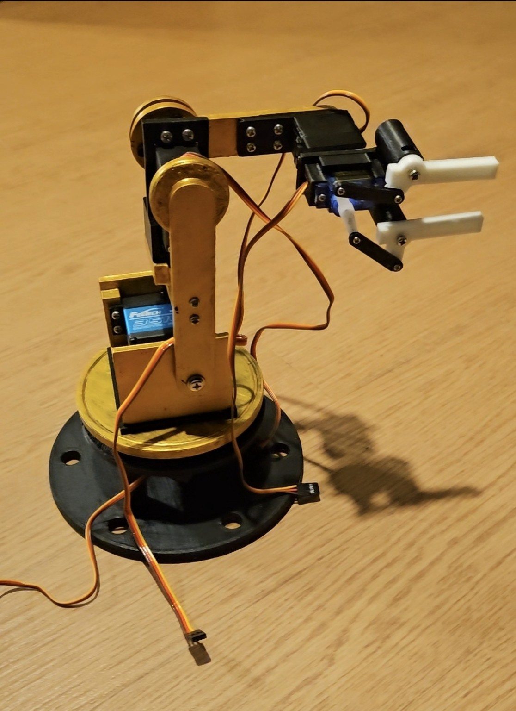

# VisionPick Arm

**Vision-Guided Pick & Place Robotic Arm**  
Arduino C++ · HUSKYLENS 1 · Fusion 360 · PLA+ 3D Printing

> **개발 현황: 2026-11-23 — J1~J5 실물 조립 및 개별 구동 확인(사용자 보고) / 통합 제어·자동 Pick & Place 미검증**  
> 개인 R&D 프로젝트 · 개발 기간 **2026-10-21 ~ 2026-11-30(목표)**  
> 실물 조립 사진을 확보했고, 사용자는 다섯 관절의 개별 움직임을 확인했다고 보고했다. **관절별 기준각 측정값, 통합 전원·제어, 반복 파지 성능과 비전 연동은 아직 기록/검증되지 않았다.**



*사진 제공일: 2026-11-23. 실제 촬영일과 각 관절의 구동·하중·정밀도는 이 정지 사진만으로 확인할 수 없다.*

## 1. 프로젝트 목표

30 × 30 × 30 mm 빨강/파랑 블록을 HUSKYLENS 내장 **Color Recognition**으로 인식하고, 영상 픽셀 좌표를 작업대 좌표로 보정한 뒤, Arduino C++로 **접근 → 파지 → 이동 → 놓기**를 자동 수행하는 **4축 로봇팔 + 1축 그리퍼**를 개발한다.

- **1차 목표:** 카메라 없이 고정 위치 블록 1개를 자동으로 집어 옮기기.
- **최종 목표:** 색상 인식 → 작업대 좌표 변환 → IK/관절 제어 → 자동 Pick & Place.
- **성능 검증 목표:** 동일 조건에서 20회 이상 반복하여 집기 성공률, 위치 오차, 사이클 시간 및 실패 원인을 기록.
- ROS 2·MoveIt 2·별도 딥러닝 모델은 이번 11/30 마감의 필수 범위가 아니다.

## 2. 현재 개발 현황 (2026-11-23)

| 구분 | 확인한 내용 | 아직 필요한 검증 |
|---|---|---|
| CAD/출력 | 4축 구조와 2핑거 그리퍼의 실물 조립 사진 확보; 검정/금색 출력물 | 최종 Fusion 원본·부품별 STL 업로드, 공차·강성·부하 시험 |
| J1 Base | MG996R 장착 및 개별 회전 동작 확인 **(사용자 보고)** | 베어링 회전 간섭, 혼 체결/토크 전달, 정면 영점·허용각 |
| J2 Shoulder | FT5330M와 어깨 링크 실물 결합, 개별 동작 **(사용자 보고)** | 수직 자세에 대응하는 서보 명령각, 종동축 유격·하중 유지 |
| J3 Elbow | MG996R 및 L2 실물 결합, 개별 동작 **(사용자 보고)** | 관절 영점·안전각, 실제 하중 및 처짐 |
| J4 Wrist | MG90S와 손목 부품 실물 결합, 개별 동작 **(사용자 보고)** | J4–J5 연결부 최종 체결·운동 간섭, 자세 오프셋 |
| J5 Gripper | SG90+양쪽 Finger/링크 기구 조립 사진, 개별 동작 **(사용자 보고)** | 실제 개폐 폭(mm), 30 mm 블록 파지·유지·반복 성능 |
| 전원/배선 | 6V 10A 어댑터, WAGO, 퓨즈, 14AWG, UBEC 등 확보; 단독 구동 시도 | 안전한 커넥터·퓨즈 직렬 구성, 극성·부하전압·전류·발열 검증 |
| PCA9685 | **2026-11-23 주문**, 납땜형 16채널 보드 | 배송·외부 전원 정격·하네스·실제 사용 확인 전 |
| HUSKYLENS | I2C 색상 ID 필터 펌웨어 저장소에 존재 | 카메라 작업대 보정, 로봇팔 통합 및 자동화 |
| 통합 제어 | 독립 구동 단계 | J1~J5 동시 연결, 안전 초기화, 상태머신, 자동 Pick & Place |

**증거 수준:** CAD 계산 / 사진 속 조립 / 사용자 개별 구동 보고 / 측정 로그 / 자동화 반복 검증은 서로 다른 단계다. 사진과 보고만으로 토크, 정밀도, 연속 구동 안전성을 합격 처리하지 않는다.

## 3. 기계 구성

| 관절 | 기능 | 채택 모터 |
|---|---|---|
| J1 | 베이스 Yaw | MG996R 호환 서보 |
| J2 | 어깨 Pitch | FEETECH FT5330M (180°) |
| J3 | 팔꿈치 Pitch | MG996R 호환 서보 |
| J4 | 손목 Pitch | MG90S |
| J5 | 2핑거 그리퍼 개폐 | SG90 (기존 보유) |

- FK/IK 개념 링크 길이: **L1=100 mm, L2=80 mm**. 이 값은 기존 계산 모델의 치수이며 최종 축간 실측 확정값이 아니다.
- J1: Base_Fixed Ø160 mm, 지지 기둥 Ø12 × h37 mm, Base_Rotating Ø110 mm, 사각 턴테이블 베어링(실물 참고 71.82 × 71.82 mm).
- J5: SG90 링크식 2지 그리퍼, 30 mm 내부 간격은 기존 **2D CAD 검산 결과**로 실물 파지 폭/파지력은 별도 검증 필요.
- 3D 프린팅: 사용자 보고상 **메이커스페이스 무료 이용(이번 제작 현금 지출 0원)**. 검정·금색 도색을 적용함.

## 4. 전원 및 제어 설계 원칙

```text
PC/USB → Arduino UNO → 서보 PWM 신호(J1~J5) 또는 PCA9685(I2C) [통합 미검증]
외부 서보전원(구입한 6V 10A) → 적합한 퓨즈/접속·분배 → 서보 전력 레일
Arduino GND ↔ 서보 전원 GND (공통 기준)
HUSKYLENS → Arduino I2C SDA(A4), SCL(A5)
```

- Arduino의 `5V`/디지털 핀에서 고전류 서보 5개에 직접 동력을 공급하지 않는다.
- PCA9685는 **PWM 생성기**이며 전원 용량을 늘려주는 장치가 아니다. 구매한 보드의 고전류 레일 정격은 확인 전이다.
- 6V 10A는 어댑터의 최대 공급 정격일 뿐, 모든 관절을 동시에 큰 하중으로 구동할 수 있다는 보장이 아니다.
- DC 배럴 접점, WAGO에 연결하는 도체 굵기, 서보 커넥터, 주/분기 퓨즈, 로커 스위치 DC 정격은 실제 부품에 맞춰 검증한다.
- J5 SG90의 허용 전압과 5V 3A UBEC의 **최소 입력 전압**은 확인 전이다. 모든 모터에 무조건 6V를 인가하지 않는다.
- 전원선 비틀어 테이프만 감은 임시 연결은 **안전한 최종 배선으로 승인하지 않는다**.

## 5. 완료해야 할 실습

1. 관절별 기준 자세에서 **서보 명령각·회전방향·안전 범위** 측정 및 [보정 CSV](docs/data/servo-calibration-2026-11-23.csv) 기입. 시작 시 전체 서보에 `90°` 명령을 일괄 전송하지 않는다.
2. 퓨즈·극성·커넥터·공통 GND 검증 후 **외부 전원 단일 관절 시험 → 5채널 순차 추가**.
3. J1~J5 안전한 자세 제어와 **고정 좌표 자동 Pick & Place**.
4. HUSKYLENS 픽셀 → 작업대 mm 보정 및 FK/IK 실물 연동.
5. 20회 이상 반복 시험 결과와 실패 원인 기록.

## 6. CAD·코드·실험 자료

- [설계 결정·변경 이력](docs/design-decisions.md)
- [실험과 검증 기록](docs/experiments.md)
- [서보 기준각 기록 템플릿](docs/data/servo-calibration-2026-11-23.csv)
- [CAD 최신본 내보내기/검증 체크리스트](cad/EXPORT_CHECKLIST_2026-11-23.md)
- [HUSKYLENS Color Recognition ID 필터](firmware/huskylens_color_filter/huskylens_color_filter.ino)
- [부품 전개 사진](media/photos/2026-11-23_parts-layout-photo-shared.jpg)
- [조립 진행 사진](media/photos/2026-11-23_upper-arm-assembly-wip-photo-shared.jpg)
- [J1~J5 조립 전경](media/photos/2026-11-23_assembled-arm-overview-photo-shared.jpg)
- [11/14 베이스 부분 조립 기록](media/photos/2026-11-14_j1-base-servo-mount-support-posts-wip.jpg)

**CAD 공개 상태:** 현재 저장소에는 11월 1일·2일 `WIP.f3d`만 존재하고 `cad/stl/`에는 최종 STL이 없다. **실제 최신 Fusion 파일을 내보내기 전에는 최종 CAD 업로드 완료로 표시하지 않는다.**

## 7. 포트폴리오·재현성 원칙

조립 사진, 서보 명령값, Fusion 기하값, 전원 실측, 파지 성공률은 각각 출처와 시험 조건을 기록한다. 실물 성능 수치가 없는 항목은 `미측정`으로 남기고, 최초 제작비에는 **새로 구매한 부품 / 기존 보유품 / 메이커스페이스 무료 출력**을 구분한다.
