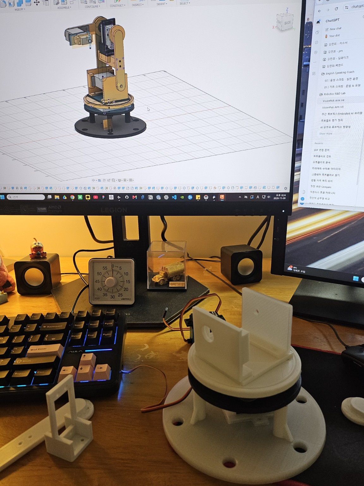
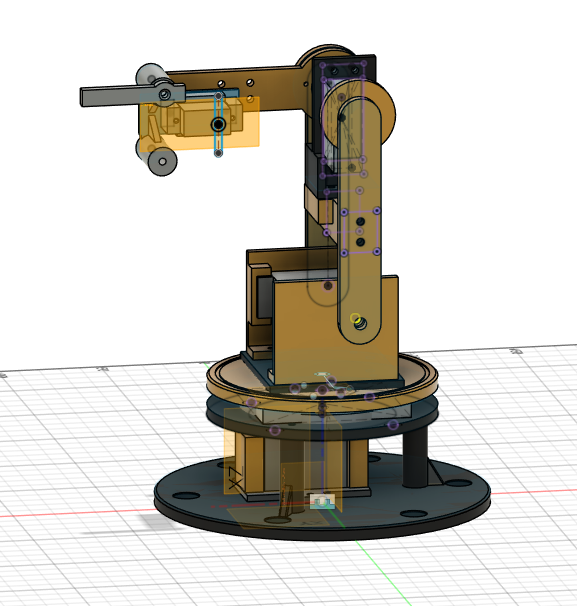
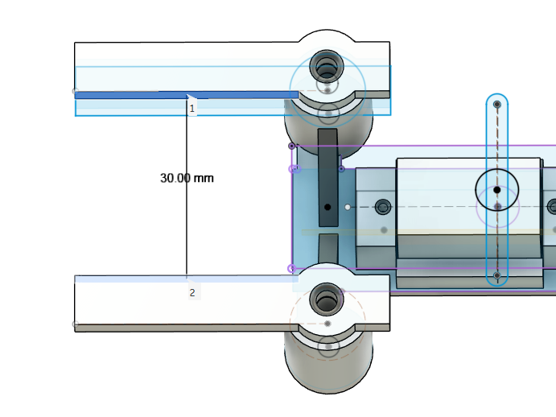
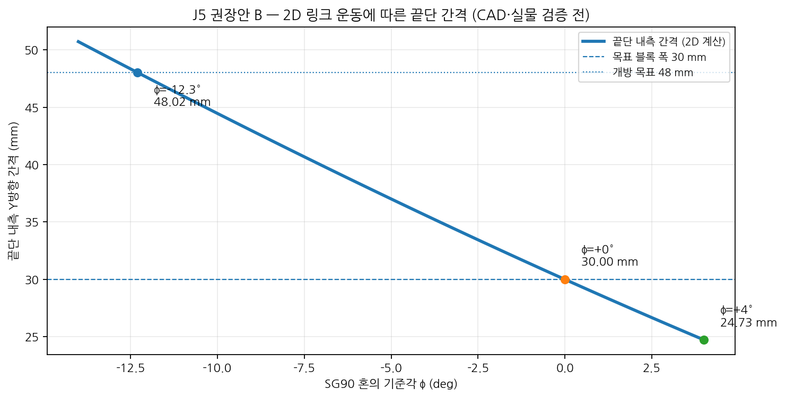

# VisionPick Arm

**Vision-Guided Pick & Place Robotic Arm** · Arduino C++ · HUSKYLENS · Fusion 360 · PLA+ 3D Printing

> **2026-11-11 개발 현황:** J1 주요 출력물 및 J2 일부 부품은 정적 가조립 단계. **J5 Base·Finger L/R·Drive Link 1/2 등 제작용 STL 5종과 슬라이서 출력 파일을 준비**했고, 2D 강체 링크 모델에서 양쪽 손가락 개폐와 30 mm 파지 간격을 수치 검토했다. **실물 출력·볼트 체결·SG90 전원 구동·전체 자동 Pick & Place는 아직 미검증**이다.
>
> 프로젝트 기간: **2026-10-21 ~ 2026-11-30 (목표)** · 개인 R&D 프로젝트 · [설계 결정](docs/design-decisions.md) · [실험 기록](docs/experiments.md)



*위 사진은 2026-11-09 실제 출력물 가조립 상태이며, 작동 완료 사진이 아니다.*

## 1. 프로젝트 목표

30 × 30 × 30 mm 빨강·파랑 블록을 HUSKYLENS로 식별하고, 카메라 좌표를 로봇 작업 좌표로 변환한 뒤, Arduino에서 역기구학과 관절 제어를 수행해 **집기 → 이동 → 놓기**를 자동화한다.

완제품 조립보다 기구학·기계 설계·모터 선정·3D 프린팅·임베디드 C++·비전 보정·성능 검증을 직접 구현하고 이해하는 것이 목적이다. 단, 11월 30일 전에는 새로운 기능 추가보다 **작동하는 자동 Pick & Place 1개 시나리오**를 우선한다.

### 핵심 성공 기준 (아직 측정 결과 아님)

- 30 mm 블록을 안전하게 집고 지정된 위치에 놓을 것
- 빨강(ID 1) / 파랑(ID 2) 목표 선택과 인식 결과를 제어에 반영할 것
- 좌표계와 서보 영점·방향을 보정하고 안전한 동작 범위를 적용할 것
- 같은 조건에서 **20회 이상** 반복 실험해 성공률·위치 오차·사이클 시간·실패 원인을 기록할 것

## 2. 현재 진행 현황 — 2026-11-11

| 분야 | 현재까지 확인된 결과 | 다음 검증 |
|---|---|---|
| 비전 인식 | Arduino UNO ↔ HUSKYLENS I2C 통신, 색상 ID 필터링 및 중심 좌표 출력 확인 | 조명별 정확도·카메라–로봇 좌표 보정 |
| FK·IK | 2링크 계산, Elbow-up/down, Fusion 360 XZ 좌표 일치 | 실제 관절 제한·영점·TCP 오프셋·3D 오차 |
| J1 Base | 주요 PLA+ 부품 첫 출력, MG996R 및 베어링 안착·가조립 | 실제 볼트 체결·원활한 회전·토크 전달 |
| J2 Shoulder | FT5330M 레일 시험 및 Shoulder SidePlate 가조립 점검 | 레일 돌출부 간섭 이력 재검토·전체 체결 |
| J3 Elbow | Servo Flange Plate, 링크·보강부 등 제작용 CAD/출력 진행 | 실물 축 정렬, 서보 장착, 하중 검증 |
| J4 Wrist | Wrist Mount 제작·재출력 검토 | MG90S 실제 장착·회전 범위 |
| J5 Gripper | Base·Finger L/R·Drive Link 1/2 제작용 CAD 형상, 30 mm 평행 간격 확인, 2D 링크 수치 검증 및 STL 5종 준비 | 실물 출력·M2/M3 체결·관절 구동·파지력/유격 검증 |
| 전원·구동 | 일부 배선·체결 부품 구매 | 외부 전원 확정, 보호회로, 서보 개별 시험 |
| 전체 자동 동작 | 미구현 | 상태머신·IK 적용·픽업 반복 실험 |

**상태 구분:** `실측`은 캘리퍼/출력물에서 확인한 값, `CAD`는 설계/측정 화면의 값, `후보`는 실제 운동이나 출력 공차가 검증되지 않은 값이다. 외형이 완성돼 보여도 실물 조립·동작이 완료된 것으로 판단하지 않는다.



*현재 전체 CAD. 컴포넌트 간 체결·회전 간섭 및 실물 동작 검증 전.*

## 3. 시스템 구성


```text
220V AC ── [외부 안정화 DC 전원: 아직 최종 미선정]
                    │
              [+ 극 보호퓨즈 / DC 스위치: 정격 검토 중]
                    │
              [전원 분배] ──→ 서보 J1~J5
                    └────────→ 공통 GND ←── Arduino GND
Arduino UNO ── USB 전원 / PWM 제어신호 ──→ 서보 J1~J5
Arduino UNO ── I2C (SDA=A4, SCL=A5) ──→ HUSKYLENS
```

Arduino 5V 핀으로 서보 5개를 구동하지 않는다. 서보의 전압 허용 범위, 각 전선·단자·스위치의 **DC 전류 정격**, 보호퓨즈 규격은 제품별 데이터와 시험 결과로 최종 확인해야 한다. **6V 15A는 전원 후보이지 구매·성능 검증 완료 사양이 아니다.**

## 4. 기구 및 하드웨어

| 관절 | 기능 | 모터 |
|---|---|---|
| J1 | Base Yaw | MG996R 호환 |
| J2 | Shoulder Pitch | FEETECH FT5330M |
| J3 | Elbow Pitch | MG996R 호환 |
| J4 | Wrist Pitch | TowerPro MG90S |
| J5 | 양쪽 손가락 연동 | SG90 |

- **개념 링크 길이:** L1 = 100 mm, L2 = 80 mm
- **개념 어깨 높이:** 70 mm / **목표 블록:** 30 mm 정육면체
- **J1 베이스:** Ø160 × 6 mm 출력 판, Ø12 × 37 mm 지지 기둥 3개
- **J1 베어링:** 71.82 × 71.82 mm, 중앙 Ø35 mm, 장착면 간 높이 **8.64 mm 실측**
- **J1 회전판:** Ø110 mm, 본체 6.40 mm, 연결 패드 포함 전체 약 8.60 mm (v02 출력 후보 형상)
- **제작 소재/도구:** PLA+, Fusion 360, Cubicreator4 / Cubicon Single Plus 3DP-310F

### 도달 거리: 기구학적 가능성 vs 실물 검증

개념 설계상 어깨–손목의 두 링크 최대 길이 합은 **180 mm**. 초기 집기 반경 약 140 mm는 기구학적으로 검토 가능한 값이나, **180 mm가 실제 수평 집기 거리라는 뜻은 아니다.** 손목 중심 높이, J4 자세, 그리퍼 TCP, 실제 관절 제한, 작업대·베이스 간섭이 작업 영역을 결정한다.

예시(어깨 높이 70 mm, 가상의 손목 목표 높이 15 mm, 어깨 기준 수평 거리 140 mm): 거리 `sqrt(140² + (15-70)²) ≈ 150.4 mm`는 이론적 2링크 거리 구간 `[|100-80|, 100+80] = [20, 180] mm` 안에 있다. **손목 높이 15 mm는 실제 집기 자세를 의미하지 않으며** TCP와 각도 제한을 포함한 검증이 필요하다.

### J5 Gripper — 11월 11일 제작용 CAD·2D 기구학 검토

**현재 상태:** 주요 형상/출력 파일 준비 완료, **2D 좌표 기반 계산 검증 완료**, 실제 조립·구동 시험 전.


*실제 Fusion Assembly 스크린샷. 구동 링크·연결 탭·서보혼의 3D 간섭 및 체결 적합성은 출력물/볼트로 추가 확인해야 한다.*

| 항목 | CAD 또는 계산 기준 | 검증 단계 |
|---|---|---|
| 구동 | SG90 1개 + 서로 다른 Drive Link 2개 | 수학 모델 검증, 실물 구동 전 |
| Finger | 피벗→끝단 40 mm, 폭 8 mm, 두께 5 mm, 피벗 홀 Ø3.4 mm | CAD 제작 완료 |
| 피벗 | P1=(0,+17), P2=(0,-17), 중심 간 34 mm | CAD 기준 |
| 링크 연결점 | A1=(6,27.5), A2=(1,-3) [mm] | 권장안 B 계산 좌표 |
| 서보 중심/혼 홀 | O=(27,0), H1/H2=(27,±13.97) [mm] | 혼 반경은 링크 실측 기반 역산·재확인 필요 |
| Drive Link | L1=24.981, L2=28.220 mm (중심 간 거리); 폭 6, 두께 2.5, 홀 Ø2.2 mm | 2D 계산 및 CAD 형상 기준 |
| 그리퍼 초기 간격 | Finger 바를 피벗에서 바깥쪽으로 ±2 mm 이동 → **30.00 mm (CAD 측정)** | 실제 블록 파지 전 |
| 2D 예측 개방 | φ≈−12.3°에서 약 48 mm | **이상적 강체 모델**, 물리 시험 전 |
| 베이스 | 케이블 슬롯 10×5 mm, P1/P2 보강 리브, 지지부 높이 후보 약 26.66 mm | CAD 설계값, 강도·조립 미검증 |



*Fusion 측정 화면: 직사각형 바 사이의 30.00 mm 간격. 실제 파지력·표면 마찰·압착력은 아직 측정하지 않았다.*



**변경 이유:** 기존 피벗 ±17 mm와 손가락 폭 8 mm에서 평행 자세의 내부 간격은 26 mm여서 30 mm 블록을 평행하게 잡을 수 없었다. 손가락 바만 바깥쪽으로 2 mm씩 옮겨 피벗 중심은 유지하고 내부 간격을 30 mm로 맞췄다. 이전 대칭형 링크 배치는 상하 손가락이 같은 방향으로 움직여 제외했고, A1/A2를 서로 다른 위치로 배치한 **권장안 B**를 2D 수치 모델로 검증했다. 자세한 원의 교점 조건·계산식·각도별 표는 [실험 기록 — EXP-012](docs/experiments.md#exp-012--2026-11-11-j5-그리퍼-2d-기구학-검증-및-cad-출력-준비)에 기록했다.

**출력 준비:** Base, Finger Left, Finger Right, Drive Link 1, Drive Link 2 **총 STL 5종**. 예비 포함 계획은 Base×1, 나머지 각×2로 총 **9개 실물**이다. `J5 SET.hfb`/`.cfb` 생성 사실과 **실제 판별 STL/HFB 수량·프린터/슬라이서 설정**은 분리해 검수한다. 이 기록은 *출력 완료*를 의미하지 않는다.

**미해결:** M2 구동 링크 체결, SG90 혼 실제 홀 크기, M3 피벗 볼트/나사 길이·와셔/스페이서, 지지대 강성·레이어 방향, 동작 중 3D 간섭, 전원 통전/30 mm 블록 실제 파지.

## 5. 3D 프린팅 및 가조립 이력

### 2026-11-06 첫 출력

**출력 계획 기준 7개 작업, 대상 실물 9개**(지지 기둥 3개 포함). 실제 출력 및 일부 가조립을 진행했으며 아래 출력량·시간은 **슬라이서 예측값**이다.

| 출력 대상 | 비고 |
|---|---|
| J1 MG996R 브래킷 시험편 | 모터 장착 공차 시험 |
| J2 FT5330M 레일 시험편 | 모터 하우징 돌출부 간섭 이력 |
| M3 Insert Tolerance Test | Ø3.8/4.0/4.2 mm 테스트홀, 열압입 시험 전 |
| Base_Fixed | 실제 베이스 판 출력 |
| J1 Support Posts ×3 | 지지 기둥 출력 |
| J1 Bearing Mount Fixed | 베어링 고정 링 출력 |
| Base_Rotating v02 | 서보혼·베어링 연결 검증용 |

슬라이서 예측 합계: **15시간 6분 / 179.08 g**(1대 순차 출력 가정). 실제 소요 시간/중량은 별도 기록이 필요하다.

### 2026-11-09 후속 제작 및 확인

- J1 주요 출력물의 **실물 가조립 사진** 확보. MG996R 및 베어링의 정적 안착을 확인했으나, 모터 구동·회전 간섭·최종 체결 강도는 미검증.
- J2 Shoulder SidePlate와 모터의 조립 적합성 확인. 기존 **레일 시험편의 간섭 이력과는 별도**로 기록.
- J2 Shoulder Base Plate/SidePlate, J3 Servo Flange Plate, J5 Gripper Base Fit Test, L2 Link v03 등 후속 출력물을 검수.
- J4 Wrist Mount, L1 CrossBrace J3, L1 Link L/R은 재출력 대상으로 관리. **최종 수령·장착 여부는 아직 확인 전.**
- 11/11에는 J5 Base·Finger L/R·Drive Link 1/2의 STL 5종과 출력 파일을 생성했다. **실제 출력 완료 기록은 다음 방문 후 추가 예정이다.**

## 6. 이미 검증한 계산

| 항목 | 수학 계산 | Fusion 검증 | 판정 |
|---|---:|---:|---|
| FK X | 155.885 mm | 155.885 mm | XZ 평면 일치 |
| FK Z | 80 mm | 80 mm | XZ 평면 일치 |
| IK 목표 X | 100 mm | 100 mm | XZ 평면 일치 |
| IK 목표 Z | 150 mm | 150 mm | XZ 평면 일치 |

단, 수학적 Shoulder +30°를 Fusion Joint에서 -30°로 재현했던 것처럼 **각도 영점과 부호는 좌표계 정의에 따라 다르다.** 3차원 오프셋(이전 Concept 기준 J2/J4 Y 약 8 mm), 실물 서보 오차 및 기구 처짐은 위 결과에 포함되지 않았다.

| 관절 | 1차 설계 요구 토크(질량 가정/안전여유 포함) |
|---|---:|
| J2 | 5.855 kgf·cm |
| J3 | 2.019 kgf·cm |
| J4 | 0.400 kgf·cm |

기준: 그리퍼 40 g, J3 모터 55 g, J4 MG90S 13.4 g, J2~J4 2.5배 설계 여유. **최종 CAD 질량·무게중심·가속·모터 연속정격은 반영하지 않았다.** 상세 조건: [Experiments](docs/experiments.md).

## 7. 코드와 저장소 구조

실제 GitHub에 올라온 실행 가능한 코드는 현재 **HUSKYLENS 목표 색상 필터**다. 아래 `cad/fusion`은 11/1·11/2 백업이 올라가 있으며, 11/11의 최신 Fusion CAD와 STL·프린터 파일은 **실제 파일 별도 업로드 예정**이다.

```text
visionpick-arm/
├── README.md
├── firmware/
│   └── huskylens_color_filter/
│       └── huskylens_color_filter.ino
├── cad/
│   ├── fusion/                       # 11/01, 11/02 WIP 백업 존재
│   └── stl/                          # 최신 부품 STL은 업로드 예정
├── docs/
│   ├── design-decisions.md
│   ├── experiments.md
│   └── data/j5-linkage-sweep-2026-11-11.csv
└── media/
    ├── photos/                       # 실제 사진·Fusion CAD 캡처
    └── figures/                      # 2D 계산 그래프 (실물 계측 아님)
```

### 지금 실행 가능한 기능: 색상 ID 필터링

1. Arduino UNO와 HUSKYLENS를 I2C로 연결한다. UNO 기준 SDA=A4, SCL=A5, GND 공통, 전원은 장치 규격에 맞춰 연결한다.
2. HUSKYLENS에서 **Color Recognition** 및 `Protocol Type = I2C`를 선택한다.
3. Arduino IDE에서 `firmware/huskylens_color_filter/huskylens_color_filter.ino`를 연다.
4. `targetID = 1`(빨강) 또는 `2`(파랑)으로 설정한다.
5. 업로드 후 Serial Monitor **115200 baud**에서 목표 ID와 X/Y 중심 좌표를 확인한다.

```text
HUSKYLENS Connected!
ID: 1
X: 154
Y: 123
```

HUSKYLENS 내장 AI 색상 인식을 사용하는 프로젝트다. **직접 학습한 딥러닝 모델, YOLO, ROS2 또는 MoveIt2를 현재 구현했다고 주장하지 않는다.**

## 8. 다음 작업 및 검증 로드맵

- [x] HUSKYLENS I2C·색상 인식 / ID 필터링
- [x] FK·IK 수학 및 Fusion XZ 평면 검증
- [x] J1 주요 부품 첫 출력 / 일부 정적 가조립
- [x] **11/11 J5 CAD:** Base, Finger L/R, Drive Link 1/2 형상 및 STL 5종 준비
- [x] **11/11 J5 2D 수치 계산:** 권장안 B 강체 기구학(φ −14°~+4°)에서 반대 방향 회전 및 간격 30→약 48 mm 검토
- [x] **11/11 CAD 정적 확인:** Finger 평행 간격 30.00 mm (Fusion 화면)
- [ ] **11/12 출력 목표:** J5 5종(Base 1 + Finger/Drive Link 각 2 = 실물 9개) 및 필요 재출력품 수령
- [ ] **출력 승인 게이트:** 프린터/HFB 설정·STL 개수·M2/M3 체결·서보혼 홀·3D 전 동작 범위 간섭 확인
- [ ] J1~J5 전체 조립·체결 공차·회전 간섭 검사
- [ ] 서보 외부 전원·퓨즈·DC 스위치·분배 및 전류/발열 측정
- [ ] 각 서보 영점·방향·가동 범위·안전 속도 제어
- [ ] Arduino C++ FK/IK, 관절 제한, 이동 궤적·상태머신
- [ ] 카메라–작업대 좌표 보정 / TCP 오프셋
- [ ] 30 mm 빨강·파랑 블록 자동 Pick & Place, **최소 20회 반복 시험**

모든 실험에서 **조건 → 관찰 → 측정치 → 실패 원인 → 수정 → 재시험 결과**를 남기는 것을 원칙으로 한다.

## 9. 사진·실험 기록

- [기존 4축 Concept Assembly](media/photos/2026-10-22_concept-assembly.png)
- [기존 개념 도달 테스트](media/photos/2026-10-22_gripper-reach-test.png)
- [11월 1일 J1 커플링 CAD](media/photos/2026_11_01_j1-coupling-wip.png)
- [11월 9일 실제 출력물 가조립](media/photos/2026-11-09_j1-j2-physical-fitup.jpg)
- [11월 9일 전체 Assembly CAD](media/photos/2026-11-09_assembly-cad-wip.png)
- [11월 9일 J5 피벗 리브 CAD](media/photos/2026-11-09_j5-pivot-ribs-cad-wip.png)
- [11월 11일 전체 Assembly CAD](media/photos/2026-11-11_assembly-overview-cad-wip.png)
- [11월 11일 J5 Link 장착 CAD](media/photos/2026-11-11_j5-assembled-linkage-cad-wip.png)
- [11월 11일 J5 30 mm 정적 간격](media/photos/2026-11-11_j5-30mm-parallel-gap-cad.png)
- [11월 11일 J5 제작용 STL/HFB 파일 목록](media/photos/2026-11-11_j5-stl-hfb-files.png)
- [J5 3개 자세 2D 수치 모델](media/figures/2026-11-11_j5-three-poses-2d.png)
- [J5 SG90 혼 각도 vs 간격 계산 그래프](media/figures/2026-11-11_j5-gap-vs-servo-angle-2d.png)
- [설계 변경과 이유](docs/design-decisions.md)
- [실측·계산·실험 원본](docs/experiments.md)

> 기록은 **2026-11-11 WIP 스냅샷**까지 반영했다. 수치 그래프는 실물 측정이 아닌 이상적인 2D 모델 계산으로, 실제 출력·동작·강도 검증과 별도로 취급한다.
