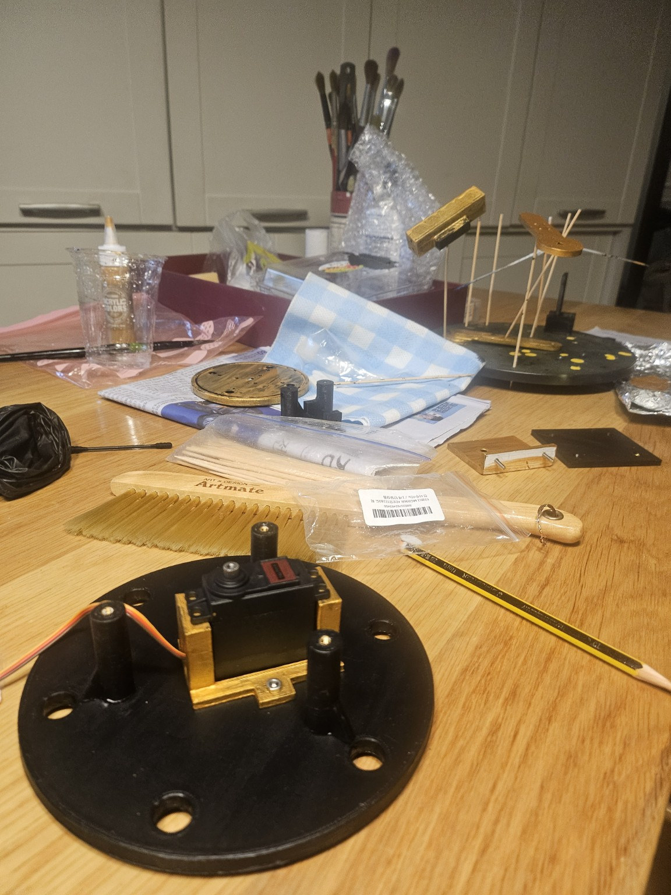
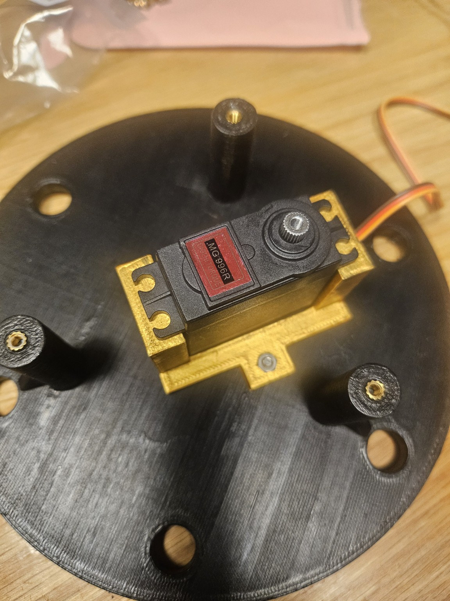
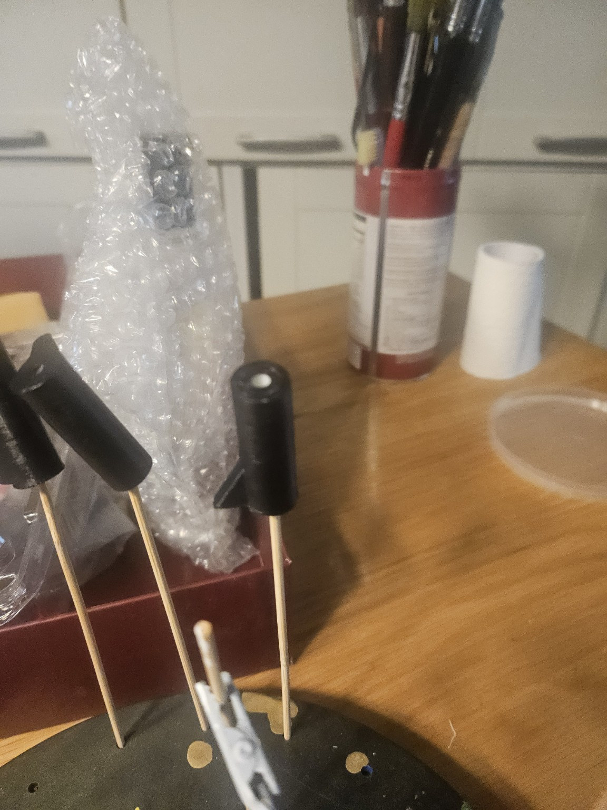

# VisionPick Arm

**Vision-Guided Pick & Place Robotic Arm**  
Arduino C++ · HUSKYLENS 1 · Fusion 360 · PLA+ 3D Printing

> **개발 현황: 2026-11-14 (가조립·도색 진행 / 실제 구동 미검증)**  
> J1 베이스 출력물에 MG996R 서보 브래킷과 지지 기둥 3개를 배치한 실물 사진을 확보했고, 일부 볼트 체결·인서트 설치 정황과 검정/금색 도색 작업을 확인했다. J5 양손가락 링크는 2D 기구학상 30 mm 블록을 위한 개폐 범위를 검토했으며, 주요 출력 완료는 사용자 보고 사항이다. **J1 서보혼-회전판 토크 전달, 베어링 전체 회전 간섭, J2~J5 실물 운동 및 통합 자동 Pick & Place는 아직 합격 판정하지 않았다.**
>
> 개발 기간: **2026-10-21 ~ 2026-11-30 (완성 목표)** · 개인 R&D 프로젝트



*2026-11-14 제공된 실물 작업 사진. 기계적 부분 조립을 보여주며, 전원 구동/전체 조립 성공의 증거가 아니다.*

## 1. 프로젝트 목표

30 × 30 × 30 mm 빨강·파랑 블록을 HUSKYLENS의 내장 Color Recognition으로 인식하고, 이미지 중심좌표를 작업대 좌표로 보정한 다음, Arduino C++의 IK·안전 관절 이동·상태머신으로 **접근 → 집기 → 이동 → 놓기**를 자동 수행한다.

핵심 목표는 완제품의 외관이 아니라 기구설계·기구학·출력/체결·전기·제어·좌표계·반복 성능을 **실물 결과로 검증**하는 것이다. ROS2·MoveIt2·별도 딥러닝 모델은 11/30 이전의 필수 범위가 아니다.

### 최종 통과 조건 (현재 목표, 측정 결과 아님)

- 고정된 위치의 30mm 블록을 안전하게 집고 배출 지점에 놓는 시나리오 동작
- 빨강 ID1 / 파랑 ID2를 선택해 인식 결과를 좌표 입력에 활용
- 서보 영점·회전방향·관절 제한·TCP 오프셋을 실물 기준으로 적용
- 동일 조건에서 20회 이상 반복하여 성공률, 위치오차, 1사이클 시간과 실패 원인 기록

## 2. 최신 진행 상황 — 2026-11-14

| 분야 | 확인된 사실 | 아직 검증되지 않은 것 |
|---|---|---|
| HUSKYLENS + Arduino | I2C 통신, 빨강 ID1/파랑 ID2 목표 필터링과 `xCenter/yCenter` 수신 | 픽셀 → 작업대 mm 보정, 인식 강건성 |
| FK·IK | 2링크 해, Elbow-up/down, Fusion XZ 평면 수치 검산 | 실제 관절 영점·각도 제한·손목 TCP 오프셋 포함 3D 검증 |
| J1 베이스 | Base_Fixed·MG996R 브래킷·Support Post 3개 실물 배치, 일부 체결과 도색 사진 | 하부 2+3개 매립홀 방향 충돌 해결, 상하 체결, 베어링 전체 회전, 회전판 ↔ 혼 결합 |
| J2 Shoulder | FT5330M, 측판/레일 실물 적합성 일부 확인, 반대편 피벗 위치 CAD | 종동축 M3 체결의 유격·마찰·동축, 하중 구동 |
| J3 Elbow | 링크·J3 고정부 제작 CAD/출력 진행 기록 | 최종 실물 축 정렬·체결·구동 |
| J4 Wrist | Wrist Mount 제작/재출력 진행 기록 | MG90S 실제 체결·회전 제한·간섭 |
| J5 Gripper | Base/Finger L/R/Drive Link 1/2 CAD, 30mm 간격, 2D 링크 수치 검증 | SG90 혼 M2 체결 적합성, 실물 연동·그립 폭·파지력 |
| 전원 부품 | 11/09 및 11/13 주문 내역 확인, WAGO 221-415 **4개** 주문 | 배송 수령, DC 배럴 접점 10A 정격, DC-DC 6V→5V 적합성, 안전 통전 |
| Arduino 운동제어 | HUSKYLENS 센서 코드 존재 | 실제 서보 구동, C++ FK·IK 이식, 상태머신, 자동 Pick & Place |

**판정 기준:** `수학 검산` ≠ `CAD 화면` ≠ `출력 완료` ≠ `볼트 체결` ≠ `전원 구동` ≠ `자동 동작 검증`. 각 단계는 별개로 기록한다.

## 3. 기구·전기 시스템

| 관절 | 운동 | 서보 |
|---|---|---|
| J1 | Base Yaw | MG996R 호환 |
| J2 | Shoulder Pitch | FEETECH FT5330M (180°) |
| J3 | Elbow Pitch | MG996R 호환 |
| J4 | Wrist Pitch | MG90S |
| J5 | 양쪽 Finger 개폐 | SG90 |

- 개념 링크 치수: **L1=100 mm, L2=80 mm**, 어깨 높이 후보 약 70 mm. 최종 실측/축 중심 보정 전임.
- J1 Base_Fixed: Ø160 × t6 mm. Support Post 3개: Ø12 × h37 mm.
- J1 사각 턴테이블 베어링: 외형 약 71.82 × 71.82 mm, 중앙 Ø35 mm, **장착면 간 높이 8.64 mm 실측**.
- J1 Base_Rotating: Ø110 mm, 본체 t6.40 mm; 6방향 혼에 연결하는 작은 홀 3개와 베어링용 M4 홀 4개는 서로 다른 용도.
- HUSKYLENS I2C on Arduino UNO: SDA=A4 / SCL=A5, 초기 높이 25cm.

### 전원 연결 개념 (최종 배선·부하 시험 전)

```text
220V AC → [6V 10A 안정화 어댑터: 주문] → [적합한 고전류 DC 출력 접속/퓨즈/스위치]
                                              ├→ 6V 분배 → J1/J2/J3 (사양 확인 전)
                                              └→ [5V 3A 모듈: 6V 입력 적합성 미확인]
                                                         └→ J4/J5 (전류 제한 확인 전)
Arduino UNO: USB 공급 → 서보 PWM + HUSKYLENS I2C
Arduino GND ↔ 서보 전원 GND 공통 (각 +전압은 혼합 금지)
```

> **안전:** Arduino UNO 5V 핀으로 서보 다섯 개에 동력을 공급하지 않는다. 6V 10A 어댑터의 DC 배럴 플러그와 구입한 암커넥터는 **접점의 연속 10A 허용정격 미확인**이므로 고부하 전체 구동에 사용 승인하지 않는다. 전원 모듈, 스위치, 와이어, 퓨즈 정격과 DC 극성도 실제 제품/부하로 확인해야 한다.

## 4. 11월 14일 실물 관찰·도색



- 검은색 Base_Fixed에 금색 MG996R 서보 브래킷과 지지 기둥 3개를 배치한 실물 사진 확인.
- 지지 기둥 상단에서 황동색 나사 인서트로 보이는 금속 부품이 관찰되지만, **6개 모두 장착·인발 강도 검증 완료로 단정하지 않음**.
- Base_Fixed의 서보 브래킷용 2개·지지 기둥용 3개 나사 머리 매립홈이 **반대쪽 면**에 있어, 판의 방향과 나사 머리 돌출/바닥 지지 문제가 남아 있음.
- Gold/Black 도색 중인 출력물을 사진으로 확보. **도료 건조/마감·끼워맞춤과 하중 영향은 별도 확인**.




### 최우선 조립 리스크

1. **J1 서보혼 ↔ Base_Rotating**: MG996R 6방향 혼의 작은 홀 약 Ø1.49mm. CAD는 M1.6 × 12mm 볼트/너트 3개 후보지만 실물 체결·동력 전달 시험 전.
2. **J1 베어링 M4 체결**: 상·하판 볼트/너트 체결 후 360° 범위에서 간섭 없는지 확인 전.
3. **J1 나사 머리/받침 안정성**: 양면 카운터보어 위치가 상충. 하부 고무발/스페이서/판 고정 대안을 실물 높이·전도 모멘트로 선택해야 함.
4. **J2 종동측 피벗**: 기존 625ZZ는 과거 후보였고 최종 구매·장착 규격 아님. 임시 M3 축 + 스페이서/와셔 + 나일론 너트 방식은 실물 홀 치수·마모·유격 검증 필요.
5. **J5 M2-서보혼 체결**: SG90 혼 작은 홀을 강제로 확장하거나 체결할 때 파손 위험; 최종 체결 강도/자유 운동 미검증.

## 5. 지금 존재하는 코드와 향후 구현 순서

현재 실행 검증된 코드는 `firmware/huskylens_color_filter/huskylens_color_filter.ino`의 `Wire.h` + `HUSKYLENS.h` 기반 I2C 인식/ID 필터다. 직접 학습한 YOLO 모델은 구현 범위가 아님.

권장 개발 단계:

1. **서보 1개 외부 전원 시험**: 실제 영점·회전방향·안전각/전압 기록.
2. **J1~J5 독립 제어**: Servo.h, 공통 GND, 관절별 보정표. 처음부터 실제 모터 전원을 연결하지 말고 시리얼 계산을 선행한다.
3. **기구학 이식**: 각도 변환, 도달영역 검사, Elbow-up/down 선택, J4 자세/TCP 보정.
4. **가상 이동+상태머신**: `millis()` 기반 순서제어, `HOME → DETECT → APPROACH → LOWER → GRIP → LIFT → PLACE → RELEASE → HOME`.
5. **고정 좌표 Pick & Place** 성공 후 카메라→작업대 좌표 보정 연결.
6. 실제 20회 이상 반복 성능 시험 및 로그 기록.

## 6. 2026-11-14 ~ 11-30 타임라인

| 목표일 | 작업 | 완료 기준 |
|---|---|---|
| 11/14~17 | 체결·가조립, 홀/축/와셔/간섭 확인, 수정 출력 선별 | 무전원 수동 운동과 간섭 기록 |
| 11/18~23 | 배송품 수령, 전원 커넥터 정격·5V 모듈 검증, 저부하 개별 구동 | 전압·극성·영점·작동 범위 기록 |
| 11/19~25 | Arduino 제어, FK/IK, 관절 보정 및 안전 이동 | 고정 좌표 이동 성공 |
| 11/26~27 | 그리퍼 + 고정 좌표 Pick & Place | 30mm 블록 집기/이동/놓기 |
| 11/28~29 | 카메라 좌표 보정 및 통합 반복 실험 | 인식 기반 동작, 성공률 기록 |
| 11/30 | 수정·시연·문서/영상 정리 | 최종 실험 조건과 한계 공개 |

> 일정은 구매품 배송 및 체결 시험 진행에 따라 조정된다. 기능 동작이 늦어지면 도색 마감보다 단일 자동 Pick & Place를 우선한다.

## 7. GitHub 문서와 자료

- [설계 결정 및 변경 이유](docs/design-decisions.md)
- [실험·계산·실물 검증 기록](docs/experiments.md)
- [11/14 가조립 전경](media/photos/2026-11-14_j1-base-servo-mount-support-posts-wip.jpg)
- [11/14 MG996R 근접 체결 사진](media/photos/2026-11-14_j1-mg996r-bracket-inserts-detail.jpg)
- [11/14 J2 종동축 CAD 참고](media/photos/2026-11-14_j2-opposite-pivot-cad-reference.jpg)
- [11/14 금색 J1 회전판](media/photos/2026-11-14_j1-base-rotating-painted-holes.jpg)
- [11/14 6방향 서보혼](media/photos/2026-11-14_j1-six-arm-plastic-servo-horn.jpg)
- [11/14 J2 장착부 실물 참고](media/photos/2026-11-14_j2-shoulder-plate-fitup-wip.jpg)
- [메이커스페이스 출력 시설 참고 1](media/photos/2026-11-14_makerspace-printer-area-reference.jpg) / [참고 2](media/photos/2026-11-14_makerspace-workbench-reference.jpg)

**사진·실측·출력 파일은 서로 대체되지 않는다.** 이 문서가 기계적 가조립, 도색 및 계획을 기록했다고 해서 완성 로봇의 전기적/운동학적 성능이 입증된 것은 아니다.
