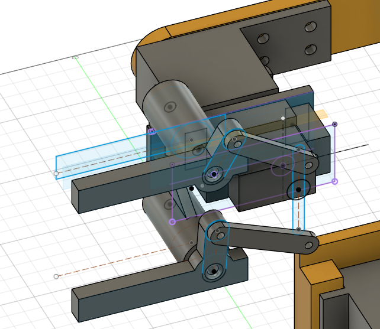
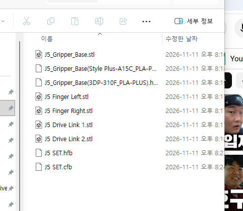

# Design Decisions

VisionPick Arm의 주요 설계 결정, 변경 이유 및 기술적 검토 기록.

**최근 업데이트:** 2026-11-11

> 설계값은 **실측값(측정)**, **설계값(CAD 적용)**, **임시 후보값(검증 전)**으로 구분한다. CAD 완성·출력 파일 생성·실제 출력·가조립·전원 구동은 서로 다른 검증 단계다.
>
> **읽는 방법:** 10/22~11/02 항목은 당시의 결정과 *그 날짜의 상태*를 기록한 이력이다. 최신 설계 결정 및 미해결 항목은 아래 11/06~11/09 항목과 마지막 체크리스트를 우선한다.

---

## 최신 결정 요약 — 2026-11-11

| 결정 | 최신 판단 | 검증 상태 |
|---|---|---|
| J1 주요 부품 | 실제 출력물을 가조립하고 접근·안착 문제 검토 | 정적 가조립, 동작·체결 미완료 |
| J2 어깨 | Shoulder SidePlate 조립 적합 확인; 레일 시험편 간섭 이력 별도 관리 | 일부 실물 적합성 확인 |
| J5 Base | 케이블 출구 누락 → **10×5 mm** 슬롯 추가 후 재출력 | CAD 수정, 재출력 전 |
| J5 양쪽 피벗 | P1/P2: SG90 중심 왼쪽 27 mm, 위/아래 17 mm | CAD 좌표·B안 2D 운동 검토, 실물 운동 미검증 |
| J5 피벗 지지부 | Base 일체형 지지 기둥 + P1/P2 삼각 보강 리브 | 3D CAD 배치, 강성·체결 미검증 |
| 전원 | 14AWG 퓨즈홀더·전선·분배 커넥터 구매; DC 스위치/6V 전원은 후속 선정 | 배선·통전 전 |
| J5 Gripper (11/11) | **Finger L/R + Drive Link 1/2 형상/5종 STL 준비**; 2D B안 30↔48 mm 간격 계산 | CAD·계산, 실물 검증 전 |

> **CAD 깊이/높이 좌표의 기준:** 15.70 mm, 32.16 mm, +11.46 mm 같은 값은 11/09 Fusion 화면의 특정 기준면에서 얻은 값이다. 전역 Z 또는 실제 출력물 치수로 혼용하지 않으며, 레퍼런스 평면과 조립 기준을 재측정한다.

---

## 2026-10-22 | 4축 로봇 구조 채택

### 결정

기존 3축 로봇팔을 **4축 + 1축 그리퍼** 구조로 변경.

### 변경 이유

- 손목 회전축 없이 집게의 방향을 독립적으로 제어하기 어려움
- 블록을 수직 방향으로 접근해 파지하기 위한 Wrist Pitch 필요
- 어깨·팔꿈치 자세 변화에 따른 집게 방향 보정 기능 확보

### 관절 구성

| 관절 | 운동 |
|---|---|
| J1 | 베이스 Yaw |
| J2 | 어깨 Pitch |
| J3 | 팔꿈치 Pitch |
| J4 | 손목 Pitch |
| J5 | 그리퍼 개폐 |

서보모터 총 5개 사용.

**설계상의 절충:** 손목 모터 추가로 상위 관절 토크와 제어 복잡도가 증가하지만, 집게 자세 제어 능력을 확보함.

**검증 상태:** Concept CAD에서 관절 구동 확인 완료.

---

## 2026-10-22 | 산업용 오픈 프레임 디자인

### 결정

산업용 미니 로봇팔과 개방형 기계 구조를 결합한 디자인 채택.

### 설계 요구사항

- 오렌지·블랙 색상 조합
- 관절·모터·볼트가 드러나는 오픈 프레임
- PLA+ 3D 프린팅
- 분해·재조립 가능한 볼트 체결
- 링크·모터 브래킷·그리퍼의 모듈화

### 제작 방안

연세대학교 메이커스페이스 3D 프린터 활용. 2026년 기본 흰색 PLA+와 검정·주황 필라멘트 보유를 확인함.

**주의:** 제작용 CAD 및 슬라이싱 결과는 실물 치수·조립 강도 검증을 대신하지 않음.

---

## 2026-10-22 | 비전 인식 및 작업 영역

### 비전 시스템

- DFRobot HUSKYLENS 1 사용
- 내장 Color Recognition 기능 우선 적용
- 빨강: ID1 / 파랑: ID2
- 로봇팔과 분리된 상부 고정 카메라 채택

### 초기 작업 영역

| 항목 | 임시값 |
|---|---:|
| 작업대 | 300 × 300mm |
| 카메라 높이 | 250mm |
| 초기 집기 반경 | 약 140mm |
| 목표 물체 | 30mm 정육면체 |

카메라 높이 20/25/30cm에서 대상이 화면에 들어오는지 확인했으며, 초기 설치 높이는 25cm로 선정.

집기 지점과 배출 지점을 비슷한 수평 반경에 배치하여 베이스 회전 동작을 단순화하는 방향을 우선 검토함.

**남은 검증:** 카메라 좌표 보정, 전체 작업 영역 및 실제 집기 성공률.

---

## 2026-10-23 ~ 10-26 | 기구학 계산 및 Fusion 검증

### 개념 설계 치수

| 항목 | 값 |
|---|---:|
| L1 | 100mm |
| L2 | 80mm |
| 어깨 높이 | 70mm |

위 값은 기구학 검증용 임시 치수임.

### 검증 결과

- FK·IK 수학 계산 완료
- Elbow-up / Elbow-down 해 계산
- 베이스 회전 및 손목 자세 보정식 검토
- Fusion 360에서 FK 목표 `(X=155.885mm, Z=80mm)` 재현
- Fusion 360에서 IK 목표 `(X=100mm, Z=150mm)` 재현

검증 좌표는 **XZ 평면 기준**. 수학적 관절 각도와 Fusion Joint 입력각의 부호 차이를 확인함.

**남은 검증:** 실제 3차원 좌표계, 관절 제한, TCP 오프셋 및 서보 영점 보정.

---

## 2026-10-26 | 관절별 기초 토크 분석

### 결정

수평 자세의 정적 중력 토크를 기본으로 관절별 모터 요구조건 산정.

### 계산 가정

- 대상 블록: 20g
- J3 모터: 55g
- J4 모터: 13.4g(MG90S 적용 후보)
- 그리퍼 조립체: 40g 기본 가정
- 중력가속도: 9.81m/s²
- J2~J4 설계 여유: 2.5배

### 수정 계산 결과 — Hardware R02

| 관절 | 요구 설계 토크 |
|---|---:|
| J2 어깨 | 5.855 kgf·cm |
| J3 팔꿈치 | 2.019 kgf·cm |
| J4 손목 | 0.400 kgf·cm |

그리퍼 질량 변화에 따른 토크 민감도:

| 그리퍼 질량 | J2 | J3 | J4 |
|---|---:|---:|---:|
| 40g | 5.855 | 2.019 | 0.400 |
| 60g | 6.855 | 2.519 | 0.500 |
| 80g | 7.855 | 3.019 | 0.600 |

단위: kgf·cm, 설계 여유 포함.

추가로 J1 점질량 기반 회전 관성 및 가속 토크, J5 손가락당 파지력 목표 0.4905N을 계산함.

**한계:** 최종 CAD 질량과 무게중심, 동적 하중, 실제 마찰, 발열 및 출력 부품 처짐 미반영.

---

## 2026-10-26 ~ 10-27 | 그리퍼 개념 설계

### 결정

SG90 서보모터 1개를 사용하는 **양쪽 링크 연동형 2핑거 집게** 채택.

| 설계 항목 | 임시 치수 |
|---|---:|
| 몸체 너비 | 72mm |
| 몸체 높이 | 18mm |
| 손가락 회전축 간격 | 54mm |
| 손가락 길이 | 40mm |
| 목표 개방 폭 | 45~50mm |

- `Gripper_Concept_v01` 스케치 제작
- 좌우 손가락 회전축 및 개폐각 구상
- SG90 참고 Component 배치
- 그리퍼 전체 질량 60g 이하 목표, 80g 조건까지 하중 검토

**상태:** Concept 설계 단계. 실제 연동 링크·파지력·질량은 아직 검증하지 않음.

---

## 2026-10-27 | 서보모터 선정

| 관절 | 선정 모터 | 최초 상태 |
|---|---|---|
| J1 Base | MG996R 호환 | 주문 |
| J2 Shoulder | FEETECH FT5330M | 주문 |
| J3 Elbow | MG996R 호환 | 주문 |
| J4 Wrist | TowerPro MG90S | 주문 |
| J5 Gripper | SG90 | 보유 |

### 선정 이유

- **J1 MG996R:** 비용을 고려한 베이스 회전 구동 후보. 하중은 별도 턴테이블 베어링으로 지지하는 구조 고려.
- **J2 FT5330M:** 상대적으로 큰 어깨 중력 토크를 고려해 선택.
- **J3 MG996R:** 계산된 팔꿈치 부하를 기준으로 선정한 경제적 후보.
- **J4 MG90S:** 말단 질량 감소를 위한 경량 서보.
- **J5 SG90:** 기존 보유 부품 활용, 파지력 시험 후 최종 적합성 판단.

**남은 검증:** 정확한 제품 모델·전압, 실제 영점·회전 범위, 부하 유지·전류·발열·위치 반복성.

---

## 2026-10-27 | 전원 및 기계 부품 구성

### 전원 아키텍처

- Arduino UNO는 USB로 전원 공급
- 서보모터는 외부 안정화 DC 전원 사용
- Arduino와 서보 전원의 GND 공통 연결
- 6V/5V 분리 전원 구성을 우선 검토

어댑터, 전압 변환 모듈, 분배 단자 및 보호장치는 최종 선정 전.

### 기계 지지 구조

- 베이스 회전부 하중을 지지하는 별도 구조 필요
- 어깨·팔꿈치 양쪽 지지 구조 검토
- 서보 출력축에 굽힘 하중이 집중되지 않도록 설계
- 베어링·축·체결 볼트는 실제 조립 구조에 따라 확정

608ZZ·625ZZ는 당시 후보 규격이며 최종 규격이 아님.

---

## 2026-10-27 | 모듈형 제작 구조

### 결정

향후 제어 소프트웨어와 기계 구조를 개선할 수 있도록 모듈형 CAD 설계 채택.

### 모듈 구성

- Base 모듈
- Shoulder & Arm 모듈
- Elbow 모듈
- Wrist 모듈
- Gripper 모듈

### 설계 기준

- 모터 하우징과 링크를 분리
- 교체 가능한 모터 장착 브래킷
- 분리 가능한 집게 장착 인터페이스
- 볼트 기반 분해·유지보수
- 서보 배선과 나사 체결 공구의 접근성 고려

**남은 검증:** 제작용 CAD에서 각 모듈의 체결 인터페이스 및 실제 장착 치수 확정.

---

## 2026-10-28 ~ 10-31 | J1 고정 베이스 및 사각 턴테이블 베어링 설계

### 결정

J1 회전판과 로봇팔의 주요 축방향·굽힘 하중은 **사각 턴테이블 베어링**으로 지지하고, MG996R과 서보혼은 주로 **회전 토크를 전달**하도록 역할을 분리한다.

### 결정 이유

서보 출력축에 로봇팔 전체의 굽힘 하중이 집중되는 구조를 피하고, 베어링·모터·회전판을 분리해 조립 및 유지보수를 쉽게 하기 위함.

### 베어링 실측

| 항목 | 실측값 |
|---|---:|
| 외형 | 71.82 × 71.82mm |
| 두께 | 7.95mm |
| 중앙 개구부 | Ø35mm |
| 체결홀 지름 | 약 Ø4.14mm |
| 측정한 체결홀 중심 간격 | 57.28mm |

베어링 양쪽 회전판의 홀 배열이 모두 57.28 × 57.28mm 정사각형인지, 볼트 머리 접근성이 충분한지는 추후 확인 필요.

### CAD에 적용한 주요 구조

- `Base_Fixed`: 외경 Ø160mm, 두께 6mm, Ø12mm 경량화 홀 6개.
- 지지 기둥 3개: Ø12mm × 37mm, 리브 보강, M3 인서트 후보홀 Ø4.0 × 7mm.
- `J1_Bearing_Mount_Fixed`: 외경 Ø110mm / 내경 Ø70mm / 두께 5mm, 기둥홀 3개 + 베어링홀 4개.
- `Base_Rotating`: 기존 두께 5mm에서 아랫면을 1.40mm 확장해 **6.40mm**로 변경. 윗면 높이는 유지.
- `Base_Rotating`의 베어링 결합 관통홀: Ø4.5mm × 4개(홀 배열 검증 전).
- J2 바닥판 고정 블라인드 홀: Ø4.0mm × 깊이 4.5mm × 4개. 잔여 두께 1.9mm.

### 설계 변경의 근거

베어링 상단과 회전판 하단의 CAD상 1.40mm 높이 차이를 제거하고, J2 결합면 위치를 유지하기 위해 회전판 아래쪽을 확장했음.

### 남은 검증

베어링 접합면의 실제 볼 레이스 형상, 볼트 머리 간섭, 인서트 규격, 회전판 하중 전달 경로 및 실물 조립 적합성.

**상태:** CAD 구성 완료 항목이 있으나 실물 출력·조립은 아직 수행하지 않음.

---

## 2026-11-01 | J1 MG996R 서보혼 선정 및 회전판 연결부 검토

### 서보혼 비교

| 후보 | 실측·확인 사항 | 판단 |
|---|---|---|
| 원형 | 외경 Ø20.72mm, 출력축에 깊게 결합되는지 불명확 | 보류 |
| 4방향 십자형 | 끝과 끝 36.79mm, MG996R 중앙 나사 체결 정상 | Ø35mm 중앙 개구부와 같은 높이에서 회전 시 간섭 우려 |
| **6방향 별형** | 외경 31.77mm, 중앙 나사 정상 체결 및 독립적인 흔들림 없음 | **J1 연결 구조의 우선 후보로 선정** |

6방향 혼을 채택한 이유는 기존 실물 부품을 재사용하면서 Ø35mm 중앙 개구부에 필요한 회전 외경 여유를 확보할 가능성이 가장 크기 때문임. 구매용 금속 혼은 현재 보류하되, 실제 체결 강도가 부족하면 재검토한다.

### 6방향 서보혼 실측

| 항목 | 값 | 분류 |
|---|---:|---|
| 회전 외경 | 31.77mm | 실측 |
| 모터 평평한 하우징 윗면 → 날개 윗면 | 8.44mm | 실측 |
| 마주 보는 가장 바깥쪽 작은 홀의 중심 간 거리 | 26.53mm | 실측 |
| 작은 홀 지름 | Ø1.49mm | 실측 |
| 날개 두께 | 2.36mm | 실측 |
| 서보혼 외경과 베어링 개구부 간 이상적 반경 여유 | 1.615mm | 계산값 |

Ø26.53mm는 외측 홀 피치원(PCD) 후보 치수이며, 실제 중심과 각도 배치가 동일하다는 가정이 포함됨. 1.615mm 역시 완전 동축이고 개구부 내부에 돌출물이 없다는 가정의 여유값임.

### Fusion에서 수행한 설계

- `J1_Horn6_Reference`에 Ø31.77mm 회전 외경 및 Ø26.53mm 후보 피치원 작성.
- `Base_Rotating` 아랫면에 120° 간격의 체결 위치 3개 투영.
- 외경 Ø32.5mm, 중앙 회피부 Ø10mm, 아래 방향 돌출 1.56mm의 **연결 패드 후보** 생성.
- Ø2.4mm 나사 통과 후보 원 3개 작성. 최종 관통·카운터보어 가공은 아직 수행하지 않음.
- Fusion에서 J2 바닥판 아랫면 ↔ `Base_Rotating` 윗면 간격 **0mm** 확인.

### 구조 판단

베어링 중앙 개구부를 통한 결합을 검토하되, 실제 접촉면과 구동 토크를 전달할 나사 체결력이 검증되기 전에는 연결 패드를 최종 설계로 확정하지 않음. J2 바닥판이 회전판에 밀착되므로, 위에서 삽입하는 연결 나사 머리는 회전판 윗면보다 돌출되면 안 됨.

### 후속 검증 조건

1. 실제 사용 가능한 나사 종류, 나사 머리 지름·높이 및 혼의 Ø1.49mm 홀 적합성 확인.
2. 날개 두께 2.36mm에서 나사 체결 강도 확보 가능 여부 확인. 일반 M2 기계나사가 플라스틱 홀에 스스로 체결된다고 가정하지 않음.
3. 중앙 서보혼 고정나사 접근성 및 분해 순서 확인.
4. J2 결합 블라인드 홀, 베어링 볼트, 나사 머리 매립부 사이의 간섭 검토.
5. 실제 베어링 형상에 따른 전체 회전 범위 간섭 및 조립 후 저속 구동 시험.

**판정:** 6방향 서보혼은 **정적 장착 확인 완료**, J1 연결 패드와 회전판의 최종 체결은 **미검증(WIP)**. `Base_Rotating` 출력 파일은 보류함.

---

## 2026-11-01 | 첫 3D 프린팅 작업 준비

### 결정

2026년 11월 6일(금) 오전 10시 연세대학교 메이커스페이스 i7(송도)에서 **시험 출력부터 시작**한다.

### 준비한 출력 작업

1. J1 MG996R 브래킷 시험편
2. J2 FT5330M 레일 시험편
3. M3 인서트 공차 비교 시험편(Ø3.8 / Ø4.0 / Ø4.2mm)
4. `Base_Fixed`
5. J1 지지 기둥 3개 통합 출력
6. `J1_Bearing_Mount_Fixed`

G-code **6개 작업**, 출력 대상 **8개 부품**, 슬라이싱 예상 **11시간 53분 / 139.22g**. 실제 출력 완료를 의미하지 않음.

### 출력 승인 원칙

- 시험 출력물의 모터 삽입 여유, 볼트 접근, 인서트 적합성 확인
- 확정되지 않은 치수를 가진 부품은 본 출력 대신 시험 출력 우선
- `Base_Rotating`은 J1 결합 구조가 검증되기 전까지 STL·G-code 생성 보류

### 마감 일정 고려

11월 30일까지 자동 Pick & Place 시스템 구현이 목표이므로 J1의 외형 마감보다는 **J3 실제 고정부, J4 손목, J5 그리퍼 및 Arduino 제어** 완성을 우선함.

---

## 2026-11-02 | J1 베어링 재실측과 제작용 CAD 위치 보정

### 변경 이유

10월 말에 베어링 두께를 약 7.95~8.00mm로 반영했으나, 11월 2일 실물 체결 탭의 **장착면 간 높이 8.64mm**를 재확인함. 단순화된 Fusion Reference(8.00mm)보다 **0.64mm 더 두껍기 때문에**, 회전판 위치와 모터-서보혼 연결 패드의 접촉 관계를 재검토함.

### 최종 실측 및 계산

| 항목 | 값 | 분류 |
|---|---:|---|
| 베어링 외형 | 71.82 × 71.82mm | 기존 실측 |
| 베어링 중앙 개구부 | Ø35mm | 기존 실측 |
| **베어링 장착면 사이 높이** | **8.64mm** | 재실측(기존 두께 수치 대체) |
| 상·하판 두께 | 각 0.77mm | 실측 |
| 상·하판 사이 간격 G | 약 7.16mm | 실측(측정 위치에 따라 차이 가능) |
| 상·하판 체결홀 중심 간격 | 각각 57.28mm | 실측 확인 |
| 체결홀 지름 | 약 Ø4.14mm | 실측 |
| 베어링 CAD Reference 높이 | 8.00mm | 기존 CAD 유지 |
| 실제 높이와 CAD Reference 차이 | +0.64mm | 계산값 |

금속판 두께 합계와 간격을 더한 8.70mm는 장착면 사이 실측 8.64mm와 0.06mm 차이가 있음. 서로 다른 위치의 측정값으로 보아 **베어링 내부 유효 체결 공간을 7.16mm로 단정하지 않음**.

### Fusion 설계 변경

- 기존 `J1_Turntable_Reference` Extrude를 직접 수정했을 때 다수의 Sketch/Project 참조 경고가 발생하여 **되돌리기(Ctrl+Z)로 전체 경고를 제거**함. 이후 기존 Reference 형상은 유지.
- `J1_Bearing_ActualTop_8p64` 기준 평면을 만들어 실제 상면 위치를 표시하고, `Base_Rotating` Component를 **위로 0.64mm 배치**함.
- `Base_Rotating` 중앙의 6방향 서보혼 연결 패드를 명목 접촉 조건에 맞게 조정함. CAD의 최종 후보 돌출 높이는 약 **2.20mm**, 본체 두께는 6.40mm로 **v02 STL 전체 높이 8.60mm**를 확인함.
- 상부 J2 바닥판 및 링크 조립체는 함께 이동시키지 않았으므로, **현재 Assembly에 0.64mm CAD 간섭이 남아 있음**. 이는 최종 간섭 검증 통과를 의미하지 않으며 상부 조립체 위치 보정은 추후 진행할 계획.

### 결정과 한계

베어링 Reference를 직접 재작성해 하위 스케치 참조를 손상시키는 대신, **실측 기준 평면 + 회전판 위치 보정** 방식으로 현재 출력용 회전판을 정리함. 출력 파일은 별도로 검증하되, 전체 Assembly 운동 간섭 검사는 상부 위치 보정 후 다시 수행해야 함.

---

## 2026-11-02 | J1 서보혼·베어링 M1.6/M4 체결 구조 및 출력 파일

### 선택한 체결 후보

| 결합부 | CAD 적용 | 상태 |
|---|---|---|
| MG996R ↔ 6방향 혼 | 보유 중앙 나사 체결 | 정적 장착 확인, 구동 전 |
| Base_Rotating ↔ 6방향 혼 | Ø2.0mm 관통홀 3개(120°), Ø3.6mm × 깊이 2.0mm 머리 매립부 3개 | CAD 완료, **M1.6 × 12mm·너트는 미구매/미검증** |
| 중앙 나사 접근 | Ø6mm 관통홀, 패드 내경 Ø10mm 회피 공간 | CAD 완료, 실물 드라이버 접근성 미검증 |
| Base_Rotating ↔ 베어링 상판 | Ø4.5mm 관통홀 4개 + Ø8.2mm × 깊이 2.4mm 머리 매립부 4개 | CAD 완료, M4 볼트·너트 실조립 전 |
| 베어링 하판 ↔ Bearing_Mount_Fixed | Ø4.5mm 관통홀 4개, Ø8.2mm 나사 머리 공간 **구성선만** | 실제 매립 가공 없이 공간 검토 |
| Bearing_Mount_Fixed ↔ 기둥 | 기존 M3 홀 3개 | 변경 없음 |

기존 MG996R 중앙 고정나사(외경 약 Ø2mm, 몸통 길이 10mm)는 6방향 혼의 작은 Ø1.49~1.54mm 날개홀에 강제로 넣어야 할 가능성이 있어 **날개 체결용으로 사용하지 않기로 결정**함. 글루건 접착만으로 토크를 전달하는 방식도 반복 가감속·분해 불가 문제로 채택하지 않음.

### M4 구조 확인 및 주의사항

- 베어링 실물의 **상판·하판 모두 57.28mm 홀 간격**을 측정하여 기존 CAD의 배치 가정을 확인함.
- 하부 베어링 고정 링에서 Ø8.2mm 나사 머리 기준원과 가장 가까운 J1 지지 기둥 외곽 사이 최소 **1.908mm**를 Fusion에서 확인함.
- M4 둥근머리 볼트를 상하 출력판 바깥쪽에서 삽입하고, 베어링 안쪽에 **박형 너트를 넣는 구조는 후보**로 유지. 실물 베어링 판 사이에 공구가 접근할 수 있음은 확인함.
- M4 × 8mm가 하부 5mm 출력 링 + 0.77mm 금속판을 지난 뒤 남기는 이론 돌출은 약 **2.23mm**로, 박형 너트 나사산의 체결 여유가 매우 작음. **최종 체결 강도·회전 간섭은 검증되지 않았고 시험 조립 전 사용 승인 불가**.
- 상·하부 판은 상대 회전하므로, 볼트 끝·너트가 특정 각도에서 서로 닿는지 실물로 전 범위 검사 필요.

### 3D 프린팅 파일 변경

| 버전 | 슬라이싱 상태 | 판단 |
|---|---|---|
| `J1_Base_Rotating_Test_v01` | 이전 CAD 형상, 전체 높이 7.96mm | 구버전 보관, 11/6 출력 대상 제외 |
| `J1_Base_Rotating_Test_v02` | **전체 높이 8.60mm**, 3시간 13분 / 39.86g | **시험 출력용 STL·HFB 준비 완료** |

기존 6개 작업에 v02가 추가되어 **총 HFB 7개 작업 / 출력 대상 실물 9개**. 순차 출력 예상 **15시간 6분 / 179.08g**. 아직 실제 프린팅을 하지 않았음.

### 구매 및 일정 결정

- **구매 완료:** 아트콥터 M3 육각렌치볼트 8mm·10mm, M4 둥근머리 볼트 8mm(시험용 후보).
- **구매 보류:** M3 열압입 인서트, M1.6 볼트·너트, M4 박형 너트. 규격·소량 구매·배송비 문제로 11월 6일 시험 출력 전후에 필요한 것을 묶어 구매할 계획.
- 인서트 권장 홀 지름과 나사 머리 치수는 실제 구입 제품의 도면·출력물 공차로 최종 확인 예정.
- 최종 체결 방식이 달라질 경우 `Base_Rotating` CAD·STL·HFB를 다시 생성해야 할 수 있음.

**판정:** 기구물 제작 후보·슬라이싱 준비는 완료. **실물 볼트 체결, 출력 공차, 베어링 회전 간섭, 모터 토크 전달, J2 상부 전체 Assembly 간섭 검증은 미완료**.

---

---

## 2026-11-06 | 실제 PLA+ 첫 출력 및 가조립 중심으로 전환

### 결정

11/02까지의 **출력 준비 완료** 상태를 11/06 이후 **실물 출력·가조립 단계**로 업데이트한다. 연세대학교 메이커스페이스 i7에서 계획된 7개 HFB 작업(지지 기둥 3개 포함 총 실물 9개)을 진행했으며, 11/09 실물 사진에 J1의 출력 베이스와 상부 구조가 보인다.

- 출력 대상: MG996R 브래킷, FT5330M 레일, M3 공차 시험편, Base_Fixed, 지지 기둥 3개, 베어링 고정 링, Base_Rotating v02.
- **실제 출력한 부품 ≠ 최종 기능 합격 부품.** 재료 오차, 서포트, 인서트 체결, 베어링 전 회전, 모터 토크 전달 검증을 별도 수행한다.
- 예상 15시간 6분 / 179.08g은 **11/02 슬라이서 예측치**이며 실제 소요 시간과 측정 중량이 아니다.

### 설계 의사결정

기존 출력물을 최대한 활용하면서 11월 30일 전 자동 Pick & Place에 필수인 J5 연동 구조 및 전체 모터 구동을 우선한다. 표면 장식·도색은 기능 검증 뒤로 미룬다.

---

## 2026-11-09 | J2 레일 시험편과 Shoulder SidePlate의 차이

### 관찰

- 초기 **J2 FT5330M 레일 시험편**에는 모터 돌출부 간섭 문제가 보고됨.
- 후속 **Shoulder SidePlate**에 대한 모터 장착 적합성은 사용자가 확인함.

### 결정

서로 다른 출력물의 평가를 합쳐서 'J2 전체 조립 완료'라고 기록하지 않는다. 동일한 모터라도 장착 부품·가공 방향이 다르면 간섭 결과가 달라진다. 최종 체결 나사, 움직이는 링크, 다른 측판까지 포함한 3차원 간섭을 다시 확인한다.

---

## 2026-11-09 | J5 Base 케이블 출구 누락 수정

### 문제 발견

최초 출력된 J5 Gripper Base Fit Test는 SG90 장착 공간에 모터 몸체가 들어가지만, **서보 케이블이 외부로 빠져나갈 통로가 없다.**

### 입력값과 수정

| 항목 | 값 | 근거 |
|---|---:|---|
| 케이블 묶음 외형 | 약 3.5 × 1.5 mm | 사용자 실측 |
| 케이블 커넥터 헤드 외형 | 약 8 × 3 mm | 사용자 실측 |
| 새 케이블 출구 | **10 × 5 mm** | 통과·출력 오차용 설계 여유 |
| 출력물 | 기존 Base Fit Test | 슬롯 없음, 재출력 필요 |
| 수정 CAD | `J5 Gripper Base v03` 이후 v04 WIP | 케이블 통로 추가 완료(사용자 확인) |

### 결정

이미 Base를 재출력해야 하므로 피벗 지지부도 **Base와 일체형**으로 통합 설계한다. 다만 케이블 통로와 장착홀·모터 몸체 간섭, 프린트 방향·잔여 벽 두께를 출력 전에 확인한다.

---

## 2026-11-09 | J5 Finger 및 피벗 지지 구조 설계 후보

### 1차 기하 배치

| 항목 | 후보 치수 | 근거/상태 |
|---|---:|---|
| SG90 중심 O → Base 왼쪽 외곽 | 32.695 mm | Fusion Measure |
| Base 폭(상하) | 20 mm | Fusion Measure |
| O → 피벗 P1/P2, 왼쪽 | **27 mm** | CAD 배치 후보 |
| O 중심선 → P1/P2 | ±17 mm | CAD 배치 후보(간격 34 mm) |
| Finger 회전축 → 앞쪽 끝 | 40 mm | CAD |
| Finger 회전축 → 뒤쪽 끝 | 10 mm | CAD |
| Finger 폭 × 두께 | 8 × 5 mm | CAD |
| Finger 피벗 보스 / 홀 | Ø12 / Ø3.4 mm | CAD, 실제 핀 시험 전 |
| Base 피벗 지지부 보스 | Ø14 mm | CAD, 강도 검증 전 |
| 피벗 기둥 연장 높이 | 약 26.66 mm | 특정 기준면에서의 임시 CAD 후보 |
| 삼각 리브 첫 형상 | 높이 20 / 밑변 12 / 두께 3 mm | CAD 후보, P1·P2 양쪽 배치 확인 |

- P1/P2가 Base의 위아래로 돌출되는 건 피벗 간격 34 mm가 Base 폭 20 mm보다 크기 때문이다. 지지부는 Base 본체와 **겹치게 Join**하되 **SG90 몸체/장착귀에 침범하면 안 된다.**
- SG90 혼이 평평하다는 실물/참조 관찰을 바탕으로, Finger 윗면을 혼의 윗면과 CAD에서 맞추었다. 기존 Finger 아래면 15.70 mm + Finger 두께 5 mm = 윗면 20.70 mm, 혼 면 32.16 mm이므로 **+11.46 mm 이동**. 이는 특정 CAD 기준면에서의 조립 위치 보정이지, 최종 회전 링크의 체결 높이를 보증하지 않는다.
- 베이스 연결부의 기존 12 mm 직사각형이 주변 형상과 겹치는 문제를 발견해 재설계. **피벗 중심 기준 왼쪽 5 mm / 오른쪽 2 mm 범위의 7 mm 연결부 후보**로 줄여 SG90 측 간섭을 피하도록 조정.
- 양쪽 피벗 기둥에 삼각형 리브를 대칭으로 추가한 CAD 화면을 확인했다. 아직 구조 해석·실제 강도·출력 방향 시험은 없다.

### 설계 리스크 — 최종 승인 전 반드시 해결

1. **개폐 운동:** SG90 혼에 링크 2개를 연결했을 때 좌우 Finger가 서로 반대 방향으로 열리고 닫히는지 Fusion Joint 또는 평면 기구학으로 검증한다. 연결점·링크 길이가 없으므로 현재는 구동 가능한 그리퍼로 단정하지 않는다.
2. **목표 파지 폭:** 피벗 간격 34 mm / Finger 폭 8 mm의 초기 평행 배치에서 안쪽 간격은 약 26 mm. 30 mm 큐브를 넣기 위해 적어도 30 mm 이상 열려야 하며, 목표 개방 폭 45~50 mm도 후속 검증한다.
3. **피벗 체결:** Ø3.4 mm 통과홀은 M3 체결부와 회전축으로 사용할 수 있지만, 베이스 지지부에 같은 구멍만 만든다고 볼트가 고정되는 것은 아니다. 인서트·너트·스페이서·와셔·축방향 유격을 함께 확정한다.
4. **길고 얇은 지지대:** 약 27 mm 높이 후보와 Ø14 보스·3 mm 리브의 강성 및 프린트 적층 방향을 검토한다. 보강 리브가 있어도 안전성이 검증된 것은 아니다.
5. **깊이 정렬:** 'Finger 윗면과 혼 윗면 높이 일치'는 링크의 양 끝 체결면이 일치한다는 뜻이 아니다. 링크 두께·와셔·혼 중심·다른 부품 간섭 검증 필요.

**결정:** Finger Left의 시험 형상은 유지하되, Finger Right·Drive Link L/R 제작 및 기구학 검증 전까지 **J5 Base 최종 STL 출력 승인을 보류한다.**

---

## 2026-11-09 | 전원/체결 부품 구매와 후속 선정

### 사용자가 구매 완료를 확인한 품목

| 품목 | 수량/옵션 | 용도 |
|---|---|---|
| 14AWG Regular/ATO 차량용 퓨즈홀더 | 1개 | 서보 전원 +극 보호 회로 후보 |
| WAGO 221-415 5폴 | 수량 재확인 | 14AWG 주배선/분배 후보(가느다란 서보선 정격 확인 필요) |
| 14AWG 레드·블랙 2P 실리콘 전선 | 1 m | 주전원 배선 |
| M3 플라스틱 평와셔 | 40개 | 절연·간격 보정 후보(고하중용 금속 와셔 대체 보증 아님) |
| M3 육각너트 | 2.4 mm 높이, 25개 | 관통 체결 |
| M3 둥근머리 렌치볼트 | M3×12, 20개 | 부품 조립 |
| M3 둥근머리 렌치볼트 | M3×15, 20개 | 부품 조립 |
| 열수축 튜브 | Ø6 mm, 1 m | 배선 접합부 절연 |

**사용자 확인:** 동일 판매자 묶음으로 배송비 11,800원까지 줄여 위 구성 구매. 초기 구매한 M3 8·10mm 및 M4 8mm 볼트는 별도 보유 후보.

### 아직 확정하지 않은 것

- **6V 15A 안정화 어댑터:** 출력전압·최대전류의 실제 신뢰성, 인증, 출력 커넥터 정격 확인 후 구매. 최대 정격 15A가 각 서보에 강제로 공급되는 것은 아님.
- **DC 로커 스위치:** AC 20A 표기만으로 DC 20A 정격이라 판단하면 안 된다. 선택 후 탭 규격에 맞는 압착 단자·공구 함께 준비.
- **15A 퓨즈:** 퓨즈홀더의 ATC/ATO 호환과 별개로, 전원·배선·커넥터 보호 조건에 따라 실제 정격을 결정. 동봉된 30A 퓨즈를 무조건 사용하지 않음.
- **M3 인서트, J1 M1.6 볼트/너트, M4 박형 너트, 그리퍼 피벗 체결부:** 실측 및 최종 CAD 후 선정.

---

## 2026-11-11 | J5 그리퍼의 2D 링크 재설계 — 권장안 B

### 발생한 문제와 변경 근거

**문제 1 — 30 mm 블록과 초기 손가락 간격의 모순.** 피벗 중심 간격은 34 mm, Finger 폭은 8 mm이므로 기존 바를 피벗에 중앙 정렬한 초기 자세의 안쪽 간격은 `34 - 8 = 26 mm`. 30 mm 큐브를 *평행한 두 면*으로 잡기 어려워 개폐 시 쐐기 접촉/미끄럼 위험이 생긴다.

- **선택한 변경:** Finger **긴 바 부분만** 위쪽은 +Y 2 mm, 아래쪽은 −Y 2 mm로 오프셋. 피벗 P1/P2 및 Ø12 보스, Ø3.4 홀 위치는 그대로 유지.
- **기대 결과:** `34 - (8 - 4) = 30 mm`의 평행 자세 내부 간격. 사용자가 Fusion `Inspect → Measure` 화면에서 **30.00 mm**를 확인함.
- **주의:** 전체 Finger 컴포넌트를 이동하는 것이 아님. 그렇지 않으면 피벗 구멍이 지지대와 비동축이 된다.

**문제 2 — 초기 대칭 링크의 같은 방향 회전/사점.** A1/A2를 P1/P2 기준 양쪽 대칭으로 잡았던 초기 구조는 H1/H2가 한 축에서 함께 회전할 때 두 Finger가 원하는 반대 방향 개폐를 보장하지 않았고, A2만 변경한 중간안은 일부 혼 각도에서 원의 교점이 사라지는 문제가 있었다.

- **선택한 변경:** 베이스, 피벗, 지지 리브, SG90 위치는 유지하고, Finger의 *구동 링크용 연결점*만 B안으로 재배치.
- **도면 좌표계:** 단위 mm, +X 오른쪽(서보 방향), +Y 위쪽, CCW가 +각. `P1=(0,17)`, `P2=(0,-17)`, `O=(27,0)`.
- **고정 위치 기준:** `H1=(27,13.97)`, `H2=(27,-13.97)`는 사용자 측정 링크 길이를 이용한 **혼의 유효 반경 역산값 기반**. 실제 혼 홀의 중심거리는 조립 전 다시 측정한다.
- **B안 A점:** `A1=(6,27.5)` [P1 대비 (+6,+10.5)], `A2=(1,-3)` [P2 대비 (+1,+14)].
- **계산 링크 길이:** `L1=24.981 mm`, `L2=28.220 mm`(핀 중심–중심). 실제 CAD 파일은 홀 위치 최종 수정 이력이 있어 STL의 실측 중심 간 거리를 별도 확인해야 한다.
- **2D 모델 결과:** φ=0°에서 간격 30.00 mm, φ≈−12.3°에서 약 48 mm, φ=+4°에서 약 24.7 mm. 상하 Finger의 회전 방향은 서로 반대이며 계산상 거의 대칭.

### 기구학 검증의 한계 및 제작 판단

이 결과는 두 강체 링크 길이를 유지하는 **2D 평면 운동학 수치 검증**이며, Fusion의 실제 Joint 전체 구동, SG90 혼의 홀 가공, 링크/와셔 스택업, 긴 지지대의 강도와 실제 파지력까지 검증됐다는 의미가 아니다. 연결 탭은 Ø7 끝 보스(제작 후보), 링크는 폭 6×두께 2.5 mm(후보)로 모델링했고 M2 링크 체결홀 Ø2.2 mm는 실제 볼트/서보혼 적합성을 확인해야 한다.

**판정:** 11/11 기준 **제작용 CAD·STL 5종 준비**, 출력 승인 전 확인 항목 존재. 수치/실험/그림 상세: [EXP-012](experiments.md#exp-012--2026-11-11-j5-그리퍼-2d-기구학-검증-및-cad-출력-준비).

*실제 Fusion 스크린샷. 그림 안의 모든 체결이 최종 확정이라는 뜻은 아니다.*

---

## 2026-11-11 | 3D 프린팅 파일 준비 및 송도 재출력 전략

- STL 분리 저장: `J5 Gripper Base`, `J5 Finger Left`, `J5 Finger Right`, `J5 Drive Link 1`, `J5 Drive Link 2` **5종**.
- `J5 SET.hfb`/`.cfb` 생성. 장비에 맞는 출력파일을 구분하고 5종 STL과 9개 출력 대상의 실제 수량을 슬라이서에서 다시 확인한다. 해당 파일 **존재 확인이지 실제 출력 완료가 아님**.
- 출력 수량 계획: Base ×1, Finger L/R ×2씩, Drive Link 1/2 ×2씩 → **9개 실물(예비 포함)**.
- 최신 J5 `.f3d`, 각 `.stl`, 프린터용 `.hfb`와 조건을 GitHub에 올릴 때는 실제 로컬 원본에서 별도 Export해야 한다. 이 문서에서 존재하지 않는 GitHub 링크를 만들지 않는다.

**내일의 제조 리스크:** 약 26.66 mm 긴 피벗 지지부 + M3×12/15 볼트의 조합은 피벗 체결 구조가 아직 불명확하다. 실제 피벗 삽입 깊이, 인서트/너트 체결, 와셔 높이/나사 머리와 회전 간섭을 먼저 확인해야 한다. 또한 M2 체결부품은 현재 구매 완료 목록에 없으므로 SG90 혼 구멍 실측 후 규격을 선정한다.

---

## 아직 확정되지 않은 설계 사항 — 2026-11-11

- [ ] J1 베어링·6방향 서보혼의 M1.6/M4 실제 체결 강도 및 자유회전 시험
- [ ] 11/02 Fusion의 J2 상부 위치 보정 필요성 재확인(이전 0.64 mm CAD 간섭과 실제 가조립 비교)
- [ ] J2 레일 시험편 돌출부 간섭 이력 해결·최종 측판/링크 체결 확인
- [ ] J3 링크·서보 최종 체결, J4 재출력품 장착 및 가동 범위
- [x] J5 Finger Right·Drive Link 1/2 CAD와 2D 기구학 수치 검증
- [ ] **J5 실제 Fusion Joint 전체 구동 및 실물 파지** — 계산만으로 완료 처리하지 않음
- [ ] J5 30 mm 파지 범위, 리브 강성, 피벗 볼트/스페이서 구조
- [ ] J5 Base 케이블 출구 수정본 재출력 및 케이블 눌림·날카로운 모서리 확인
- [ ] M3 열압입 인서트 제품/홀 공차 및 M3·M4 볼트 길이·나사 체결 시험
- [ ] 안정화 서보 전원·DC 스위치·보호회로·분배기 정격·통전 테스트
- [ ] 전체 CAD 최종 질량·무게중심·강도·처짐 및 조립 간섭 검증
- [ ] Arduino 모터 제어·FK/IK 구현, 카메라 좌표 보정 및 자동 Pick & Place 실험

**다음 실습:** J5 출력 파일/체결 부품 정격·STL 검사 → 11/12 출력·실물 가조립 → SG90 구동 및 30 mm 블록 파지 시험 → 전원·관절 제어 통합. 목표 마감 2026-11-30.
