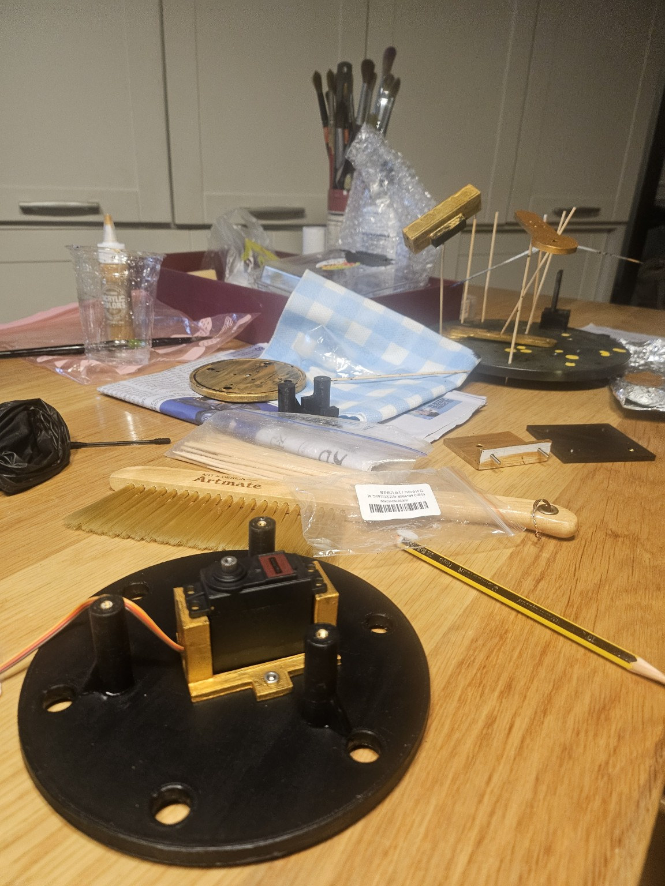
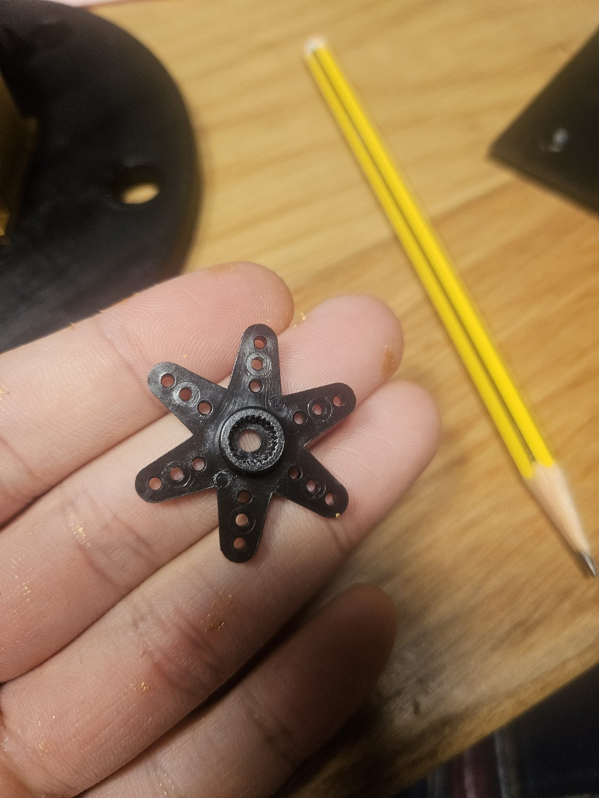
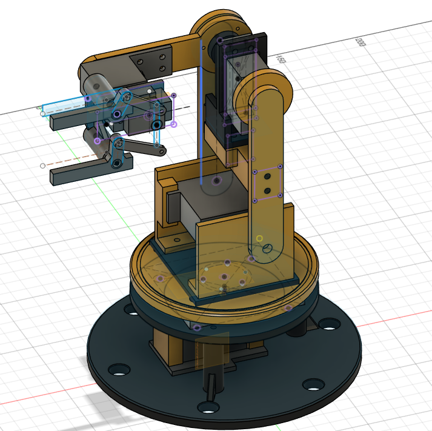

# Design Decisions

VisionPick Arm의 주요 설계 결정, 변경 이유 및 기술적 검토 기록.

**최근 업데이트:** 2026-11-14

> 설계값은 **실측값**, **CAD 적용값**, **검증 전 후보**로 구분한다. 출력물·정적 가조립·전원 구동을 독립적으로 검증한다. 2026-11-02까지의 내용은 해당 날짜의 **역사적 스냅샷**이며 최신 결정은 문서 후반의 11/06~11/14 기록을 우선한다.

---

## 2026-10-22 | 4축 로봇 구조 채택

### 결정

기존 3축 로봇팔을 **4축 + 1축 그리퍼** 구조로 변경.

### 변경 이유

- 손목 회전축 없이 집게의 방향을 독립적으로 제어하기 어려움
- 블록을 수직 방향으로 접근해 파지하기 위한 Wrist Pitch 필요
- 어깨·팔꿈치 자세 변화에 따른 집게 방향 보정 기능 확보

### 관절 구성

| 관절 | 운동 |
|---|---|
| J1 | 베이스 Yaw |
| J2 | 어깨 Pitch |
| J3 | 팔꿈치 Pitch |
| J4 | 손목 Pitch |
| J5 | 그리퍼 개폐 |

서보모터 총 5개 사용.

**설계상의 절충:** 손목 모터 추가로 상위 관절 토크와 제어 복잡도가 증가하지만, 집게 자세 제어 능력을 확보함.

**검증 상태:** Concept CAD에서 관절 구동 확인 완료.

---

## 2026-10-22 | 산업용 오픈 프레임 디자인

### 결정

산업용 미니 로봇팔과 개방형 기계 구조를 결합한 디자인 채택.

### 설계 요구사항

- 오렌지·블랙 색상 조합
- 관절·모터·볼트가 드러나는 오픈 프레임
- PLA+ 3D 프린팅
- 분해·재조립 가능한 볼트 체결
- 링크·모터 브래킷·그리퍼의 모듈화

### 제작 방안

연세대학교 메이커스페이스 3D 프린터 활용. 2026년 기본 흰색 PLA+와 검정·주황 필라멘트 보유를 확인함.

**주의:** 제작용 CAD 및 슬라이싱 결과는 실물 치수·조립 강도 검증을 대신하지 않음.

---

## 2026-10-22 | 비전 인식 및 작업 영역

### 비전 시스템

- DFRobot HUSKYLENS 1 사용
- 내장 Color Recognition 기능 우선 적용
- 빨강: ID1 / 파랑: ID2
- 로봇팔과 분리된 상부 고정 카메라 채택

### 초기 작업 영역

| 항목 | 임시값 |
|---|---:|
| 작업대 | 300 × 300mm |
| 카메라 높이 | 250mm |
| 초기 집기 반경 | 약 140mm |
| 목표 물체 | 30mm 정육면체 |

카메라 높이 20/25/30cm에서 대상이 화면에 들어오는지 확인했으며, 초기 설치 높이는 25cm로 선정.

집기 지점과 배출 지점을 비슷한 수평 반경에 배치하여 베이스 회전 동작을 단순화하는 방향을 우선 검토함.

**남은 검증:** 카메라 좌표 보정, 전체 작업 영역 및 실제 집기 성공률.

---

## 2026-10-23 ~ 10-26 | 기구학 계산 및 Fusion 검증

### 개념 설계 치수

| 항목 | 값 |
|---|---:|
| L1 | 100mm |
| L2 | 80mm |
| 어깨 높이 | 70mm |

위 값은 기구학 검증용 임시 치수임.

### 검증 결과

- FK·IK 수학 계산 완료
- Elbow-up / Elbow-down 해 계산
- 베이스 회전 및 손목 자세 보정식 검토
- Fusion 360에서 FK 목표 `(X=155.885mm, Z=80mm)` 재현
- Fusion 360에서 IK 목표 `(X=100mm, Z=150mm)` 재현

검증 좌표는 **XZ 평면 기준**. 수학적 관절 각도와 Fusion Joint 입력각의 부호 차이를 확인함.

**남은 검증:** 실제 3차원 좌표계, 관절 제한, TCP 오프셋 및 서보 영점 보정.

---

## 2026-10-26 | 관절별 기초 토크 분석

### 결정

수평 자세의 정적 중력 토크를 기본으로 관절별 모터 요구조건 산정.

### 계산 가정

- 대상 블록: 20g
- J3 모터: 55g
- J4 모터: 13.4g(MG90S 적용 후보)
- 그리퍼 조립체: 40g 기본 가정
- 중력가속도: 9.81m/s²
- J2~J4 설계 여유: 2.5배

### 수정 계산 결과 — Hardware R02

| 관절 | 요구 설계 토크 |
|---|---:|
| J2 어깨 | 5.855 kgf·cm |
| J3 팔꿈치 | 2.019 kgf·cm |
| J4 손목 | 0.400 kgf·cm |

그리퍼 질량 변화에 따른 토크 민감도:

| 그리퍼 질량 | J2 | J3 | J4 |
|---|---:|---:|---:|
| 40g | 5.855 | 2.019 | 0.400 |
| 60g | 6.855 | 2.519 | 0.500 |
| 80g | 7.855 | 3.019 | 0.600 |

단위: kgf·cm, 설계 여유 포함.

추가로 J1 점질량 기반 회전 관성 및 가속 토크, J5 손가락당 파지력 목표 0.4905N을 계산함.

**한계:** 최종 CAD 질량과 무게중심, 동적 하중, 실제 마찰, 발열 및 출력 부품 처짐 미반영.

---

## 2026-10-26 ~ 10-27 | 그리퍼 개념 설계

### 결정

SG90 서보모터 1개를 사용하는 **양쪽 링크 연동형 2핑거 집게** 채택.

| 설계 항목 | 임시 치수 |
|---|---:|
| 몸체 너비 | 72mm |
| 몸체 높이 | 18mm |
| 손가락 회전축 간격 | 54mm |
| 손가락 길이 | 40mm |
| 목표 개방 폭 | 45~50mm |

- `Gripper_Concept_v01` 스케치 제작
- 좌우 손가락 회전축 및 개폐각 구상
- SG90 참고 Component 배치
- 그리퍼 전체 질량 60g 이하 목표, 80g 조건까지 하중 검토

**상태:** Concept 설계 단계. 실제 연동 링크·파지력·질량은 아직 검증하지 않음.

---

## 2026-10-27 | 서보모터 선정

| 관절 | 선정 모터 | 최초 상태 |
|---|---|---|
| J1 Base | MG996R 호환 | 주문 |
| J2 Shoulder | FEETECH FT5330M | 주문 |
| J3 Elbow | MG996R 호환 | 주문 |
| J4 Wrist | TowerPro MG90S | 주문 |
| J5 Gripper | SG90 | 보유 |

### 선정 이유

- **J1 MG996R:** 비용을 고려한 베이스 회전 구동 후보. 하중은 별도 턴테이블 베어링으로 지지하는 구조 고려.
- **J2 FT5330M:** 상대적으로 큰 어깨 중력 토크를 고려해 선택.
- **J3 MG996R:** 계산된 팔꿈치 부하를 기준으로 선정한 경제적 후보.
- **J4 MG90S:** 말단 질량 감소를 위한 경량 서보.
- **J5 SG90:** 기존 보유 부품 활용, 파지력 시험 후 최종 적합성 판단.

**남은 검증:** 정확한 제품 모델·전압, 실제 영점·회전 범위, 부하 유지·전류·발열·위치 반복성.

---

## 2026-10-27 | 전원 및 기계 부품 구성

### 전원 아키텍처

- Arduino UNO는 USB로 전원 공급
- 서보모터는 외부 안정화 DC 전원 사용
- Arduino와 서보 전원의 GND 공통 연결
- 6V/5V 분리 전원 구성을 우선 검토

어댑터, 전압 변환 모듈, 분배 단자 및 보호장치는 최종 선정 전.

### 기계 지지 구조

- 베이스 회전부 하중을 지지하는 별도 구조 필요
- 어깨·팔꿈치 양쪽 지지 구조 검토
- 서보 출력축에 굽힘 하중이 집중되지 않도록 설계
- 베어링·축·체결 볼트는 실제 조립 구조에 따라 확정

608ZZ·625ZZ는 당시 후보 규격이며 최종 규격이 아님.

---

## 2026-10-27 | 모듈형 제작 구조

### 결정

향후 제어 소프트웨어와 기계 구조를 개선할 수 있도록 모듈형 CAD 설계 채택.

### 모듈 구성

- Base 모듈
- Shoulder & Arm 모듈
- Elbow 모듈
- Wrist 모듈
- Gripper 모듈

### 설계 기준

- 모터 하우징과 링크를 분리
- 교체 가능한 모터 장착 브래킷
- 분리 가능한 집게 장착 인터페이스
- 볼트 기반 분해·유지보수
- 서보 배선과 나사 체결 공구의 접근성 고려

**남은 검증:** 제작용 CAD에서 각 모듈의 체결 인터페이스 및 실제 장착 치수 확정.

---

## 2026-10-28 ~ 10-31 | J1 고정 베이스 및 사각 턴테이블 베어링 설계

### 결정

J1 회전판과 로봇팔의 주요 축방향·굽힘 하중은 **사각 턴테이블 베어링**으로 지지하고, MG996R과 서보혼은 주로 **회전 토크를 전달**하도록 역할을 분리한다.

### 결정 이유

서보 출력축에 로봇팔 전체의 굽힘 하중이 집중되는 구조를 피하고, 베어링·모터·회전판을 분리해 조립 및 유지보수를 쉽게 하기 위함.

### 베어링 실측

| 항목 | 실측값 |
|---|---:|
| 외형 | 71.82 × 71.82mm |
| 두께 | 7.95mm |
| 중앙 개구부 | Ø35mm |
| 체결홀 지름 | 약 Ø4.14mm |
| 측정한 체결홀 중심 간격 | 57.28mm |

베어링 양쪽 회전판의 홀 배열이 모두 57.28 × 57.28mm 정사각형인지, 볼트 머리 접근성이 충분한지는 추후 확인 필요.

### CAD에 적용한 주요 구조

- `Base_Fixed`: 외경 Ø160mm, 두께 6mm, Ø12mm 경량화 홀 6개.
- 지지 기둥 3개: Ø12mm × 37mm, 리브 보강, M3 인서트 후보홀 Ø4.0 × 7mm.
- `J1_Bearing_Mount_Fixed`: 외경 Ø110mm / 내경 Ø70mm / 두께 5mm, 기둥홀 3개 + 베어링홀 4개.
- `Base_Rotating`: 기존 두께 5mm에서 아랫면을 1.40mm 확장해 **6.40mm**로 변경. 윗면 높이는 유지.
- `Base_Rotating`의 베어링 결합 관통홀: Ø4.5mm × 4개(홀 배열 검증 전).
- J2 바닥판 고정 블라인드 홀: Ø4.0mm × 깊이 4.5mm × 4개. 잔여 두께 1.9mm.

### 설계 변경의 근거

베어링 상단과 회전판 하단의 CAD상 1.40mm 높이 차이를 제거하고, J2 결합면 위치를 유지하기 위해 회전판 아래쪽을 확장했음.

### 남은 검증

베어링 접합면의 실제 볼 레이스 형상, 볼트 머리 간섭, 인서트 규격, 회전판 하중 전달 경로 및 실물 조립 적합성.

**상태:** CAD 구성 완료 항목이 있으나 실물 출력·조립은 아직 수행하지 않음.

---

## 2026-11-01 | J1 MG996R 서보혼 선정 및 회전판 연결부 검토

### 서보혼 비교

| 후보 | 실측·확인 사항 | 판단 |
|---|---|---|
| 원형 | 외경 Ø20.72mm, 출력축에 깊게 결합되는지 불명확 | 보류 |
| 4방향 십자형 | 끝과 끝 36.79mm, MG996R 중앙 나사 체결 정상 | Ø35mm 중앙 개구부와 같은 높이에서 회전 시 간섭 우려 |
| **6방향 별형** | 외경 31.77mm, 중앙 나사 정상 체결 및 독립적인 흔들림 없음 | **J1 연결 구조의 우선 후보로 선정** |

6방향 혼을 채택한 이유는 기존 실물 부품을 재사용하면서 Ø35mm 중앙 개구부에 필요한 회전 외경 여유를 확보할 가능성이 가장 크기 때문임. 구매용 금속 혼은 현재 보류하되, 실제 체결 강도가 부족하면 재검토한다.

### 6방향 서보혼 실측

| 항목 | 값 | 분류 |
|---|---:|---|
| 회전 외경 | 31.77mm | 실측 |
| 모터 평평한 하우징 윗면 → 날개 윗면 | 8.44mm | 실측 |
| 마주 보는 가장 바깥쪽 작은 홀의 중심 간 거리 | 26.53mm | 실측 |
| 작은 홀 지름 | Ø1.49mm | 실측 |
| 날개 두께 | 2.36mm | 실측 |
| 서보혼 외경과 베어링 개구부 간 이상적 반경 여유 | 1.615mm | 계산값 |

Ø26.53mm는 외측 홀 피치원(PCD) 후보 치수이며, 실제 중심과 각도 배치가 동일하다는 가정이 포함됨. 1.615mm 역시 완전 동축이고 개구부 내부에 돌출물이 없다는 가정의 여유값임.

### Fusion에서 수행한 설계

- `J1_Horn6_Reference`에 Ø31.77mm 회전 외경 및 Ø26.53mm 후보 피치원 작성.
- `Base_Rotating` 아랫면에 120° 간격의 체결 위치 3개 투영.
- 외경 Ø32.5mm, 중앙 회피부 Ø10mm, 아래 방향 돌출 1.56mm의 **연결 패드 후보** 생성.
- Ø2.4mm 나사 통과 후보 원 3개 작성. 최종 관통·카운터보어 가공은 아직 수행하지 않음.
- Fusion에서 J2 바닥판 아랫면 ↔ `Base_Rotating` 윗면 간격 **0mm** 확인.

### 구조 판단

베어링 중앙 개구부를 통한 결합을 검토하되, 실제 접촉면과 구동 토크를 전달할 나사 체결력이 검증되기 전에는 연결 패드를 최종 설계로 확정하지 않음. J2 바닥판이 회전판에 밀착되므로, 위에서 삽입하는 연결 나사 머리는 회전판 윗면보다 돌출되면 안 됨.

### 후속 검증 조건

1. 실제 사용 가능한 나사 종류, 나사 머리 지름·높이 및 혼의 Ø1.49mm 홀 적합성 확인.
2. 날개 두께 2.36mm에서 나사 체결 강도 확보 가능 여부 확인. 일반 M2 기계나사가 플라스틱 홀에 스스로 체결된다고 가정하지 않음.
3. 중앙 서보혼 고정나사 접근성 및 분해 순서 확인.
4. J2 결합 블라인드 홀, 베어링 볼트, 나사 머리 매립부 사이의 간섭 검토.
5. 실제 베어링 형상에 따른 전체 회전 범위 간섭 및 조립 후 저속 구동 시험.

**판정:** 6방향 서보혼은 **정적 장착 확인 완료**, J1 연결 패드와 회전판의 최종 체결은 **미검증(WIP)**. `Base_Rotating` 출력 파일은 보류함.

---

## 2026-11-01 | 첫 3D 프린팅 작업 준비

### 결정

2026년 11월 6일(금) 오전 10시 연세대학교 메이커스페이스 i7(송도)에서 **시험 출력부터 시작**한다.

### 준비한 출력 작업

1. J1 MG996R 브래킷 시험편
2. J2 FT5330M 레일 시험편
3. M3 인서트 공차 비교 시험편(Ø3.8 / Ø4.0 / Ø4.2mm)
4. `Base_Fixed`
5. J1 지지 기둥 3개 통합 출력
6. `J1_Bearing_Mount_Fixed`

G-code **6개 작업**, 출력 대상 **8개 부품**, 슬라이싱 예상 **11시간 53분 / 139.22g**. 실제 출력 완료를 의미하지 않음.

### 출력 승인 원칙

- 시험 출력물의 모터 삽입 여유, 볼트 접근, 인서트 적합성 확인
- 확정되지 않은 치수를 가진 부품은 본 출력 대신 시험 출력 우선
- `Base_Rotating`은 J1 결합 구조가 검증되기 전까지 STL·G-code 생성 보류

### 마감 일정 고려

11월 30일까지 자동 Pick & Place 시스템 구현이 목표이므로 J1의 외형 마감보다는 **J3 실제 고정부, J4 손목, J5 그리퍼 및 Arduino 제어** 완성을 우선함.

---

## 2026-11-02 | J1 베어링 재실측과 제작용 CAD 위치 보정

### 변경 이유

10월 말에 베어링 두께를 약 7.95~8.00mm로 반영했으나, 11월 2일 실물 체결 탭의 **장착면 간 높이 8.64mm**를 재확인함. 단순화된 Fusion Reference(8.00mm)보다 **0.64mm 더 두껍기 때문에**, 회전판 위치와 모터-서보혼 연결 패드의 접촉 관계를 재검토함.

### 최종 실측 및 계산

| 항목 | 값 | 분류 |
|---|---:|---|
| 베어링 외형 | 71.82 × 71.82mm | 기존 실측 |
| 베어링 중앙 개구부 | Ø35mm | 기존 실측 |
| **베어링 장착면 사이 높이** | **8.64mm** | 재실측(기존 두께 수치 대체) |
| 상·하판 두께 | 각 0.77mm | 실측 |
| 상·하판 사이 간격 G | 약 7.16mm | 실측(측정 위치에 따라 차이 가능) |
| 상·하판 체결홀 중심 간격 | 각각 57.28mm | 실측 확인 |
| 체결홀 지름 | 약 Ø4.14mm | 실측 |
| 베어링 CAD Reference 높이 | 8.00mm | 기존 CAD 유지 |
| 실제 높이와 CAD Reference 차이 | +0.64mm | 계산값 |

금속판 두께 합계와 간격을 더한 8.70mm는 장착면 사이 실측 8.64mm와 0.06mm 차이가 있음. 서로 다른 위치의 측정값으로 보아 **베어링 내부 유효 체결 공간을 7.16mm로 단정하지 않음**.

### Fusion 설계 변경

- 기존 `J1_Turntable_Reference` Extrude를 직접 수정했을 때 다수의 Sketch/Project 참조 경고가 발생하여 **되돌리기(Ctrl+Z)로 전체 경고를 제거**함. 이후 기존 Reference 형상은 유지.
- `J1_Bearing_ActualTop_8p64` 기준 평면을 만들어 실제 상면 위치를 표시하고, `Base_Rotating` Component를 **위로 0.64mm 배치**함.
- `Base_Rotating` 중앙의 6방향 서보혼 연결 패드를 명목 접촉 조건에 맞게 조정함. CAD의 최종 후보 돌출 높이는 약 **2.20mm**, 본체 두께는 6.40mm로 **v02 STL 전체 높이 8.60mm**를 확인함.
- 상부 J2 바닥판 및 링크 조립체는 함께 이동시키지 않았으므로, **현재 Assembly에 0.64mm CAD 간섭이 남아 있음**. 이는 최종 간섭 검증 통과를 의미하지 않으며 상부 조립체 위치 보정은 추후 진행할 계획.

### 결정과 한계

베어링 Reference를 직접 재작성해 하위 스케치 참조를 손상시키는 대신, **실측 기준 평면 + 회전판 위치 보정** 방식으로 현재 출력용 회전판을 정리함. 출력 파일은 별도로 검증하되, 전체 Assembly 운동 간섭 검사는 상부 위치 보정 후 다시 수행해야 함.

---

## 2026-11-02 | J1 서보혼·베어링 M1.6/M4 체결 구조 및 출력 파일

### 선택한 체결 후보

| 결합부 | CAD 적용 | 상태 |
|---|---|---|
| MG996R ↔ 6방향 혼 | 보유 중앙 나사 체결 | 정적 장착 확인, 구동 전 |
| Base_Rotating ↔ 6방향 혼 | Ø2.0mm 관통홀 3개(120°), Ø3.6mm × 깊이 2.0mm 머리 매립부 3개 | CAD 완료, **M1.6 × 12mm·너트는 미구매/미검증** |
| 중앙 나사 접근 | Ø6mm 관통홀, 패드 내경 Ø10mm 회피 공간 | CAD 완료, 실물 드라이버 접근성 미검증 |
| Base_Rotating ↔ 베어링 상판 | Ø4.5mm 관통홀 4개 + Ø8.2mm × 깊이 2.4mm 머리 매립부 4개 | CAD 완료, M4 볼트·너트 실조립 전 |
| 베어링 하판 ↔ Bearing_Mount_Fixed | Ø4.5mm 관통홀 4개, Ø8.2mm 나사 머리 공간 **구성선만** | 실제 매립 가공 없이 공간 검토 |
| Bearing_Mount_Fixed ↔ 기둥 | 기존 M3 홀 3개 | 변경 없음 |

기존 MG996R 중앙 고정나사(외경 약 Ø2mm, 몸통 길이 10mm)는 6방향 혼의 작은 Ø1.49~1.54mm 날개홀에 강제로 넣어야 할 가능성이 있어 **날개 체결용으로 사용하지 않기로 결정**함. 글루건 접착만으로 토크를 전달하는 방식도 반복 가감속·분해 불가 문제로 채택하지 않음.

### M4 구조 확인 및 주의사항

- 베어링 실물의 **상판·하판 모두 57.28mm 홀 간격**을 측정하여 기존 CAD의 배치 가정을 확인함.
- 하부 베어링 고정 링에서 Ø8.2mm 나사 머리 기준원과 가장 가까운 J1 지지 기둥 외곽 사이 최소 **1.908mm**를 Fusion에서 확인함.
- M4 둥근머리 볼트를 상하 출력판 바깥쪽에서 삽입하고, 베어링 안쪽에 **박형 너트를 넣는 구조는 후보**로 유지. 실물 베어링 판 사이에 공구가 접근할 수 있음은 확인함.
- M4 × 8mm가 하부 5mm 출력 링 + 0.77mm 금속판을 지난 뒤 남기는 이론 돌출은 약 **2.23mm**로, 박형 너트 나사산의 체결 여유가 매우 작음. **최종 체결 강도·회전 간섭은 검증되지 않았고 시험 조립 전 사용 승인 불가**.
- 상·하부 판은 상대 회전하므로, 볼트 끝·너트가 특정 각도에서 서로 닿는지 실물로 전 범위 검사 필요.

### 3D 프린팅 파일 변경

| 버전 | 슬라이싱 상태 | 판단 |
|---|---|---|
| `J1_Base_Rotating_Test_v01` | 이전 CAD 형상, 전체 높이 7.96mm | 구버전 보관, 11/6 출력 대상 제외 |
| `J1_Base_Rotating_Test_v02` | **전체 높이 8.60mm**, 3시간 13분 / 39.86g | **시험 출력용 STL·HFB 준비 완료** |

기존 6개 작업에 v02가 추가되어 **총 HFB 7개 작업 / 출력 대상 실물 9개**. 순차 출력 예상 **15시간 6분 / 179.08g**. 아직 실제 프린팅을 하지 않았음.

### 구매 및 일정 결정

- **구매 완료:** 아트콥터 M3 육각렌치볼트 8mm·10mm, M4 둥근머리 볼트 8mm(시험용 후보).
- **구매 보류:** M3 열압입 인서트, M1.6 볼트·너트, M4 박형 너트. 규격·소량 구매·배송비 문제로 11월 6일 시험 출력 전후에 필요한 것을 묶어 구매할 계획.
- 인서트 권장 홀 지름과 나사 머리 치수는 실제 구입 제품의 도면·출력물 공차로 최종 확인 예정.
- 최종 체결 방식이 달라질 경우 `Base_Rotating` CAD·STL·HFB를 다시 생성해야 할 수 있음.

**판정:** 기구물 제작 후보·슬라이싱 준비는 완료. **실물 볼트 체결, 출력 공차, 베어링 회전 간섭, 모터 토크 전달, J2 상부 전체 Assembly 간섭 검증은 미완료**.

---

## 2026-11-02 당시 미확정 사항 (과거 스냅샷)

- [ ] J1 서보혼 연결 나사 규격과 체결 강도
- [ ] J1 연결 패드 형상·높이·실접촉면 및 회전 간섭
- [x] J1 베어링 상·하판 홀 간격 57.28mm 및 하부 M4 머리-기둥 평면 간격 검토(실측·CAD)
- [ ] M4 볼트·박형 너트의 실제 체결 길이, 공구 접근 및 베어링 전 회전 범위 간섭
- [ ] M3 열압입 인서트 제품 선정 및 실제 삽입 공차
- [x] `Base_Rotating v02` 시험 출력용 STL·HFB 및 M1.6/M4 머리 매립 CAD 준비
- [ ] 출력 후 볼트·너트 규격 적합성 검증 및 최종 제작 형상 확정
- [ ] J3 모터 및 L2 실제 체결 구조
- [ ] J4 Wrist와 J5 연동형 그리퍼 상세 제작용 CAD
- [ ] 전원 어댑터·변환기·보호회로 선정 및 실측 전류 시험
- [ ] 최종 CAD 질량·강도·처짐 및 전체 Assembly 간섭 검증
- [ ] 출력물의 실제 조립성 및 모터 구동 성능 확인

**다음 작업:** 2026-11-06 첫 시험 출력 및 홀·브래킷·베어링 조립성 점검. 이후 체결부품 선정, J2 상부 CAD 간섭 보정, M1.6/M4 전체 회전 범위 체결 검증 진행.

---

## 2026-11-06 ~ 11-09 | 실제 출력·J1/J2 부분 가조립

**관찰:** 11/06 메이커스페이스에서 J1 Base_Fixed, Support Post 3개, 서보 브래킷, 베어링 링 및 Base_Rotating v02 등을 첫 출력했고, 11/09에는 J1/J2 일부 부품의 실제 정적 가조립 사진과 사용자 확인이 있었다.

- J1 MG996R 브래킷/서보와 베어링의 안착은 정적 적합성 시험 단계. **볼트 체결 강도/회전 구동 검증 전**.
- 초기 FT5330M 레일 시험편의 돌출 간섭 이력과 후속 Shoulder SidePlate의 장착 적합성 확인은 서로 다른 부품 결과이므로 혼동하지 않는다.
- 11/02 J1 베어링 높이 8.64mm 보정 과정의 **CAD 0.64mm 상부 간섭**은 최신 실물에서 재검증 전. 초기 기록을 그대로 실물 실패로 단정하지 않는다.

## 2026-11-09 ~ 11-11 | J5 재설계·2D 기구 검증

**결정:** 단일 SG90과 서로 다른 두 Drive Link로 Finger L/R이 반대 방향으로 움직이는 2핑거 기구를 우선 검토한다.

- 이전 J5 Base 시험편에 케이블 출구가 없어서 **10 × 5mm 케이블 슬롯**을 CAD에 추가했다. 이 수정본이 실물 출력 후 최종 통과했는지는 별도 확인해야 한다.
- P1=(0,+17)mm, P2=(0,−17)mm; 혼 O=(27,0)mm. 피벗 34mm 간격의 양 Finger 바를 바깥으로 각 2mm 오프셋하여 **평행 자세 내부 간격 30.00mm**를 Fusion에서 측정했다.
- 권장안 B: A1=(6,27.5), A2=(1,−3)mm, H1/H2=(27,±13.97)mm. 두 Drive Link의 중심간 길이 **24.9812mm / 28.2195mm**는 2D 계산값이다.
- 2D 모델에서 SG90 상대 혼각 −12°는 끝단 간격 약 47.55mm, 0°는 30.00mm, +4°는 약 24.73mm. **실물 혼 절대각/파지력 결과가 아니다**.
- 기둥·피벗 지지부에는 보강 리브를 배치했으나 실제 강성, 적층방향, 볼트 체결, 간섭은 미검증.
- 제작용 STL 후보 5종: Base, Finger Left/Right, Drive Link 1/2. 사용자는 11/12 무렵 주요 출력 완료를 보고했지만 **부품별 전체 체결 성공은 확인되지 않았다**.

참고: [EXP-012 기구학 및 실험](experiments.md#exp-012--2026-11-11-j5-그리퍼-2d-기구학-검증-및-cad-출력-준비).

## 2026-11-13 | 전원 선정과 조달 확정

**변경 이유:** 국내 6V 10~15A 어댑터의 가격·배송 문제로 12V+강압 다단 구성 대신 AliExpress **6V 10A(60W 최대 정격) 안정화 전원**을 주문함. 배송 예정 11/18~23일.

### 11/09 구매 확인

- 14AWG ATO/ATC 일반형 퓨즈홀더 1개
- **WAGO 221-415 5폴 4개** (기존 문서의 '1개' 또는 '수량 재확인' 기재는 정정)
- 14AWG 2P 실리콘 전선 1m
- M3×8/12/15/10mm 등 보유/주문 체결품의 시점별 기록을 구분해 관리
- M3 평와셔/너트/압착 단자/열수축 튜브 등

### 11/13 신규 주문 확인 (대부분 11/18~23 배송 예정)

| 품목 | 주문된 옵션 | 아직 필요한 검증 |
|---|---|---|
| 안정화 어댑터 | 6V 10A, EU AC 코드, 판매자 DC 5.5×2.5mm 기재 | 실제 전압·극성·연속출력, DC 플러그 정격 |
| 멀티미터 | ANENG SZ308 | 저전압 전압/연속성 점검, 정확도 |
| 일반형 퓨즈 | ATO/ATC 10A ×10 | 실제 부하·회로 보호 규격 |
| 로커 스위치 | 판매자 12V DC 20A 표기 2핀 ×5 | 단자·동봉 전선·접점의 실제 DC 정격 |
| DC 암케이블 | 5.5×2.5mm Female 16AWG ×2 | **내부 접점 10A 연속정격 미확인** |
| 콘덴서 | 16V 2200µF ×10 | +/− 극성·납땜/고정과 부하 시험 |
| 전원 모듈 | 5V 3A RC 전원 모듈 ×1 | 입력 DC 6V에서 안정화 5V 출력 가능 여부 |
| 나사 세트 | M2/M3 포함 400pcs, 별도 120pcs | 개별 길이·피치/실물 체결 |
| 정밀 공구 | 32비트 드라이버 | 팁 맞음/과도한 체결 방지 |

점퍼선(수-수/수-암)과 3핀 서보 연장선은 **이미 집에 보유**하여 추가 구매 목록에서 제외. J5 혼 체결에는 M1.4 태핑 나사를 새로 사지 않고 M2 사용을 시도하기로 했으나 **SG90 혼 구멍 파손 없이 체결 가능한지는 미확정**.

**전기 결정의 한계:** 어댑터가 10A라 해도 배럴 커넥터 접점이 10A를 보장하지 않는다. 제품 정격이 불명확하면 저전류 개별 테스트에만 제한하거나 정격이 명확한 연결부로 설계를 변경해야 한다. XT60을 저정격 배럴 뒤에 추가해도 기존 배럴 한계는 해결되지 않는다.

## 2026-11-14 | J1 실물 도색·부분 조립 및 체결 계획 업데이트

### 1. 사진으로 직접 관찰한 사실

- 검정색 `Base_Fixed`(Ø160) 위에 금색 `J1_Servo_Mount_Fixed`와 MG996R, 검은 지지 기둥 3개를 실제로 배치했다.
- 근접 사진에 브래킷 고정 볼트가 보이고 기둥 윗면에 황동색의 나사산 부품이 보인다. **모든 볼트의 규정 토크·인서트 6개 장착/인발 강도는 확인되지 않음**.
- 별도 사진에서 금색 `Base_Rotating`과 검은 지지 기둥의 도색·건조 작업을 확인했다. 도장층 두께로 생기는 홀 공차·접촉면 변화 검증 전.
- `Base_Fixed`의 **브래킷용 2개** 및 **지지 기둥용 3개** 볼트 머리 매립홈이 서로 반대쪽 면으로 가공되어 있다고 사용자가 보고했다. 어느 방향으로 배치하느냐에 따라 아래쪽 나사 머리가 일부 돌출되는 문제가 있다.

### 2. 실물 사용을 우선한 기계적 결정

- 원판 전체를 곧바로 재출력하지 않는다. **브래킷 2개 체결홀을 매립하고, 지지 기둥 3개 쪽 볼트 머리 돌출을 받침발로 회피하는 방향** 등을 가조립 대안으로 검토한다. 다만 현재 방향을 완성 검증으로 기록하지 않는다.
- 기둥 위/아래 M3 열압입 인서트 **최대 6개 계획**. 기둥 홀 CAD 후보 Ø4.0×깊이7mm는 제품별 설치 권장홀에 맞춰 시험편 확인 후 열압입한다. 위쪽 황동색 부품이 사진에 보인다고 하단까지 전부 장착한 것으로 단정하지 않는다.
- 하부 받침발 높이는 실제 최대 볼트 머리 돌출 + 압축 여유보다 커야 하고, 받침점 3개가 만들어내는 지지 다각형 안에 작업 자세별 투영 무게중심이 들어야 한다. 실제 높이를 재기 전 5mm 등을 최종값으로 지정하지 않는다.
- J1 베어링은 별도로 상·하판 M4 체결 후 **전 회전범위 간섭**을 검토한다. 서보혼 및 축 중심에서 발생하는 굽힘 하중을 MG996R 출력축 단독으로 지지하도록 만들지 않는다.

### 3. Base_Rotating ↔ J1 6방향 혼

- 기존 CAD에 혼 작은 홀 3개와 회전판 연결을 위해 **M1.6×12mm + M1.6 너트 3세트 후보**가 있다. 작은 혼홀 실측 Ø1.49mm로 볼트가 통과하지 않을 수 있어 장착 전 실물 확인이 필수.
- 혼 날개는 모터 축에 중앙 전용 나사로 고정하고, 회전판과 혼은 별도 볼트 체결하여 토크를 전달해야 한다. 접착만으로 토크 전달 성공이라고 판단하지 않는다.
- 서보혼·볼트머리·너트·베어링·J2 바닥판의 충돌 가능성을 시험 조립 전 검토해야 한다.

### 4. J2 반대편 수동 회전 피벗

- FT5330M 한쪽 모터가 L1 링크를 구동하고, **반대편은 같은 회전축의 종동측 지지**가 목적이다.
- 기존 625ZZ 베어링은 구매 확정 부품이 아니라 초기 후보. **M3 볼트 + 와셔/스페이서 + 나일론 풀림방지 너트**는 간단한 시제품 조립 후보이다.
- M3×16mm는 최종 확정 규격이 아님. 측판·링크 두께와 실제 홀 직경을 재서 선정하며, 너트를 과도하게 조여 움직이는 링크를 압착하지 않는다. 나사산 직접 접촉에 의한 PLA 마모 가능성을 확인한다.

### 미검증 사항과 후속 판단

1. 베이스 바닥에서 볼트 머리 최대 돌출량 및 받침 수평·전도 가능성 측정.
2. 지지 기둥의 위·아래 M3 인서트 모두의 설치 상태/깊이/인발 강도 검증.
3. J1 회전판 ↔ 혼의 3홀 중심 정렬 및 M1.6 실물 체결.
4. J1 베어링 M4 체결 후 자유회전·간섭 및 하중 전달 확인.
5. J2 종동측 피벗 공차 및 서보축 동축 확인, 전 범위 수동 이동.
6. 도색의 건조 상태, 서보/회전 접촉면 간섭, 가동 중 도료 박리 확인.
7. J5 SG90 혼 M2 연결과 Finger L/R 실제 개폐·파지 시험.

**프로젝트 관리 결정:** 11/30 마감 이전에는 새 기능을 추가하기보다 체결→개별 구동→고정좌표 Pick & Place→비전 좌표 통합 순서로 검증한다.
