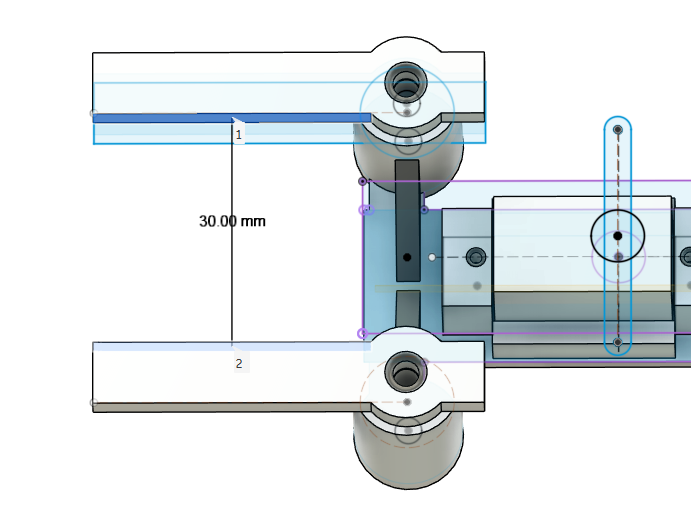
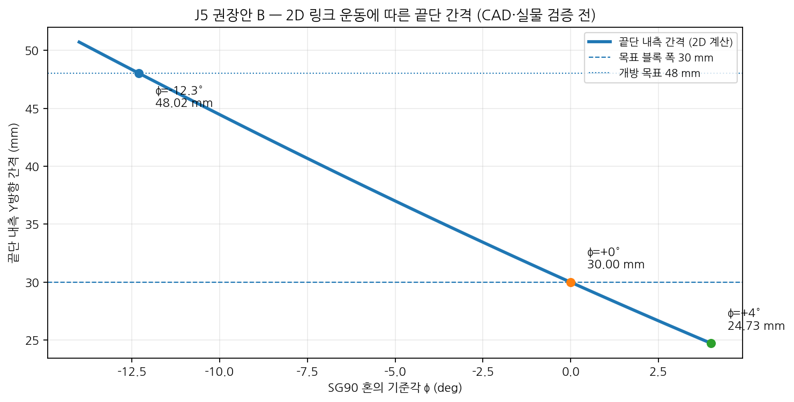
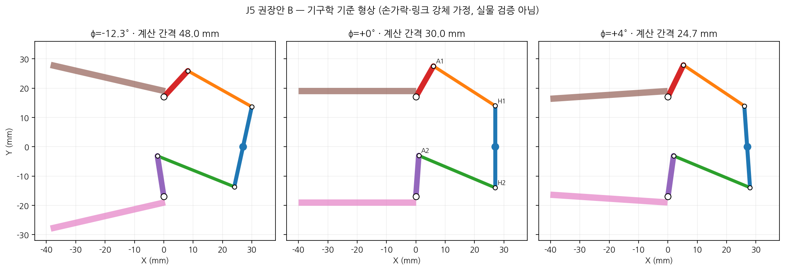
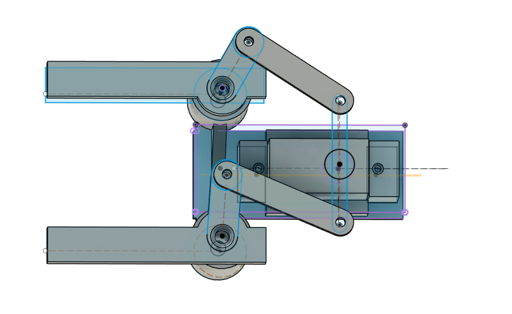
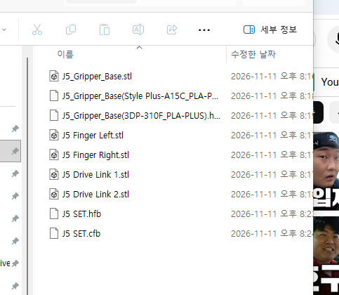

# Experiments

VisionPick Arm의 실험 조건, 계산 결과, 제작용 CAD 확인 및 실제 하드웨어 검증 기록.

- **프로젝트:** VisionPick Arm (4축 로봇팔 + 1축 그리퍼)
- **최근 업데이트:** 2026-11-11

> **기록 원칙:** 수학적 계산, Fusion CAD 확인, 실물 치수 측정, 정적 안착 확인, 실제 모터 구동 및 반복 실험을 구분하여 기록한다. **10/22~11/02 항목의 '예정/미출력' 표현은 당시 상태를 보존한 역사적 기록**이며, 최신 결과는 EXP-009~011을 참조한다.

---

## EXP-001 | HUSKYLENS 색상 인식

**일자:** 2026-10-22  
**상태:** 초기 인식 시험 완료

### 목적

빨강·파랑 블록 인식 및 Arduino 좌표 수신 검증.

### 실험 환경

- HUSKYLENS 1
- Arduino UNO(I2C)
- 30 × 30 × 30mm 실험용 블록
- 카메라 높이: 20 / 25 / 30cm

### 결과

- 빨강 ID1 인식 성공
- 파랑 ID2 인식 성공
- 두 블록 동시 인식 성공
- Arduino C++ 목표 ID 필터링 구현 및 동작 확인
- 25cm 높이를 초기 설치 기준으로 선정

### 한계

- 조명 변화에 따른 정량적 인식률 미측정
- 픽셀 좌표의 실제 거리 변환 미구현

---

## EXP-002 | 4축 Concept CAD 동작 시험

**일자:** 2026-10-22  
**상태:** 개념 설계 단계 동작 확인 완료

### 목적

Fusion 360에서 4축 로봇팔의 관절 동작 및 블록 접근 가능성 확인.

### 조건

- L1: 100mm
- L2: 80mm
- 어깨 높이: 70mm
- 대상: 30mm 정육면체
- 도구: Fusion 360

### 결과

- Base / Shoulder / Elbow / Wrist 관절 구동 성공
- Revolute 및 Rigid Joint 연결 확인
- 30mm 블록에 대한 집게 접근 자세 구현
- 손목 회전을 통한 집게 기울기 조절 확인
- 기존 3축 구조에 손목 Pitch 축 추가

### 한계

- 일부 목표 위치에서 자세 제약 확인
- 전체 작업 가능 범위의 정량적 검증 미완료
- 모터·베어링·실제 하중 미반영
- 제작용 CAD가 아닌 Concept CAD

---

## EXP-003 | 순기구학·역기구학 계산

**일자:** 2026-10-23  
**상태:** 수학적 계산 검증 완료

### 목적

4축 로봇팔의 FK·IK 및 손목 자세 제어 원리 검증.

### 조건

- L1: 100mm / L2: 80mm
- 어깨 높이: 70mm
- Base / Shoulder / Elbow / Wrist 구성
- 종이 계산 및 계산기 사용

### 결과

- 2링크 평면 FK 계산 완료
- 코사인 법칙 기반 IK 계산 완료
- Elbow-up / Elbow-down 두 가지 해 계산
- 베이스 회전각 및 수평 반경 계산
- 손목 자세 보정각 계산
- TCP 오프셋을 고려한 손목 목표 좌표 계산 연습

### 핵심 확인 내용

FK는 관절각으로 끝점 좌표를 계산하며, IK는 목표 위치에서 관절각을 계산함. 동일 목표 위치에 복수의 IK 해가 존재할 수 있음.

### 한계

- 모터 회전 제한 미반영
- 실제 영점·회전 방향 보정 전
- Arduino C++ FK·IK 함수 구현 전

---

## EXP-004 | Fusion 360 FK·IK 검증

**일자:** 2026-10-26  
**상태:** XZ 평면 좌표 검증 완료

### 목적

수학적 FK·IK 계산 결과와 Fusion 360 관절 구동 결과 비교.

### 조건

- Fusion 파일: `VisionPick_Concept_v01`
- L1: 100mm / L2: 80mm
- 어깨 높이: 70mm
- Revolute Joint 기반 구동

### 시험 1 — 순기구학(FK)

수학적 입력: Shoulder +30°, Elbow -60°.

| 좌표 | 계산값 | Fusion |
|---|---:|---:|
| X | 155.885mm | 155.885mm |
| Z | 80mm | 80mm |

**결과:** XZ 평면 좌표 일치.

Fusion에서 자세를 재현할 때 Shoulder Joint 입력은 -30°였음. 수학적 각도와 CAD Joint 입력 부호 차이 확인.

### 시험 2 — 역기구학(IK)

목표 손목 좌표: X = 100mm, Z = 150mm.

계산된 관절 자세를 Fusion에 적용하여 목표 XZ 좌표 도달 확인.

### 한계

- J2의 Y 좌표 0mm, J4의 Y 좌표 -8mm로 측면 오프셋 존재
- 평면 좌표 검증이며 완전한 3차원 정확도 검증은 아님
- 실제 서보 영점·백래시·동작 오차 미반영

---

## EXP-005 | 관절 토크 1차 계산

**일자:** 2026-10-26  
**상태:** 예비 계산 완료

### 목적

J1~J5 실제 모터 선정을 위한 기본 하중 및 토크 분석.

### 초기 가정

- L1: 100mm / L2: 80mm
- 대상 블록: 20g
- J3 모터: 55g
- J4 모터: 30g(초기 가정)
- 그리퍼 조립체: 40g(초기 가정)
- 중력가속도: 9.81m/s²
- J2~J4 설계 여유: 2.5배
- 링크를 수평으로 펼친 정적 하중 조건

### 초기 계산 결과

| 관절 | 분석 항목 | 계산 결과 |
|---|---|---:|
| J1 베이스 | 회전 관성 및 가속 토크 | 0.008868 N·m |
| J2 어깨 | 중력 토크 × 2.5 | 6.602 kgf·cm |
| J3 팔꿈치 | 중력 토크 × 2.5 | 2.351 kgf·cm |
| J4 손목 | 중력 토크 × 2.5 | 0.400 kgf·cm |
| J5 그리퍼 | 손가락당 수직 파지력 | 0.4905 N |

J1 가정: 점질량 근사, 총 관성모멘트 0.004434kg·m², 각가속도 2rad/s².

J5 가정: 블록 20g, 마찰계수 0.4, 안전율 2.

### Hardware R02 — 수정 토크 계산

J4 모터를 MG90S 13.4g으로 변경하고 J3 모터 55g 유지.

| 관절 | 수정 설계 토크 |
|---|---:|
| J2 어깨 | 5.855 kgf·cm |
| J3 팔꿈치 | 2.019 kgf·cm |
| J4 손목 | 0.400 kgf·cm |

그리퍼 질량 증가에 따른 검토:

| 그리퍼 질량 | J2 | J3 | J4 |
|---|---:|---:|---:|
| 40g | 5.855 | 2.019 | 0.400 |
| 60g | 6.855 | 2.519 | 0.500 |
| 80g | 7.855 | 3.019 | 0.600 |

단위: kgf·cm, 설계 여유 2.5배 포함.

### 한계

- 실제 CAD 질량 및 무게중심 미반영
- J1 베이스 자체 관성과 마찰 미반영
- 동적 하중 및 모터 발열 미검증
- PLA+ 부품 강도·처짐 미검증
- J5 실제 기구비·마찰 미검증

---

## EXP-006 | 그리퍼 Concept 설계

**일자:** 2026-10-26 ~ 2026-10-27  
**상태:** 예비 형상 설계 완료

### 목적

30mm 블록을 파지하기 위한 양쪽 연동형 집게 기본 형상과 SG90 배치 검토.

### 조건

- Fusion 파일: `Gripper_Concept_v01`
- 구동 모터: SG90(보유)
- 형식: 대칭형 2핑거
- 대상: 30mm 정육면체

### 개념 치수

| 항목 | 값 |
|---|---:|
| 몸체 너비 | 72mm |
| 몸체 높이 | 18mm |
| 손가락 회전축 간격 | 54mm |
| 손가락 길이 | 40mm |
| 초기 닫힘각 | 약 12° |
| 회전축 Reference 지름 | Ø4mm |

### 결과

- 좌우 손가락 회전축과 기준선 스케치 완료
- 개폐 자세를 위한 초기 각도 스케치 완료
- SG90 참고 Component 모델링
- SG90 중앙 배치와 측면 위치 확인
- `Gripper_Concept_v01` 저장

### 예비 질량 예산

| 부품 | 예상 질량 |
|---|---:|
| SG90 | 9g |
| 몸체와 손가락 | 25g |
| 연동 링크 | 10g |
| 체결부품 및 패드 | 8g |
| **합계** | **52g** |

목표 질량 60g 이하, 하중 검토 상한 80g.

### 한계

- 실제 측정 질량이 아닌 설계 예산
- 서보혼·연동 링크의 상세 기구 미완성
- 동시 개폐 및 파지력 미검증
- 출력 공차·마찰·유격 미검증

---

## EXP-007 | J1·J2 실물 치수 및 서보혼 정적 장착 확인

**일자:** 2026-10-28 ~ 2026-11-01  
**상태:** 일부 실측 및 정적 장착 확인 완료 / 구동 시험 전

### 목적

제작용 CAD 설계에 필요한 실제 모터·서보혼·베어링 치수를 수집하고, 설계 후보 간 간섭 가능성을 평가한다.

### 실측 데이터

| 대상 | 측정 부위 | 실측값 |
|---|---|---:|
| J1 사각 베어링 | 외형 | 71.82 × 71.82mm |
| J1 사각 베어링 | 두께 | 7.95mm |
| J1 사각 베어링 | 중앙 개구부 | Ø35mm |
| J1 사각 베어링 | 체결홀 지름·측정 중심 간격 | 약 Ø4.14mm / 57.28mm |
| MG996R 원형 서보혼 | 외경 | 20.72mm |
| MG996R 십자형 서보혼 | 끝과 끝 전체 길이 | 36.79mm |
| MG996R 6방향 서보혼 | 끝과 끝 회전 외경 | 31.77mm |
| MG996R 6방향 서보혼 | 모터 하우징 윗면 → 날개 윗면 | 8.44mm |
| MG996R 6방향 서보혼 | 반대 날개 바깥쪽 홀 중심 간격 | 26.53mm |
| MG996R 6방향 서보혼 | 작은 체결홀 지름 | Ø1.49mm |
| MG996R 6방향 서보혼 | 날개 두께 | 2.36mm |
| J2 FT5330M | 본체 길이 × 폭 | 39.98 × 20.09mm |
| J2 FT5330M | 본체 기본 높이 / 돌출 포함 | 39.60 / 42.20mm |
| J2 FT5330M | 장착 귀 포함 전체 길이 | 55.26mm |
| J2 FT5330M | 장착 귀 홀 지름 | 약 Ø4.46mm |
| J2 FT5330M | 체결홀 중심 간격 | 약 48.13 × 10.06mm |
| J2 FT5330M | 스플라인 / 금속 혼 허브 외경 | Ø5.87 / Ø14.93mm |

### MG996R 서보혼 비교 결과

- **원형(Ø20.72mm):** 출력축에 일부 끼워졌지만 정상 결합 깊이와 고정 상태를 확인하기 어려워 보류.
- **십자형(36.79mm):** 중앙 고정나사가 정상 체결되고 출력축 대비 흔들림 없음. 다만 베어링 Ø35mm 개구부보다 큼.
- **6방향(31.77mm):** 출력축과 중앙 나사가 정상 체결되고 가벼운 정적 흔들림 확인에서 독립 유격 없음. J1 연결부 설계의 우선 후보로 채택.

6방향 혼과 베어링 중앙이 이상적으로 동축이고 베어링 내부에 추가 돌출이 없다는 조건에서 계산한 반경 방향 여유는:

**반경 여유 = (35.00 - 31.77) / 2 = 1.615mm**

Fusion에서 모터의 평평한 하우징 윗면과 베어링 아랫면 사이 거리는 **2.00mm**. 실측 서보혼 날개 윗면 높이 8.44mm를 적용하면 혼이 베어링 높이 영역으로 진입하므로 **실제 베어링 내부 형상 검증이 필요함**.

### 판정 및 한계

- 서보혼의 **정적 장착은 확인**했지만 회전 토크, 반복 구동, 충격 하중에 대한 체결 강도는 확인하지 않음.
- 베어링 양쪽 판의 홀 배열과 내부 볼 레이스 형상은 단순화 Reference에 정확히 반영되지 않았음.
- 모터 전원 연결·동작 범위·전류·발열 시험은 진행하지 않음.

---

## EXP-008 | J1·J2 제작용 CAD 및 3D 프린팅 준비

**일자:** 2026-10-28 ~ 2026-11-01  
**상태:** CAD·슬라이싱 작업 완료 항목 보유 / 실제 출력·조립 전

### 목적

실측 치수를 Fusion 제작용 Assembly에 반영하고, 시험 출력에 필요한 모델과 G-code를 준비한다. 현재 단계에서 설계 후보와 물리적 검증 완료 항목을 명확히 구분한다.

### 주요 CAD 결과

| 부품·설계 | 적용 내용 | 현재 상태 |
|---|---|---|
| `Base_Fixed` | Ø160 × 6mm, 경량화 홀 Ø12 × 6 | CAD 및 G-code 준비 |
| J1 지지 기둥 3개 | Ø12 × 37mm, 리브, 인서트 후보 Ø4.0 × 깊이 7mm | CAD 및 G-code 준비 |
| J1 MG996R 브래킷 | 모터 삽입 슬롯, 고정 탭, 케이블 노치 | 시험 출력 파일 준비 |
| `J1_Bearing_Mount_Fixed` | 외경 Ø110 / 내경 Ø70 / 두께 5mm, 총 7개 홀 | CAD 및 G-code 준비 |
| `Base_Rotating` | 외경 Ø110 / 두께 6.40mm | CAD WIP, 출력 보류 |
| `Base_Rotating` 베어링 체결홀 | Ø4.5 관통홀 × 4 | CAD 형상 있음, 실물 맞춤 전 |
| `Base_Rotating` J2 결합홀 | Ø4.0 × 깊이 4.5mm 블라인드 홀 × 4 | 인서트 규격 미확정 |
| J2 FT5330M 레일 | 모터 장착 후보 형상 | 시험 출력 파일 준비 |

`Base_Rotating` 두께는 기존 5mm에서 아랫면을 1.40mm 확장한 **6.40mm**로 변경했고 윗면 위치는 유지했다.

### STEP 43-F — 서보혼 연결 구조 설계 경과

1. MG996R에 장착 가능한 6방향 혼의 회전 외경 **Ø31.77mm**를 Fusion Sketch Reference로 작성.
2. 바깥 체결홀 중심 간격 **26.53mm**를 피치원 후보로 반영하고, 6개 작은 홀 위치 표시.
3. 120° 간격의 체결 위치 3개를 `Base_Rotating` 아랫면 Sketch에 투영.
4. 회전판 아랫면에 **Ø32.5mm 외경 / Ø10mm 중앙 회피 구멍 / 1.56mm 돌출** 연결 패드 후보 생성.
5. 체결용 **Ø2.4mm 후보 원 3개** 작성. 관통 가공과 나사 머리 매립 가공은 아직 확정하지 않음.
6. J2 바닥판 아랫면과 `Base_Rotating` 윗면 사이 간격이 **0mm**임을 Fusion에서 확인.

**설계 판단:** 나사 머리가 회전판 윗면보다 돌출되면 J2 바닥판과 간섭할 수 있으므로, 실제 나사 규격에 따른 매립 깊이와 다른 체결홀 사이 잔여 두께를 재검토해야 함.

### 준비한 G-code 작업

| 작업 | 슬라이싱 예상 시간 | 예상 재료 |
|---|---:|---:|
| `J1_MG996R_Bracket_Test_v01` | 1시간 23분 | 12.66g |
| `J2_FT5330M_Rail_Test_v01` | 1시간 30분 | 15.22g |
| `M3_Insert_Tolerance_Test_v01` | 27분 | 4.35g |
| `Base_Fixed` | 5시간 22분 | 73.60g |
| J1 지지 기둥 3개 통합 작업 | 1시간 19분 | 11.33g |
| `J1_Bearing_Mount_Fixed_v01` | 1시간 52분 | 22.06g |
| **합계(순차 출력 가정)** | **11시간 53분** | **139.22g** |

**G-code 6개 작업 / 대상 부품 8개.** 슬라이서 예측치이며 실측 출력 시간이나 실제 무게가 아님.

### 제작 일정

- **첫 출력 예약:** 2026-11-06(금) 오전 10시
- **장소:** 연세대학교 메이커스페이스 i7, 송도
- **슬라이서:** Cubicreator4
- **주요 장비:** Cubicon Single Plus 3DP-310F
- **기본 설정:** PLA-PLUS, 0.2mm 레이어, 노즐 220°C, 베드 65°C(부품별 설정 재확인)

11월 1일 기준으로 **실제 출력한 부품은 없음**. 2대 동시 사용 가능 여부도 아직 확정되지 않음.

### 첫 출력 후 검증 항목

1. 기둥 3개가 G-code에 모두 포함되어 있는지 및 출력 방향·Brim 점검.
2. MG996R 브래킷과 FT5330M 레일의 삽입·고정 여유 확인.
3. M3 인서트 제품 권장 치수와 Ø3.8 / Ø4.0 / Ø4.2mm 시험편 결과 비교.
4. 사각 턴테이블 베어링 홀 배열, 볼트·와셔·나사 머리 접근 공간 확인.
5. 실제 서보혼 체결나사·매립·조립 순서 및 회전 간섭 검증 후 `Base_Rotating` 출력 승인.

### 한계

- 아직 PLA+ 출력물의 수축·공차·강도 검증을 수행하지 않음.
- 베어링 Reference의 내부 레이스와 볼트 간섭은 단순화 모델로는 최종 판단할 수 없음.
- `Base_Rotating`의 1.56mm 연결 패드는 **임시 CAD 형상**이며, 혼 날개와 실제 접촉하는지 검증되지 않음.
- 출력 전 구조 검증과 출력 후 실물 조립 검증은 별도로 수행해야 함.

---

## EXP-008 추가 기록 | 2026-11-02 J1 베어링 재실측 및 회전판 v02 검증

**일자:** 2026-11-02  
**상태:** 실물 치수 측정·CAD 배치 검토·슬라이싱 완료 / 3D 출력·실제 볼트 조립 미실시

### 1. 베어링 실물 재측정

| 측정 대상 | 값 | 결과 유형 |
|---|---:|---|
| 베어링 외형 | 71.82 × 71.82mm | 이전 실측 |
| 중앙 개구부 | Ø35mm | 이전 실측 |
| 장착면 사이 높이 | **8.64mm** | 11/2 재실측, 이전 7.95~8.00mm 값을 정정 |
| 상부 금속판 두께 | 0.77mm | 실측 |
| 하부 금속판 두께 | 0.77mm | 실측 |
| 두 판 사이 간격 G | 약 7.16mm | 실측(특정 위치) |
| 상판 체결홀 중심 간격 | 57.28mm | 실측 |
| 하판 체결홀 중심 간격 | 57.28mm | 실측 |
| M4 체결홀 지름 | 약 Ø4.14mm | 실측 |

판 두께 두 개와 간격 G의 합은 8.70mm로 전체 8.64mm와 0.06mm 차이가 있음. 측정 위치·형상 차이 때문에 하나의 정밀 단면으로 환산하지 않음. Ø4.14mm 관통홀은 M4 공칭 지름 4.0mm에 대해 여유가 작으므로 실제 볼트 삽입성을 확인해야 함.

### 2. Fusion 참조 복구와 위치 보정

- 기존 `J1_Turntable_Reference`의 두께 피처를 직접 바꿨을 때 `The sketch plane is lost`, `The project source is lost` 등의 참조 경고가 다수 발생.
- 변경을 되돌려 경고를 **0개로 복구**하고, 기존 베어링 Reference **8.00mm** 유지.
- 실제 높이 8.64mm를 나타내는 상면 기준 평면 생성, `Base_Rotating` Component를 위로 **0.64mm** 이동해 실측 상면과의 높이 차이를 **0mm**로 맞춤.
- 6방향 서보혼 윗면과 중앙 연결 패드 아랫면의 간격을 **0mm**로 확인. 연결 패드 돌출 높이 후보 **2.20mm**, 본체 두께 **6.40mm**를 반영한 STL 전체 높이는 **8.60mm**.
- J2 바닥판과 `Base_Rotating` 사이에는 **0.64mm CAD 간섭이 남음**. 상부 조립체 이동은 수행하지 않았으며 Fusion 전체 조립 간섭 검증은 통과 처리하지 않음.

### 3. M1.6·M4 체결부 CAD 확인

| 부위 | CAD 검토 결과 | 남은 위험 |
|---|---|---|
| MG996R 중앙 서보혼 나사 | `Base_Rotating` 중심 Ø6mm 드라이버 접근홀 관통 | 실제 드라이버·나사 접근 시험 전 |
| 6방향 혼의 외측 날개 3개 | Ø2.0mm 관통홀 ×3, Ø3.6mm × 깊이 2.0mm 머리 매립 ×3 | M1.6 볼트·너트 미구매, 날개 Ø1.49~1.54mm 홀 가공·체결 시험 전 |
| 베어링 상판 연결 | Ø4.5mm 관통홀 ×4, Ø8.2mm × 깊이 2.4mm 매립 ×4 | M4 둥근머리 볼트·박형 너트 실조립 전 |
| 하부 베어링 고정 링 | M4 체결홀 Ø4.5mm ×4 유지, Ø8.2mm 기준원 구성선만 생성 | 하부 링은 매립 가공하지 않음 |
| M4 머리 ↔ 지지 기둥 | Fusion 기준 최소 **1.908mm** 여유 측정 | 실제 머리 치수·와셔 및 도구 접근 미검증 |
| 베어링 ↔ 연결 패드 | 단순 Reference 기준 Fusion 간섭 없음 | 실물 볼 레이스·회전 상태 검증 전 |

M4 × 8mm 볼트의 하부 관통 후 명목 돌출은 **8.00 - 5.00 - 0.77 = 2.23mm**(고정 링 5mm, 베어링 판 0.77mm 가정). 두께 약 2.2mm 박형 너트로 조이면 체결 여유가 매우 짧으므로 **최종 조립 승인 전**. 중앙 나사와 날개 연결 나사는 기능이 다르며, 기존 중앙 고정나사를 작은 날개홀에 강제 삽입하는 방식은 사용하지 않기로 함.

### 4. Base_Rotating v02 슬라이싱 결과

| 항목 | `v02` 결과 |
|---|---|
| 출력 Body | `Base_Rotating` 1개, Ref 제외 |
| STL 외형 | 약 Ø110 × **8.60mm** |
| 출력 방향 | 넓은 회전판 면을 베드에, 중앙 연결 패드는 위쪽 |
| 프린터 | Cubicon Single Plus 3DP-310F |
| 소재/설정 | PLA-PLUS / 220°C 노즐, 65°C 베드 / 0.2mm 레이어 / 벽 1.2mm |
| 서포트/베드 부착 | Support None / Brim |
| 예상 출력 시간 | **3시간 13분** |
| 예상 소재 | **39.86g** |
| 저장 상태 | STL 및 프린터용 **HFB** 파일 준비 완료(사용자 확인) |

구버전 `J1_Base_Rotating_Test_v01`은 보관하고 11월 6일 출력 후보에서는 제외. G-code로 불리지만 실제 Cubicreator4 출력 파일 확장자는 **`.hfb`**임. 실제 출력 및 물리적 치수 검증은 아직 없음.

### 5. 11월 6일 출력 작업 — 수정된 최종 준비 현황

| HFB 작업 | 대상 실물 수 | 슬라이서 예상 시간 | 예상 재료 |
|---|---:|---:|---:|
| J1 MG996R 브래킷 시험편 | 1 | 1시간 23분 | 12.66g |
| J2 FT5330M 레일 시험편 | 1 | 1시간 30분 | 15.22g |
| M3 인서트 공차 시험편 | 1 | 27분 | 4.35g |
| Base_Fixed | 1 | 5시간 22분 | 73.60g |
| J1 지지 기둥 통합 출력 | 3 | 1시간 19분 | 11.33g |
| J1 베어링 고정 링 | 1 | 1시간 52분 | 22.06g |
| **Base_Rotating v02 (시험 후보)** | 1 | **3시간 13분** | **39.86g** |
| **합계** | **9개** | **15시간 6분** | **179.08g** |

- HFB **7개 작업**, 실물 대상 **9개**. 시험편의 홀 유지와 기둥 3개 포함 여부는 파일 미리보기로 확인.
- 출력 예정: **2026-11-06(금) 오전 10시**, 연세대학교 메이커스페이스 i7(송도).
- 프린터 2대 동시 사용·장시간 무인 출력·익일 수령은 현장 확인 필요.
- 11월 2일까지 실제 3D 출력은 **0개**. 슬라이서의 시간·재료 예측은 실제 출력 실적이 아님.

### 6. 조달 상태와 후속 검증

- **구매 완료:** 아트콥터 M3 육각렌치볼트 8·10mm 및 M4 둥근머리 볼트 8mm(시험용 후보).
- **구매 보류:** M3 열압입 인서트, M1.6 × 12mm 볼트/너트, M4 박형 너트. 소량 규격·배송비와 실물 적합성 문제로 11월 6일 첫 출력 전후 재검토하기로 함.
- 출력 후에는 J1/J2 브래킷 삽입 공차, J1 기둥 Ø4.0mm 인서트 홀, 회전판 M1.6/M4 매립부 치수, 중앙 드라이버 접근, 베어링 전 회전 범위의 충돌 및 실제 체결 강도를 각각 평가할 계획.

**최종 판정:** `Base_Rotating v02`는 **시험 출력 파일 준비 완료**. 실제 체결구조와 전체 Assembly 동작을 검증한 완성 설계로 간주하지 않음.

---

---

## EXP-009 | 11월 6일 첫 PLA+ 실물 출력

**일자:** 2026-11-06  
**상태:** 첫 출력 진행 / 일부 출력물 가조립 확인; 상세 공차 시험은 미완료

### 목적

Fusion 제작용 CAD 및 HFB 출력 파일이 실제 PLA+ 출력물과 맞는지 확인하고, J1/J2 조립 적합성 시험용 부품을 확보한다.

### 사전 조건

- 장소: 연세대학교 메이커스페이스 i7(송도)
- 장비/슬라이서: Cubicon Single Plus 3DP-310F / Cubicreator4
- 소재: PLA-PLUS, 기본 0.2 mm 레이어 (예비 슬라이싱 세팅)

| 예정 출력 작업 | 대상 수량 | 슬라이서 예상 시간 | 예상 재료 |
|---|---:|---:|---:|
| J1 MG996R Bracket Test | 1 | 1시간 23분 | 12.66 g |
| J2 FT5330M Rail Test | 1 | 1시간 30분 | 15.22 g |
| M3 Insert Tolerance Test | 1 | 27분 | 4.35 g |
| Base_Fixed | 1 | 5시간 22분 | 73.60 g |
| J1 지지 기둥 통합 작업 | 3 | 1시간 19분 | 11.33 g |
| J1 Bearing Mount Fixed | 1 | 1시간 52분 | 22.06 g |
| Base_Rotating v02 | 1 | 3시간 13분 | 39.86 g |
| **계획 합계** | **9개** | **15시간 6분** | **179.08 g** |

> 시간·재료는 **11/02 슬라이서 예측치**다. 실물 출력이 진행되었다는 사실과 무관하게 **실측 소요 시간·최종 중량으로 사용하지 않는다**.

### 결과와 증거

- 11/09 실제 출력물을 이용한 J1·J2 상부 가조립 사진 확보: [실물 사진](../media/photos/2026-11-09_j1-j2-physical-fitup.jpg).
- MG996R/베어링 및 J2 구성을 손으로 배치해 정적 안착을 확인하는 단계에 진입.
- **미확인:** 전체 9개 부품 각각의 공차·재료 결함·서포트 제거 기록, 실제 출력 시간, 실물 중량.

### 후속 시험

기둥 인서트 홀(Ø3.8/4.0/4.2), 레일 모터 삽입, 베어링 M4 관통홀·회전 간섭, Base_Rotating 혼 체결을 별도 기록한다. 출력했다고 곧바로 기능 통과로 분류하지 않는다.

---

## EXP-010 | J1/J2 실물 가조립 및 간섭 확인

**일자:** 2026-11-09  
**상태:** 일부 정적 가조립/장착 적합성 확인 · 동작 검증 전

### 시험 대상

- J1: Base_Fixed, 지지 기둥 3개, Bearing Mount Fixed, Base_Rotating v02, MG996R, 사각 턴테이블 베어링.
- J2: FT5330M 레일 시험편과 후속 Shoulder SidePlate는 서로 다른 출력물이므로 별도로 판단.

### 관찰 결과

| 대상 | 관찰 | 판정 |
|---|---|---|
| J1 베이스 상하 적층 | 출력 베이스·베어링 부품·회전판을 실물로 가조립 | **형상/정적 배치 확인**, 기능 승인 아님 |
| J1 MG996R 및 베어링 | 정적 장착·안착 상태 확인 | 전 범위 회전·토크 전달 미확인 |
| J2 FT5330M Rail Test | 모터 돌출부와의 간섭 이력 | 시험편 수정 필요 가능성 |
| J2 Shoulder SidePlate | 모터 장착 위치 적합하다고 사용자 확인 | 특정 장착부 적합, 전체 J2 승인 전 |
| 후속 출력물 | Shoulder Base/SidePlate, J3 Servo Flange Plate, J5 Base Fit Test, L2 Link v03 등을 검수 | 부품별 조립·강도 시험 전 |
| 재출력 대상 | J4 Wrist Mount, L1 CrossBrace, L1 Link Left/Right | 수령/적합성 재확인 필요 |

### 남은 검증

1. M4 체결 후 베어링이 기둥/나사머리와 충돌하지 않고 자유롭게 도는지 확인.
2. J1 서보혼 중앙 나사 접근, M1.6 결합, 정지·반복 회전시 느슨해짐/유격 확인.
3. J2 FT5330M 레일과 최신 SidePlate의 차이 및 모터 돌출부/체결홀 공차 비교.
4. J3/J4 링크 정렬과 회전 가동 범위 검증.

**시험 사진:** [2026-11-09 실제 가조립](../media/photos/2026-11-09_j1-j2-physical-fitup.jpg)

---

## EXP-011 | J5 Finger–SG90 CAD 배치 및 보강 리브

**일자:** 2026-11-09  
**상태:** Fusion CAD 형상·배치 검토 / **실제 출력·구동·파지 실험 아님**

### 시험 목표

SG90 혼을 이용한 2핑거 연동 그리퍼를 실제 출력 가능한 구성으로 설계하고, 피벗 지지부와 케이블 출구를 마련한다.

### 관찰 및 입력값

| 입력/측정 | 값 | 근거 |
|---|---:|---|
| SG90 케이블 묶음 | 약 3.5 × 1.5 mm | 사용자 실측 |
| 케이블 커넥터 헤드 | 약 8 × 3 mm | 사용자 실측 |
| 수정 Base 케이블 슬롯 | 10 × 5 mm | CAD 가공 후보, 출력 전 |
| J5 Base 상하 폭 | 20 mm | Fusion Measure |
| SG90 중심 → Base 왼쪽 끝 | 32.695 mm | Fusion Measure |
| O → P1/P2 왼쪽 거리 | 27 mm | CAD 후보 |
| O 중심선 → P1/P2 세로 거리 | +17 / -17 mm | CAD 후보 (총 34 mm) |
| Finger Left 형상 | 앞 40 mm / 뒤 10 mm / 폭 8 mm / 두께 5 mm | CAD 후보 |
| Finger 피벗 보스·홀 | Ø12 / Ø3.4 mm | CAD 후보 |
| Base 피벗 지지부 보스 | Ø14 mm | CAD 후보 |

### 높이 정렬 계산 (모두 동일 CAD 기준면 가정)

- 초기 Finger 아랫면 위치: **15.70 mm**
- Finger 두께: **5.00 mm** → 윗면 **20.70 mm**
- 평평한 SG90 혼의 표면 높이: **32.16 mm**
- Finger 윗면을 혼 표면에 맞추기 위한 이동량: `32.16 − 20.70 = +11.46 mm`
- 이동 후 Finger 아랫면의 위치: **27.16 mm**
- 피벗 지지대 윗면을 Finger 아랫면에서 약 0.5 mm 띄우려는 시험 높이: **26.66 mm**

**중요:** 26.66 mm는 Fusion 내부의 특정 기준면을 이용한 임시 값이다. 실제 Base 판 두께와 혼/링크 연결 방향을 포함한 기계적 체결 높이가 확정된 것은 아니다.

### 리브 형상 및 화면 확인

- Base의 위아래로 벗어나는 Ø14 피벗 보스와 연결부를 모델링.
- SG90 장착부와 겹치는 기존 넓은 사각 연결부를 줄여 간섭을 피하는 CAD 수정.
- 보강 리브 후보: 삼각형 높이 20 mm, 밑변 12 mm, 두께 3 mm. 기둥과 Base에 일부 겹치도록 Join 설계.
- **P1 및 P2 양쪽 대칭 보강 리브가 보이는 Fusion 화면** 확인.

CAD 사진: [J5 피벗 보강 리브](../media/photos/2026-11-09_j5-pivot-ribs-cad-wip.png).  
전체 CAD: [11/9 Assembly](../media/photos/2026-11-09_assembly-cad-wip.png).

### 결과 판정

| 항목 | 결과 |
|---|---|
| SG90 몸체가 시험 베이스에 들어가는가? | 정적 Fit Test에서 들어감(사용자 확인) |
| SG90 케이블이 빠져나갈 수 있는가? | **수정 CAD만 완료**, 실물 재출력 전 |
| Finger Left 형태가 모델링됐는가? | 기본 형상 및 Ø3.4 홀 CAD 완료 |
| 피벗 지지부와 리브가 배치됐는가? | 좌우 보강 CAD 형태 확인 |
| 양쪽 Finger가 동시에 반대 방향으로 개폐되는가? | **미검증**. Finger Right와 Drive Link L/R 미완성 |
| 30 mm 블록 파지 가능한가? | **미검증**. 개방 폭·파지력·서보 토크 미측정 |
| 26.66 mm 지지대가 견고한가? | **미검증**. 하중과 적층방향·체결 검토 필요 |

### 다음 실험에서 할 일

1. Finger Right 및 두 Drive Link 제작·3D Joint 개폐 검증.
2. 실제 중심축과 링크 연결홀 위치·높이·와셔/스페이서 정렬.
3. 개방 폭 45~50 mm 목표 및 30 mm 블록 접근/닫힘 상태 검증.
4. 지지부 강성·체결용 볼트 길이·인서트 유지력을 검토한 후 수정 Base STL 생성.

---

## EXP-012 | 2026-11-11 J5 그리퍼 2D 기구학 검증 및 CAD 출력 준비

**일자:** 2026-11-11  
**상태:** **좌표 기반 2D 강체 링크 수치 계산 완료 / Fusion 정적 CAD 확인 / 실물 출력·SG90 구동·파지 미실시**  
**근거:** 사용자가 제공한 Fusion CAD/치수, Claude/Fable 제안 B안을 별도 2D 기하계산으로 재현. 입력 수치에서 역산한 혼 반경 13.97 mm는 실물 측정치가 아니다.

### 1. 실험 목적과 설계 변경 전 문제

목표는 30×30×30 mm 큐브를 SG90 1개, 2개의 독립 회전 Finger, 2개의 Drive Link로 **연속적으로 열고 닫는** 구조를 찾는 것이다.

초기 Finger 피벗 간격 34 mm에 Finger 폭 8 mm를 중심 정렬하면 평행 자세의 내부 간격이 `34 - 8 = 26 mm`여서 30 mm 큐브를 수평으로 끼울 수 없다. 두 바를 **각 피벗 바깥쪽으로 2 mm** 평행 이동(보스·피벗홀 고정)하면 내부 간격이 `34 - 8 + 2 + 2 = 30 mm`가 된다. 이는 Fusion 정적 측정 화면에서도 **30.00 mm**로 확인했다.



### 2. 좌표·치수·각도 정의

아래 기준 좌표는 **실물 측정의 절대 위치가 아니라 정해진 2D 설계 좌표계**이다.

| 항목 | 좌표 또는 치수 | 자료 성격 |
|---|---|---|
| 좌표계 | +X 오른쪽(SG90), +Y 위, CCW 각도 +, 단위 mm/deg | 정의 |
| P1, P2 | P1=(0,17), P2=(0,-17) | CAD 설계 기준 |
| O | (27,0) | CAD 설계 기준 |
| H1, H2 | (27,13.97), (27,-13.97) | 혼 홀의 **유효 반경 13.97 mm** 기반 모델값 (실물 재측정 필요) |
| A1, A2 (권장안 B) | (6,27.5), (1,-3) | 설계 후보 · 링크 연결 탭 위치 |
| Finger 끝단 거리 | 피벗 기준 −X 40 mm | CAD 후보 |
| Finger 폭/두께 | 8/5 mm, 보스 Ø12, 피벗 Ø3.4 | CAD 후보 |
| Finger 바 중심 이동 | 상단 +2 mm, 하단 −2 mm (**피벗 이동 0**) | CAD 변경·간격 검증 |
| Drive Link | 폭 6 mm, 두께 2.5 mm, 양끝 Ø2.2 mm | 제작 후보 |

고정 길이 계산:

- `a1 = A1 - P1 = (6, 10.5)` → `|a1| = √(6² + 10.5²) = 12.0934 mm`
- `a2 = A2 - P2 = (1, 14)` → `|a2| = √(1² + 14²) = 14.0357 mm`
- `h1 = H1 - O = (0, 13.97)` / `h2 = H2 - O = (0, -13.97)`
- `L1 = |H1 - A1| = √[(27-6)² + (13.97-27.5)²] = √(21² + 13.53²)` = **24.9812 mm**
- `L2 = |H2 - A2| = √[(27-1)² + (-13.97+3)²] = √(26² + 10.97²)` = **28.2195 mm**

이 `L1/L2`는 **연결홀의 중심-중심 거리**이고 완성 링크의 전체 길이나 출력 시 측정한 실제 부품 길이를 의미하지 않는다. 초기 대칭안의 P–A 거리 13.416 mm와 혼동해서는 안 된다.

### 3. 수학적 조건과 계산 절차

2D 회전행렬:

$$
R(\gamma)=\begin{bmatrix}\cos\gamma&-\sin\gamma\\\sin\gamma&\cos\gamma\end{bmatrix}
$$

SG90 혼의 회전각을 `φ`, 위·아래 Finger의 피벗 회전각을 각각 `θ1`, `θ2`로 두고 혼 수직 자세를 `φ=0°`, 양 Finger 평행 자세를 `θ1=θ2=0°`로 정의한다.

```text
H_i(φ) = O + R(φ) × (H_i(0) - O)
A_i(θ_i) = P_i + R(θ_i) × (A_i(0) - P_i)
|A_i(θ_i) - H_i(φ)|² = L_i²          (i = 1, 2)
```

이는 모든 움직임에서 **① P–A 거리 일정 ② H–A 링크 길이 일정 ③ 두 H점은 동일한 서보혼 강체 위에서 같은 φ만큼 회전**한다는 조건이다.

실제 수동 Fusion Sketch에서는 혼을 φ만큼 회전한 새 위치 H1′/H2′를 만든 뒤 `(P_i, |a_i|)` 원과 `(H_i′, L_i)` 원의 교점을 찾아 A_i′를 구할 수 있다. **교점 중 현재 Finger 자세에서 연속적으로 이어지는 branch를 선택**해야 한다. 반대 교점으로 갑자기 전환하면 비현실적인 기구 점프가 된다.

검산 절차:

1. 초기 φ=0°에서 입력 A1/A2와 H1/H2를 놓고 L1/L2를 계산한다.
2. 각 φ에서 H1/H2를 **같은 부호의 각도로 함께** 회전시킨다.
3. 두 원의 교점에서 이전 상태에 연속적인 A1′/A2′를 선택한다.
4. `θ_i = atan2(cross(a_i, A_i′-P_i), dot(a_i, A_i′-P_i))`로 **부호가 있는 Finger 회전각**을 얻는다.
5. 링크 길이 유지, 각도 연속성, 두 Finger 반대 회전 및 간격을 확인한다.

### 4. 끝단 간격 계산과 수치 결과

2mm 오프셋된 바에서 **피벗으로부터 왼쪽 40mm 떨어진 끝단의 안쪽 모서리**를 관찰하면, 로컬 좌표가 위쪽 Finger는 `(-40,-2)`, 아래쪽 Finger는 `(-40,+2)`이다. 이 두 점을 각 Finger 각도만큼 회전시킨 뒤 **Y방향 간격**을 계산한다.

```text
upper_tip_y = +17 - 40 sin(θ1) - 2 cos(θ1)
lower_tip_y = -17 - 40 sin(θ2) + 2 cos(θ2)
G_tip = upper_tip_y - lower_tip_y
      = 34 - 40[sin(θ1)-sin(θ2)] - 2[cos(θ1)+cos(θ2)]
```

**주의:** `G_tip`은 *지정한 끝단 점의 Y방향 간격*이고, 회전한 두 패드 면 사이의 최소 수직거리, 실제 파지 접촉면·유격을 모두 고려한 실측 그립 폭은 아니다.

| SG90 혼각 φ | 위 Finger θ1 | 아래 Finger θ2 | 끝단 간격 G_tip | 근거 |
|---:|---:|---:|---:|---|
| −14° | −14.89° | +14.91° | 50.71 mm | 2D 계산 |
| −12° | −12.60° | +12.61° | 47.55 mm | 2D 계산 |
| −10° | −10.37° | +10.36° | 44.46 mm | 2D 계산 |
| −6° | −6.07° | +6.05° | 38.46 mm | 2D 계산 |
| 0° | 0.00° | 0.00° | **30.00 mm** | 2D 계산 + CAD 정적 측정 |
| +2° | +1.92° | −1.91° | 27.33 mm | 2D 계산 |
| +4° | +3.79° | −3.78° | 24.73 mm | 2D 계산 |

**운동 범위 후보:** `φ ≈ −12.3°`에서 약 48 mm 개방, `φ ≈ 0°`에서 30 mm 블록 파지 기준, `+4°`에서 약 24.7 mm(블록 없이 닫힘 기준 계산). 실제 블록을 낀 채 과도하게 명령하면 SG90 스톨과 발열 위험이 있으므로 **실험에서 하드스톱·전류를 확인하기 전까지 +4° 파지를 강제하지 않는다.**





- [각도 스윕 수치 데이터 CSV](data/j5-linkage-sweep-2026-11-11.csv) — φ=−14°~+4°를 0.25° 간격으로 계산
- **모델 확인:** 위 지정한 구간 안에서는 두 원의 교점이 존재하고 초기 자세와 연속되는 가지를 찾을 수 있었다. 이를 **실물 서보 구동/비틀림/간섭 검증 완료**라고 해석하지 않는다.
- **파지력의 별도 예비 검토(기존 EXP-005 조건):** 블록 질량 20 g, 마찰계수 μ=0.4, 안전여유 2배인 대칭 2면 수직 파지에서 손가락당 요구 법선력은 `N ≥ (2×0.020×9.81)/(2×0.4) = 0.4905 N`이다. 이는 마찰계수·접촉 위치·동적 가속이 미확정인 **가정 계산**이며, 오늘의 2D 링크 운동만으로 SG90 구동 토크와 실제 파지력을 보증하지 않는다.

### 5. CAD 설계·파일 준비 결과와 실제 증거

| 항목 | 관찰 | 판정 |
|---|---|---|
| Finger L/R 독립 형상 | 양손가락과 A1/A2 구동 탭·Ø2.2 후보 홀이 보이는 CAD 이미지 | 정적 CAD 확인 |
| Finger 바 간격 | Fusion `Inspect→Measure` 30.00 mm 스크린샷 | CAD 정적 수치 확인 |
| Drive Link 1/2 | 두 링크가 각 손가락과 혼을 연결하는 CAD 정면/사선 이미지 | 정적 모델 확인; **전 가동범위 Interference 아직 별도 기록 필요** |
| 출력 후보 STL | J5 Base, Finger Left/Right, Drive Link 1/2 총 5종 파일 이름 확인 | 파일 준비 확인; 출력 전 |
| 슬라이서 출력 후보 | `J5 SET.hfb`, `J5 SET.cfb`, Base용 파일 후보 | 프린터별 모델·베드·지원 형상·출력 개수 검토 필요 |
| 체결 | M2 링크 홀, M3 피벗홀, SG90 혼 홀 | **실제 볼트·와셔·너트 규격 및 공차 미확정** |
| 실제 파지 | 30 mm 큐브 / 마찰패드 / SG90 전류·힘 | **미실시** |





### 6. 반례·실패 위험 및 다음 실험

- 초기 좌우 대칭 A2 연결점은 상·하 Finger가 같은 방향으로 회전하는 후보를 만들었다. 중간 A2=(12,−11) 구조는 일부 φ에서 두 원이 만나지 않아 잠김/운동 불가 위험이 나타났다. **변경 로그는 11/11 설계 결정**에 따로 기록.
- 실제 혼의 두 홀 중심 반경 13.97 mm는 **역산값**이며 사진만으로 실측 승인할 수 없다.
- 약 26.66 mm 높이 Ø14 mm 지지부+삼각 리브의 휨/좌굴, 출력 적층방향, 긴 피벗 M3 체결·와셔/스페이서 두께 검증이 필요하다.
- 양끝 Ø2.2 mm 구멍과 SG90 플라스틱 혼 홀의 적합성, M2 볼트 조임·마찰·접촉력 시험이 필요하다.
- 6×2.5 mm PLA+ 링크의 피벗 주변 재료 폭·출력 방향·서포트 제거 시 손상 위험이 있다.
- **다음 실험 완료 기준:** ① 출력물 9개 수량/품질 확인 → ② 실제 M2/M3 체결 및 자유회전 → ③ SG90 개별 각도 구동·전류 → ④ 30 mm 블록 파지·이동·놓기 시험 → ⑤ 최소 20회 반복 성공률 기록.

---

## 하드웨어 확보 및 검증 상태 — 2026-11-11

| 하드웨어 | 현재 상태 | 남은 시험 |
|---|---|---|
| Arduino UNO + HUSKYLENS | 보유·통신/ID 인식 완료 | 카메라 좌표 보정 |
| J1 MG996R | 보유·정적 안착 확인 | 각도/전류/회전구동 |
| J2 FT5330M | 보유·장착 구조 일부 확인 | 하중·정렬·온도/전류 |
| J3 MG996R | 선정·CAD 연결 구조 진행 | 실제 조립·구동 |
| J4 MG90S | 선정·Wrist Mount 재출력 대상 | 실제 장착·구동 |
| J5 SG90 | 보유·베이스 시험 삽입 | 구동·실제 파지 |
| 14AWG 배선·WAGO·퓨즈홀더 등 | 11/09 사용자 구매 완료 확인 | 배선 구성·전류 정격 검토 |
| 6V 15A 어댑터 / DC 로커 스위치 | **구매 보류/사양 검토** | 인증·DC 정격·안전성 확인 |
| M3 인서트·M1.6/M4 체결품 | 일부 미선정 | 공차 및 체결 강도 시험 |

## 후속 실험 계획 (아직 결과 없음)

- [x] **EXP-012 (이번 기록):** J5 2D 강체 링크 기구학 및 CAD 정적 형상/파일 준비 확인(실물 운동은 제외)
- [ ] **EXP-013:** 서보 전원·전압 강하·개별 각도/전류/발열·반복 구동
- [ ] **EXP-014:** J5 연동 링크 **실물** 구동, 30 mm 블록 파지력·개방 폭·질량 검증
- [ ] **EXP-015:** PLA+ 피벗 기둥·링크 강도, 처짐, 모터/베어링 실물 체결
- [ ] **EXP-016:** J1~J5 통합, 관절 영점·각도 제한·궤적 및 상태머신
- [ ] **EXP-017:** HUSKYLENS 픽셀 ↔ 로봇 작업 좌표 보정
- [ ] **EXP-018:** 색상 지정 자동 Pick & Place **20회 이상 반복** 및 통계

### 반복 실험에서 수집할 항목

| 측정 지표 | 기록 내용 |
|---|---|
| 인식 성공률 | 대상 색, 거리, 조명, ID 일치 여부 |
| 위치 오차 | 목표 작업대 좌표 vs 실측 TCP 좌표 [mm] |
| 반복 정밀도 | 동일 위치 반복 접근의 편차 [mm] |
| 파지 성공률 | 잡기/운반/놓기 단계별 성공 및 실패 원인 |
| 1사이클 시간 | 목표 인식 ~ 놓기 완료 [s] |
| 구동 신뢰성 | 전류[A], 전압[V], 발열[°C], 회전 유격, 나사 풀림 |

실험 결과가 없으면 수치란은 **미측정**으로 유지하고 추정값을 성능 측정치로 보고하지 않는다.
