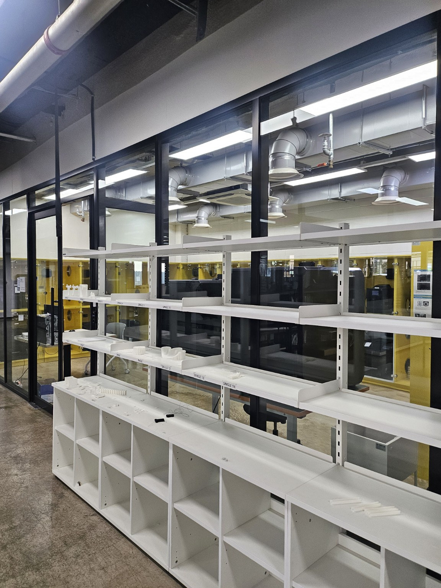

# Experiments

VisionPick Arm의 실험 조건, 계산 결과, 제작용 CAD 확인 및 실제 하드웨어 검증 기록.

- **프로젝트:** VisionPick Arm (4축 로봇팔 + 1축 그리퍼)
- **최근 업데이트:** 2026-11-14

> **기록 원칙:** 수학적 계산, CAD 형상, 실물 측정, 부분 체결, 실제 모터 구동과 반복 실험을 구분한다. 2026-11-02까지의 계획형 표현은 당시 기록이며, 후반의 11/06~11/14 내용을 최신 상태로 읽어야 한다.

---

## EXP-001 | HUSKYLENS 색상 인식

**일자:** 2026-10-22  
**상태:** 초기 인식 시험 완료

### 목적

빨강·파랑 블록 인식 및 Arduino 좌표 수신 검증.

### 실험 환경

- HUSKYLENS 1
- Arduino UNO(I2C)
- 30 × 30 × 30mm 실험용 블록
- 카메라 높이: 20 / 25 / 30cm

### 결과

- 빨강 ID1 인식 성공
- 파랑 ID2 인식 성공
- 두 블록 동시 인식 성공
- Arduino C++ 목표 ID 필터링 구현 및 동작 확인
- 25cm 높이를 초기 설치 기준으로 선정

### 한계

- 조명 변화에 따른 정량적 인식률 미측정
- 픽셀 좌표의 실제 거리 변환 미구현

---

## EXP-002 | 4축 Concept CAD 동작 시험

**일자:** 2026-10-22  
**상태:** 개념 설계 단계 동작 확인 완료

### 목적

Fusion 360에서 4축 로봇팔의 관절 동작 및 블록 접근 가능성 확인.

### 조건

- L1: 100mm
- L2: 80mm
- 어깨 높이: 70mm
- 대상: 30mm 정육면체
- 도구: Fusion 360

### 결과

- Base / Shoulder / Elbow / Wrist 관절 구동 성공
- Revolute 및 Rigid Joint 연결 확인
- 30mm 블록에 대한 집게 접근 자세 구현
- 손목 회전을 통한 집게 기울기 조절 확인
- 기존 3축 구조에 손목 Pitch 축 추가

### 한계

- 일부 목표 위치에서 자세 제약 확인
- 전체 작업 가능 범위의 정량적 검증 미완료
- 모터·베어링·실제 하중 미반영
- 제작용 CAD가 아닌 Concept CAD

---

## EXP-003 | 순기구학·역기구학 계산

**일자:** 2026-10-23  
**상태:** 수학적 계산 검증 완료

### 목적

4축 로봇팔의 FK·IK 및 손목 자세 제어 원리 검증.

### 조건

- L1: 100mm / L2: 80mm
- 어깨 높이: 70mm
- Base / Shoulder / Elbow / Wrist 구성
- 종이 계산 및 계산기 사용

### 결과

- 2링크 평면 FK 계산 완료
- 코사인 법칙 기반 IK 계산 완료
- Elbow-up / Elbow-down 두 가지 해 계산
- 베이스 회전각 및 수평 반경 계산
- 손목 자세 보정각 계산
- TCP 오프셋을 고려한 손목 목표 좌표 계산 연습

### 핵심 확인 내용

FK는 관절각으로 끝점 좌표를 계산하며, IK는 목표 위치에서 관절각을 계산함. 동일 목표 위치에 복수의 IK 해가 존재할 수 있음.

### 한계

- 모터 회전 제한 미반영
- 실제 영점·회전 방향 보정 전
- Arduino C++ FK·IK 함수 구현 전

---

## EXP-004 | Fusion 360 FK·IK 검증

**일자:** 2026-10-26  
**상태:** XZ 평면 좌표 검증 완료

### 목적

수학적 FK·IK 계산 결과와 Fusion 360 관절 구동 결과 비교.

### 조건

- Fusion 파일: `VisionPick_Concept_v01`
- L1: 100mm / L2: 80mm
- 어깨 높이: 70mm
- Revolute Joint 기반 구동

### 시험 1 — 순기구학(FK)

수학적 입력: Shoulder +30°, Elbow -60°.

| 좌표 | 계산값 | Fusion |
|---|---:|---:|
| X | 155.885mm | 155.885mm |
| Z | 80mm | 80mm |

**결과:** XZ 평면 좌표 일치.

Fusion에서 자세를 재현할 때 Shoulder Joint 입력은 -30°였음. 수학적 각도와 CAD Joint 입력 부호 차이 확인.

### 시험 2 — 역기구학(IK)

목표 손목 좌표: X = 100mm, Z = 150mm.

계산된 관절 자세를 Fusion에 적용하여 목표 XZ 좌표 도달 확인.

### 한계

- J2의 Y 좌표 0mm, J4의 Y 좌표 -8mm로 측면 오프셋 존재
- 평면 좌표 검증이며 완전한 3차원 정확도 검증은 아님
- 실제 서보 영점·백래시·동작 오차 미반영

---

## EXP-005 | 관절 토크 1차 계산

**일자:** 2026-10-26  
**상태:** 예비 계산 완료

### 목적

J1~J5 실제 모터 선정을 위한 기본 하중 및 토크 분석.

### 초기 가정

- L1: 100mm / L2: 80mm
- 대상 블록: 20g
- J3 모터: 55g
- J4 모터: 30g(초기 가정)
- 그리퍼 조립체: 40g(초기 가정)
- 중력가속도: 9.81m/s²
- J2~J4 설계 여유: 2.5배
- 링크를 수평으로 펼친 정적 하중 조건

### 초기 계산 결과

| 관절 | 분석 항목 | 계산 결과 |
|---|---|---:|
| J1 베이스 | 회전 관성 및 가속 토크 | 0.008868 N·m |
| J2 어깨 | 중력 토크 × 2.5 | 6.602 kgf·cm |
| J3 팔꿈치 | 중력 토크 × 2.5 | 2.351 kgf·cm |
| J4 손목 | 중력 토크 × 2.5 | 0.400 kgf·cm |
| J5 그리퍼 | 손가락당 수직 파지력 | 0.4905 N |

J1 가정: 점질량 근사, 총 관성모멘트 0.004434kg·m², 각가속도 2rad/s².

J5 가정: 블록 20g, 마찰계수 0.4, 안전율 2.

### Hardware R02 — 수정 토크 계산

J4 모터를 MG90S 13.4g으로 변경하고 J3 모터 55g 유지.

| 관절 | 수정 설계 토크 |
|---|---:|
| J2 어깨 | 5.855 kgf·cm |
| J3 팔꿈치 | 2.019 kgf·cm |
| J4 손목 | 0.400 kgf·cm |

그리퍼 질량 증가에 따른 검토:

| 그리퍼 질량 | J2 | J3 | J4 |
|---|---:|---:|---:|
| 40g | 5.855 | 2.019 | 0.400 |
| 60g | 6.855 | 2.519 | 0.500 |
| 80g | 7.855 | 3.019 | 0.600 |

단위: kgf·cm, 설계 여유 2.5배 포함.

### 한계

- 실제 CAD 질량 및 무게중심 미반영
- J1 베이스 자체 관성과 마찰 미반영
- 동적 하중 및 모터 발열 미검증
- PLA+ 부품 강도·처짐 미검증
- J5 실제 기구비·마찰 미검증

---

## EXP-006 | 그리퍼 Concept 설계

**일자:** 2026-10-26 ~ 2026-10-27  
**상태:** 예비 형상 설계 완료

### 목적

30mm 블록을 파지하기 위한 양쪽 연동형 집게 기본 형상과 SG90 배치 검토.

### 조건

- Fusion 파일: `Gripper_Concept_v01`
- 구동 모터: SG90(보유)
- 형식: 대칭형 2핑거
- 대상: 30mm 정육면체

### 개념 치수

| 항목 | 값 |
|---|---:|
| 몸체 너비 | 72mm |
| 몸체 높이 | 18mm |
| 손가락 회전축 간격 | 54mm |
| 손가락 길이 | 40mm |
| 초기 닫힘각 | 약 12° |
| 회전축 Reference 지름 | Ø4mm |

### 결과

- 좌우 손가락 회전축과 기준선 스케치 완료
- 개폐 자세를 위한 초기 각도 스케치 완료
- SG90 참고 Component 모델링
- SG90 중앙 배치와 측면 위치 확인
- `Gripper_Concept_v01` 저장

### 예비 질량 예산

| 부품 | 예상 질량 |
|---|---:|
| SG90 | 9g |
| 몸체와 손가락 | 25g |
| 연동 링크 | 10g |
| 체결부품 및 패드 | 8g |
| **합계** | **52g** |

목표 질량 60g 이하, 하중 검토 상한 80g.

### 한계

- 실제 측정 질량이 아닌 설계 예산
- 서보혼·연동 링크의 상세 기구 미완성
- 동시 개폐 및 파지력 미검증
- 출력 공차·마찰·유격 미검증

---

## EXP-007 | J1·J2 실물 치수 및 서보혼 정적 장착 확인

**일자:** 2026-10-28 ~ 2026-11-01  
**상태:** 일부 실측 및 정적 장착 확인 완료 / 구동 시험 전

### 목적

제작용 CAD 설계에 필요한 실제 모터·서보혼·베어링 치수를 수집하고, 설계 후보 간 간섭 가능성을 평가한다.

### 실측 데이터

| 대상 | 측정 부위 | 실측값 |
|---|---|---:|
| J1 사각 베어링 | 외형 | 71.82 × 71.82mm |
| J1 사각 베어링 | 두께 | 7.95mm |
| J1 사각 베어링 | 중앙 개구부 | Ø35mm |
| J1 사각 베어링 | 체결홀 지름·측정 중심 간격 | 약 Ø4.14mm / 57.28mm |
| MG996R 원형 서보혼 | 외경 | 20.72mm |
| MG996R 십자형 서보혼 | 끝과 끝 전체 길이 | 36.79mm |
| MG996R 6방향 서보혼 | 끝과 끝 회전 외경 | 31.77mm |
| MG996R 6방향 서보혼 | 모터 하우징 윗면 → 날개 윗면 | 8.44mm |
| MG996R 6방향 서보혼 | 반대 날개 바깥쪽 홀 중심 간격 | 26.53mm |
| MG996R 6방향 서보혼 | 작은 체결홀 지름 | Ø1.49mm |
| MG996R 6방향 서보혼 | 날개 두께 | 2.36mm |
| J2 FT5330M | 본체 길이 × 폭 | 39.98 × 20.09mm |
| J2 FT5330M | 본체 기본 높이 / 돌출 포함 | 39.60 / 42.20mm |
| J2 FT5330M | 장착 귀 포함 전체 길이 | 55.26mm |
| J2 FT5330M | 장착 귀 홀 지름 | 약 Ø4.46mm |
| J2 FT5330M | 체결홀 중심 간격 | 약 48.13 × 10.06mm |
| J2 FT5330M | 스플라인 / 금속 혼 허브 외경 | Ø5.87 / Ø14.93mm |

### MG996R 서보혼 비교 결과

- **원형(Ø20.72mm):** 출력축에 일부 끼워졌지만 정상 결합 깊이와 고정 상태를 확인하기 어려워 보류.
- **십자형(36.79mm):** 중앙 고정나사가 정상 체결되고 출력축 대비 흔들림 없음. 다만 베어링 Ø35mm 개구부보다 큼.
- **6방향(31.77mm):** 출력축과 중앙 나사가 정상 체결되고 가벼운 정적 흔들림 확인에서 독립 유격 없음. J1 연결부 설계의 우선 후보로 채택.

6방향 혼과 베어링 중앙이 이상적으로 동축이고 베어링 내부에 추가 돌출이 없다는 조건에서 계산한 반경 방향 여유는:

**반경 여유 = (35.00 - 31.77) / 2 = 1.615mm**

Fusion에서 모터의 평평한 하우징 윗면과 베어링 아랫면 사이 거리는 **2.00mm**. 실측 서보혼 날개 윗면 높이 8.44mm를 적용하면 혼이 베어링 높이 영역으로 진입하므로 **실제 베어링 내부 형상 검증이 필요함**.

### 판정 및 한계

- 서보혼의 **정적 장착은 확인**했지만 회전 토크, 반복 구동, 충격 하중에 대한 체결 강도는 확인하지 않음.
- 베어링 양쪽 판의 홀 배열과 내부 볼 레이스 형상은 단순화 Reference에 정확히 반영되지 않았음.
- 모터 전원 연결·동작 범위·전류·발열 시험은 진행하지 않음.

---

## EXP-008 | J1·J2 제작용 CAD 및 3D 프린팅 준비

**일자:** 2026-10-28 ~ 2026-11-01  
**상태:** CAD·슬라이싱 작업 완료 항목 보유 / 실제 출력·조립 전

### 목적

실측 치수를 Fusion 제작용 Assembly에 반영하고, 시험 출력에 필요한 모델과 G-code를 준비한다. 현재 단계에서 설계 후보와 물리적 검증 완료 항목을 명확히 구분한다.

### 주요 CAD 결과

| 부품·설계 | 적용 내용 | 현재 상태 |
|---|---|---|
| `Base_Fixed` | Ø160 × 6mm, 경량화 홀 Ø12 × 6 | CAD 및 G-code 준비 |
| J1 지지 기둥 3개 | Ø12 × 37mm, 리브, 인서트 후보 Ø4.0 × 깊이 7mm | CAD 및 G-code 준비 |
| J1 MG996R 브래킷 | 모터 삽입 슬롯, 고정 탭, 케이블 노치 | 시험 출력 파일 준비 |
| `J1_Bearing_Mount_Fixed` | 외경 Ø110 / 내경 Ø70 / 두께 5mm, 총 7개 홀 | CAD 및 G-code 준비 |
| `Base_Rotating` | 외경 Ø110 / 두께 6.40mm | CAD WIP, 출력 보류 |
| `Base_Rotating` 베어링 체결홀 | Ø4.5 관통홀 × 4 | CAD 형상 있음, 실물 맞춤 전 |
| `Base_Rotating` J2 결합홀 | Ø4.0 × 깊이 4.5mm 블라인드 홀 × 4 | 인서트 규격 미확정 |
| J2 FT5330M 레일 | 모터 장착 후보 형상 | 시험 출력 파일 준비 |

`Base_Rotating` 두께는 기존 5mm에서 아랫면을 1.40mm 확장한 **6.40mm**로 변경했고 윗면 위치는 유지했다.

### STEP 43-F — 서보혼 연결 구조 설계 경과

1. MG996R에 장착 가능한 6방향 혼의 회전 외경 **Ø31.77mm**를 Fusion Sketch Reference로 작성.
2. 바깥 체결홀 중심 간격 **26.53mm**를 피치원 후보로 반영하고, 6개 작은 홀 위치 표시.
3. 120° 간격의 체결 위치 3개를 `Base_Rotating` 아랫면 Sketch에 투영.
4. 회전판 아랫면에 **Ø32.5mm 외경 / Ø10mm 중앙 회피 구멍 / 1.56mm 돌출** 연결 패드 후보 생성.
5. 체결용 **Ø2.4mm 후보 원 3개** 작성. 관통 가공과 나사 머리 매립 가공은 아직 확정하지 않음.
6. J2 바닥판 아랫면과 `Base_Rotating` 윗면 사이 간격이 **0mm**임을 Fusion에서 확인.

**설계 판단:** 나사 머리가 회전판 윗면보다 돌출되면 J2 바닥판과 간섭할 수 있으므로, 실제 나사 규격에 따른 매립 깊이와 다른 체결홀 사이 잔여 두께를 재검토해야 함.

### 준비한 G-code 작업

| 작업 | 슬라이싱 예상 시간 | 예상 재료 |
|---|---:|---:|
| `J1_MG996R_Bracket_Test_v01` | 1시간 23분 | 12.66g |
| `J2_FT5330M_Rail_Test_v01` | 1시간 30분 | 15.22g |
| `M3_Insert_Tolerance_Test_v01` | 27분 | 4.35g |
| `Base_Fixed` | 5시간 22분 | 73.60g |
| J1 지지 기둥 3개 통합 작업 | 1시간 19분 | 11.33g |
| `J1_Bearing_Mount_Fixed_v01` | 1시간 52분 | 22.06g |
| **합계(순차 출력 가정)** | **11시간 53분** | **139.22g** |

**G-code 6개 작업 / 대상 부품 8개.** 슬라이서 예측치이며 실측 출력 시간이나 실제 무게가 아님.

### 제작 일정

- **첫 출력 예약:** 2026-11-06(금) 오전 10시
- **장소:** 연세대학교 메이커스페이스 i7, 송도
- **슬라이서:** Cubicreator4
- **주요 장비:** Cubicon Single Plus 3DP-310F
- **기본 설정:** PLA-PLUS, 0.2mm 레이어, 노즐 220°C, 베드 65°C(부품별 설정 재확인)

11월 1일 기준으로 **실제 출력한 부품은 없음**. 2대 동시 사용 가능 여부도 아직 확정되지 않음.

### 첫 출력 후 검증 항목

1. 기둥 3개가 G-code에 모두 포함되어 있는지 및 출력 방향·Brim 점검.
2. MG996R 브래킷과 FT5330M 레일의 삽입·고정 여유 확인.
3. M3 인서트 제품 권장 치수와 Ø3.8 / Ø4.0 / Ø4.2mm 시험편 결과 비교.
4. 사각 턴테이블 베어링 홀 배열, 볼트·와셔·나사 머리 접근 공간 확인.
5. 실제 서보혼 체결나사·매립·조립 순서 및 회전 간섭 검증 후 `Base_Rotating` 출력 승인.

### 한계

- 아직 PLA+ 출력물의 수축·공차·강도 검증을 수행하지 않음.
- 베어링 Reference의 내부 레이스와 볼트 간섭은 단순화 모델로는 최종 판단할 수 없음.
- `Base_Rotating`의 1.56mm 연결 패드는 **임시 CAD 형상**이며, 혼 날개와 실제 접촉하는지 검증되지 않음.
- 출력 전 구조 검증과 출력 후 실물 조립 검증은 별도로 수행해야 함.

---

## EXP-008 추가 기록 | 2026-11-02 J1 베어링 재실측 및 회전판 v02 검증

**일자:** 2026-11-02  
**상태:** 실물 치수 측정·CAD 배치 검토·슬라이싱 완료 / 3D 출력·실제 볼트 조립 미실시

### 1. 베어링 실물 재측정

| 측정 대상 | 값 | 결과 유형 |
|---|---:|---|
| 베어링 외형 | 71.82 × 71.82mm | 이전 실측 |
| 중앙 개구부 | Ø35mm | 이전 실측 |
| 장착면 사이 높이 | **8.64mm** | 11/2 재실측, 이전 7.95~8.00mm 값을 정정 |
| 상부 금속판 두께 | 0.77mm | 실측 |
| 하부 금속판 두께 | 0.77mm | 실측 |
| 두 판 사이 간격 G | 약 7.16mm | 실측(특정 위치) |
| 상판 체결홀 중심 간격 | 57.28mm | 실측 |
| 하판 체결홀 중심 간격 | 57.28mm | 실측 |
| M4 체결홀 지름 | 약 Ø4.14mm | 실측 |

판 두께 두 개와 간격 G의 합은 8.70mm로 전체 8.64mm와 0.06mm 차이가 있음. 측정 위치·형상 차이 때문에 하나의 정밀 단면으로 환산하지 않음. Ø4.14mm 관통홀은 M4 공칭 지름 4.0mm에 대해 여유가 작으므로 실제 볼트 삽입성을 확인해야 함.

### 2. Fusion 참조 복구와 위치 보정

- 기존 `J1_Turntable_Reference`의 두께 피처를 직접 바꿨을 때 `The sketch plane is lost`, `The project source is lost` 등의 참조 경고가 다수 발생.
- 변경을 되돌려 경고를 **0개로 복구**하고, 기존 베어링 Reference **8.00mm** 유지.
- 실제 높이 8.64mm를 나타내는 상면 기준 평면 생성, `Base_Rotating` Component를 위로 **0.64mm** 이동해 실측 상면과의 높이 차이를 **0mm**로 맞춤.
- 6방향 서보혼 윗면과 중앙 연결 패드 아랫면의 간격을 **0mm**로 확인. 연결 패드 돌출 높이 후보 **2.20mm**, 본체 두께 **6.40mm**를 반영한 STL 전체 높이는 **8.60mm**.
- J2 바닥판과 `Base_Rotating` 사이에는 **0.64mm CAD 간섭이 남음**. 상부 조립체 이동은 수행하지 않았으며 Fusion 전체 조립 간섭 검증은 통과 처리하지 않음.

### 3. M1.6·M4 체결부 CAD 확인

| 부위 | CAD 검토 결과 | 남은 위험 |
|---|---|---|
| MG996R 중앙 서보혼 나사 | `Base_Rotating` 중심 Ø6mm 드라이버 접근홀 관통 | 실제 드라이버·나사 접근 시험 전 |
| 6방향 혼의 외측 날개 3개 | Ø2.0mm 관통홀 ×3, Ø3.6mm × 깊이 2.0mm 머리 매립 ×3 | M1.6 볼트·너트 미구매, 날개 Ø1.49~1.54mm 홀 가공·체결 시험 전 |
| 베어링 상판 연결 | Ø4.5mm 관통홀 ×4, Ø8.2mm × 깊이 2.4mm 매립 ×4 | M4 둥근머리 볼트·박형 너트 실조립 전 |
| 하부 베어링 고정 링 | M4 체결홀 Ø4.5mm ×4 유지, Ø8.2mm 기준원 구성선만 생성 | 하부 링은 매립 가공하지 않음 |
| M4 머리 ↔ 지지 기둥 | Fusion 기준 최소 **1.908mm** 여유 측정 | 실제 머리 치수·와셔 및 도구 접근 미검증 |
| 베어링 ↔ 연결 패드 | 단순 Reference 기준 Fusion 간섭 없음 | 실물 볼 레이스·회전 상태 검증 전 |

M4 × 8mm 볼트의 하부 관통 후 명목 돌출은 **8.00 - 5.00 - 0.77 = 2.23mm**(고정 링 5mm, 베어링 판 0.77mm 가정). 두께 약 2.2mm 박형 너트로 조이면 체결 여유가 매우 짧으므로 **최종 조립 승인 전**. 중앙 나사와 날개 연결 나사는 기능이 다르며, 기존 중앙 고정나사를 작은 날개홀에 강제 삽입하는 방식은 사용하지 않기로 함.

### 4. Base_Rotating v02 슬라이싱 결과

| 항목 | `v02` 결과 |
|---|---|
| 출력 Body | `Base_Rotating` 1개, Ref 제외 |
| STL 외형 | 약 Ø110 × **8.60mm** |
| 출력 방향 | 넓은 회전판 면을 베드에, 중앙 연결 패드는 위쪽 |
| 프린터 | Cubicon Single Plus 3DP-310F |
| 소재/설정 | PLA-PLUS / 220°C 노즐, 65°C 베드 / 0.2mm 레이어 / 벽 1.2mm |
| 서포트/베드 부착 | Support None / Brim |
| 예상 출력 시간 | **3시간 13분** |
| 예상 소재 | **39.86g** |
| 저장 상태 | STL 및 프린터용 **HFB** 파일 준비 완료(사용자 확인) |

구버전 `J1_Base_Rotating_Test_v01`은 보관하고 11월 6일 출력 후보에서는 제외. G-code로 불리지만 실제 Cubicreator4 출력 파일 확장자는 **`.hfb`**임. 실제 출력 및 물리적 치수 검증은 아직 없음.

### 5. 11월 6일 출력 작업 — 수정된 최종 준비 현황

| HFB 작업 | 대상 실물 수 | 슬라이서 예상 시간 | 예상 재료 |
|---|---:|---:|---:|
| J1 MG996R 브래킷 시험편 | 1 | 1시간 23분 | 12.66g |
| J2 FT5330M 레일 시험편 | 1 | 1시간 30분 | 15.22g |
| M3 인서트 공차 시험편 | 1 | 27분 | 4.35g |
| Base_Fixed | 1 | 5시간 22분 | 73.60g |
| J1 지지 기둥 통합 출력 | 3 | 1시간 19분 | 11.33g |
| J1 베어링 고정 링 | 1 | 1시간 52분 | 22.06g |
| **Base_Rotating v02 (시험 후보)** | 1 | **3시간 13분** | **39.86g** |
| **합계** | **9개** | **15시간 6분** | **179.08g** |

- HFB **7개 작업**, 실물 대상 **9개**. 시험편의 홀 유지와 기둥 3개 포함 여부는 파일 미리보기로 확인.
- 출력 예정: **2026-11-06(금) 오전 10시**, 연세대학교 메이커스페이스 i7(송도).
- 프린터 2대 동시 사용·장시간 무인 출력·익일 수령은 현장 확인 필요.
- 11월 2일까지 실제 3D 출력은 **0개**. 슬라이서의 시간·재료 예측은 실제 출력 실적이 아님.

### 6. 조달 상태와 후속 검증

- **구매 완료:** 아트콥터 M3 육각렌치볼트 8·10mm 및 M4 둥근머리 볼트 8mm(시험용 후보).
- **구매 보류:** M3 열압입 인서트, M1.6 × 12mm 볼트/너트, M4 박형 너트. 소량 규격·배송비와 실물 적합성 문제로 11월 6일 첫 출력 전후 재검토하기로 함.
- 출력 후에는 J1/J2 브래킷 삽입 공차, J1 기둥 Ø4.0mm 인서트 홀, 회전판 M1.6/M4 매립부 치수, 중앙 드라이버 접근, 베어링 전 회전 범위의 충돌 및 실제 체결 강도를 각각 평가할 계획.

**최종 판정:** `Base_Rotating v02`는 **시험 출력 파일 준비 완료**. 실제 체결구조와 전체 Assembly 동작을 검증한 완성 설계로 간주하지 않음.

---

## 2026-11-02 당시 하드웨어 확보 및 검증 상태 (과거 스냅샷)

**최초 선정:** 2026-10-27 / **상태 업데이트:** 2026-11-02

| 관절 | 모터 | 현재 확인 상태 |
|---|---|---|
| J1 Base | MG996R 호환 | 실물 보유·서보혼 정적 체결 확인 / 동작 시험 전 |
| J2 Shoulder | FEETECH FT5330M | 실측 치수 CAD 반영 / 동작 시험 전 |
| J3 Elbow | MG996R 호환 | 선정 완료 / 최종 브래킷 미완성 |
| J4 Wrist | TowerPro MG90S | 선정 완료 / 제작용 CAD 미완성 |
| J5 Gripper | SG90 | 기존 보유 / 집게 파지력 미검증 |

서보 전원 어댑터·변환기는 아직 미선정. M3 열압입 인서트·M1.6 볼트/너트·M4 박형 너트는 구매 보류 상태이며, 아트콥터 M3 8/10mm 및 M4 8mm 볼트는 구매함. J1 사각 턴테이블 베어링의 장착면 높이는 **8.64mm**로 재측정하여 CAD 배치를 보정함.

---

## 2026-11-02 당시 다음 실험 계획 (과거 스냅샷)

- [ ] **EXP-008 실물 후속** — 2026-11-06 첫 출력, 홀 공차·M1.6/M4 체결 및 베어링 전 회전 범위 간섭 평가
- [ ] **EXP-009** — 서보모터 전원·입력각·전류·발열 및 반복 구동 시험
- [ ] **EXP-010** — 그리퍼 연동 기구 조립·질량·파지력 확인
- [ ] **EXP-011** — 관절 하중·링크 강도·처짐 및 지지 구조 검증
- [ ] **EXP-012** — 로봇팔 전체 관절 구동·모션 제어 통합 시험
- [ ] **EXP-013** — 카메라 픽셀 좌표와 로봇 작업 좌표 보정
- [ ] **EXP-014** — 색상 지정 자동 Pick & Place 통합 및 20회 이상 반복 성능 시험

**최종 검증 지표:** 색상 인식 정확도, 위치 오차, 반복 정밀도, 집기 성공률, 1회 사이클 시간. 실물 실험 후 수치와 실패 원인을 기록할 예정.

---

## EXP-009 | 2026-11-06 첫 PLA+ 출력 — 실물 제작 시작

**목적:** 제작용 CAD에 따라 실제 PLA+ 구조물을 출력하고 모터 삽입/홀 공차를 확인한다.

**실행/결과 기록:** 11/06 메이커스페이스에서 J1 관련 부품·J2 레일·M3 홀 공차 시험편 등의 첫 출력 진행. 11/09 실물 J1/J2 부분 가조립 사진 및 사용자 보고로 출력물 존재 확인.

**한계:** 슬라이싱 예상 15h06m/179.08g 등은 **예측치**이고 인쇄 작업 실측 시간·질량으로 사용하지 않는다. 출력 성공이 각 나사·베어링·서보 구동 합격을 의미하지 않는다.



*사용자가 11/14 공유한 제작 환경 사진. 실제 촬영 날짜는 이 기록에서 확정하지 않는다.*

## EXP-010 | 2026-11-09 J1/J2 정적 가조립

**시험 대상:** `Base_Fixed`, `J1_Support_Posts` 3개, `J1_Servo_Mount_Fixed`, MG996R, J1 Bearing Mount/베어링/회전판 후보, FT5330M 레일 및 Shoulder SidePlate.

**관찰:** 출력한 베이스/서보 구조를 일부 조립했고 J2 후속 SidePlate는 모터 장착 적합성 확인이 보고되었다. 기존 J2 레일 시험편의 돌출 간섭 사례와는 구분한다.

**미검증:** 전체 볼트 체결 강도, M1.6 서보혼 토크 전달, M4 베어링 간섭, J2 하중 지지 및 회전 구동.

## EXP-011 | 2026-11-09 J5 Finger·SG90 CAD 높이 정렬 및 피벗 리브

**확인:** J5 SG90 Base 케이블 출구 누락을 발견했고 10×5mm 후보 슬롯으로 CAD 수정. Finger 높이 정렬과 양쪽 P1/P2 피벗 지지대·삼각 보강 리브를 모델링. 일부 CAD 화면에 각 부품이 보인다.

**높이 기록의 주의:** 15.70, 20.70, 32.16mm, 이동량 11.46mm 등의 값은 당시 Fusion 특정 기준면의 치수이다. 전역 Z나 실제 출력물 상면 높이로 전환해서 사용하지 않는다.

**미검증:** 실물 케이블 통과/강성/피벗 축 정렬/하드스톱.

## EXP-012 | 2026-11-11 J5 그리퍼 2D 기구학 검증 및 CAD 출력 준비

**목적:** SG90 한 개로 Finger 2개가 원하는 방향으로 열리고 닫히며 30mm 블록을 파지할 수 있는지 계산·CAD로 확인한다.

**좌표계:** +X 우측(서보), +Y 위, CCW 양(+), 위치 mm/각도 degree.

| 기호 | 값 또는 정의 | 근거 |
|---|---|---|
| P1/P2 | (0,+17)/(0,−17)mm | CAD 기준 |
| 서보 O | (27,0)mm | CAD 기준 |
| 혼 H1/H2 | (27,+13.97)/(27,−13.97)mm | 유효 반경 역산 후보, 실측 재확인 |
| A1/A2 | (6,27.5)/(1,−3)mm | 권장안 B |
| L_drive1 | 24.9812mm | 중심간 계산 |
| L_drive2 | 28.2195mm | 중심간 계산 |
| Finger | 피벗→끝단 40mm, 8mm 폭, 5mm 두께 | CAD 후보 |
| 피벗홀 | Ø3.4mm | CAD 후보 / 실제 공차 미측정 |
| 링크홀 | Ø2.2mm | CAD 후보 / 실제 공차 미측정 |

**기구학 관계**

```text
H_i(phi)   = O + R(phi) * (H_i(0) - O)
A_i(theta) = P_i + R(theta) * (A_i(0) - P_i)
|A_i(theta_i) - H_i(phi)|^2 = L_drive_i^2
```

계산할 때 두 원의 교점 중 초기 자세와 연속되는 해를 선택해야 하며 반대 branch로 급변시키면 안 된다.

평행 자세에서 피벗 중심 34mm, Finger 폭 8mm이면 내부 간격이 26mm이므로 긴 Finger 바를 바깥쪽으로 각 2mm 오프셋해서 30mm로 수정했다. 피벗 구멍 위치는 이동하지 않았다.

관찰하는 두 안쪽 끝단 점 간격은:

```text
G_tip = 34 - 40[sin(theta1) - sin(theta2)] - 2[cos(theta1) + cos(theta2)]
```

| SG90 상대 혼각 φ | 상부 θ1 | 하부 θ2 | 이론 끝단 간격 G_tip |
|---:|---:|---:|---:|
| −14° | −14.89° | +14.91° | 50.71mm |
| −12° | −12.60° | +12.61° | 47.55mm |
| −10° | −10.37° | +10.36° | 44.46mm |
| −6° | −6.07° | +6.05° | 38.46mm |
| 0° | 0° | 0° | **30.00mm** |
| +2° | +1.92° | −1.91° | 27.33mm |
| +4° | +3.79° | −3.78° | 24.73mm |

**증거:** 2D 계산, 일부 CAD 형상, 30.00mm Fusion 측정 화면. **실물 SG90 명령각/장착방향/실제 개폐 최소거리/파지력은 측정하지 않음**. 특히 30mm 블록을 물린 채 +4°로 강제 폐쇄하지 않는다.

**출력 계획:** J5 Base, Finger L/R, Drive Link 1/2 총 STL 5종. 예비 포함 부품 9개를 계획한 기록이 있다. 11/12 주요 출력 완료는 사용자 보고로 남기되 모든 체결 및 실물 작동 성공으로 해석하지 않는다.

## EXP-012B | 2026-11-14 J1 부분 체결·도색 실물 사진 기록

**시험 목적:** 11/14 사용자가 제시한 사진에서 실제 조립 정도와 간섭 위험을 구분한다. 아직 전원 구동·수동 회전 전 범위 검증을 수행한 것은 아니다.

### 관찰 증거

| 사진 | 직접 확인할 수 있는 사실 | 한계 |
|---|---|---|
| [베이스 전체](../media/photos/2026-11-14_j1-base-servo-mount-support-posts-wip.jpg) | Base_Fixed, MG996R, 금색 브래킷, 지지 기둥 3개 배치 | 기둥 하단 볼트 체결/전체 체결력 미확정 |
| [서보/기둥 근접](../media/photos/2026-11-14_j1-mg996r-bracket-inserts-detail.jpg) | MG996R 장착 및 상부 황동색 나사산 부품 관찰 | 상·하 모든 인서트 설치·인발강도 미확정 |
| [베이스 밑면](../media/photos/2026-11-14_j1-base-fixed-underside-recesses.jpg) | 검은 출력판에 홀·매립홈 존재 | 2+3 홈의 실제 깊이/나사 머리 높이는 미측정 |
| [도색 기둥](../media/photos/2026-11-14_j1-support-posts-paint-drying.jpg) | 검정색 지지 기둥 도색 진행 | 도료 경화·치수 변화·강도 미시험 |
| [회전판](../media/photos/2026-11-14_j1-base-rotating-painted-holes.jpg) | 금색 회전판, 큰 베어링홀 4개 및 소형 홀 존재 | 6방향 혼 실조립·M4 간섭 미시험 |
| [서보혼](../media/photos/2026-11-14_j1-six-arm-plastic-servo-horn.jpg) | 구멍이 여러 개 있는 6방향 플라스틱 혼 존재 | Ø1.49mm 기존 실측과 출력 홀 정렬 여부는 재검증 |
| [J2 CAD 참고](../media/photos/2026-11-14_j2-opposite-pivot-cad-reference.jpg) | 종동측 J2 링크의 중심/반대편 축 위치를 CAD 화면으로 볼 수 있음 | 실제 M3 축·부싱/너트 체결 미검증 |
| [J2 실물 참고](../media/photos/2026-11-14_j2-shoulder-plate-fitup-wip.jpg) | J2 골드/블랙 출력 부품의 실물 맞대기 | 실제 토크 구동·최종 체결 미검증 |

**원칙:** 사용자가 11/14에 사진을 공유한 날짜와 각 사진의 실제 촬영 날짜는 다를 수 있다. 메이커스페이스 사진도 제공일 기준 이름으로 보관하며 촬영일을 단정하지 않는다.

### 발견 문제 및 시험 예정

1. `Base_Fixed` 서보 브래킷용 2개와 Support Post용 3개 매립홈이 반대쪽 면에 배치되어 있음(사용자 확인). **표준 볼트 머리 일부가 하부로 돌출될 수 있음**.
2. 현재 검토 중인 베이스 방향은 서보 브래킷 2개 매립을 우선하고 나머지 3개 돌출부를 받침발로 회피하는 방법. **선택안이지 실측 통과 결과가 아님**.
3. 기둥 M3 열압입 인서트는 상·하 6개 후보. 사진에는 상단 금속 부품이 보이지만 규격·설치 완료 개수·체결력 별도 시험 필요.
4. J1 혼 ↔ 회전판 3개 소형 홀은 CAD상 M1.6×12+너트 후보이나 실제 정렬과 베어링 간섭 미검증.
5. J2 종동 측은 M3 피벗 + 와셔·스페이서·나일론 너트의 간단한 시험 방식이 논의됐지만 실물 구멍 직경·축 길이 확인 전.
6. 도색 후 구멍/접촉면에 도료가 쌓였는지 및 베어링 장착 정밀도 확인 필요.

### 향후 시험 기록지 (아직 측정하지 않음)

| 측정 항목 | 결과 |
|---|---|
| Base_Fixed 아래 돌출된 머리 최대 높이 [mm] | 미측정 |
| Support Post 인서트 상/하 실제 완료 수량 [개] | 미확정 |
| J1 Bearing Mount 체결 후 수동 전 회전범위 통과 여부 | 미시험 |
| 서보혼과 Base_Rotating 3홀 정렬·체결강도 | 미시험 |
| J2 종동측 회전 저항·유격 | 미시험 |
| J5 실물 개방폭/파지력 | 미시험 |
| 6V 어댑터 출력/부하 중 전압강하 | 미시험 (배송 전) |

## 2026-11-14 조달·전원 시험 준비

- **11/09 구매:** ATO 퓨즈홀더 14AWG, WAGO 221-415 **총 4개**, 14AWG 실리콘 전선, M3 볼트·너트·와셔·압착단자 등.
- **11/13 주문:** 6V 10A 어댑터, ANENG SZ308, ATO 10A 퓨즈×10, DC 로커 스위치×5, 16AWG 5.5×2.5mm 암케이블×2, 16V 2200µF 콘덴서×10, 5V 3A 모듈, M2/M3 세트, 정밀 드라이버.
- **보유:** Arduino UNO/HUSKYLENS, 점퍼선, 3핀 서보 연장선. **미구매/검토:** M1.6 볼트+너트, 필요한 M3 인서트/그리퍼 M2 체결 세부, 고전류 출력 연결부.
- **중요 안전:** 구매 완료는 구동 검증이 아니다. 5.5×2.5mm DC 배럴 접점의 연속 10A 허용 여부와 6V 입력에서 5V 3A 모듈 작동 조건은 미확정.

## 후속 실험 (2026-11-14 기준, 아직 결과 없음)

- [ ] **EXP-013:** 안전한 전원 연결 후 서보 개별 각도, 부하 중 전압 강하/발열 시험.
- [ ] **EXP-014:** J5 M2/M3 실제 링크 체결·자유 회전·30mm 블록 파지.
- [ ] **EXP-015:** J1~J4 베어링·축 정렬·링크 처짐/강도 및 전 가동범위 무간섭 확인.
- [ ] **EXP-016:** J1~J5 통합, 영점·각도 제한·궤적·상태머신.
- [ ] **EXP-017:** HUSKYLENS 픽셀 좌표↔작업대 mm 보정, 작업영역 위치 오차.
- [ ] **EXP-018:** 빨강/파랑 인식 기반 Pick & Place 20회 이상 반복 성공률·사이클 시간·위치 오차 기록.

결과를 얻기 전에는 **미시험/미측정**으로 남기며, 서보 Stall Torque나 이론적 2D 간격을 실물 반복 성능으로 표현하지 않는다.
